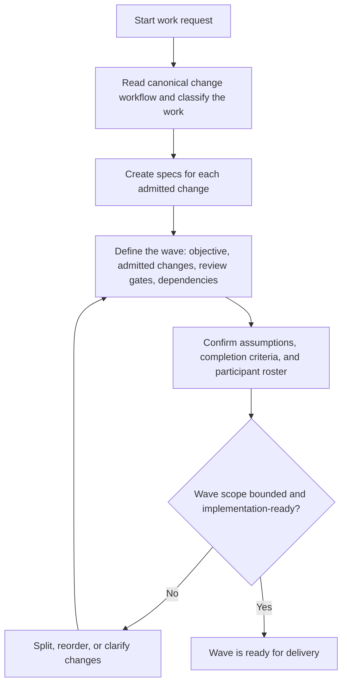
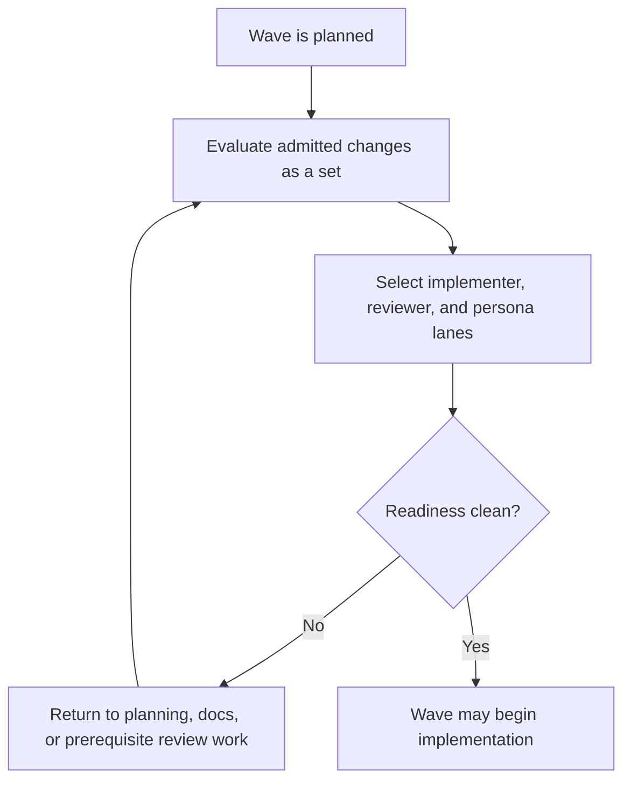
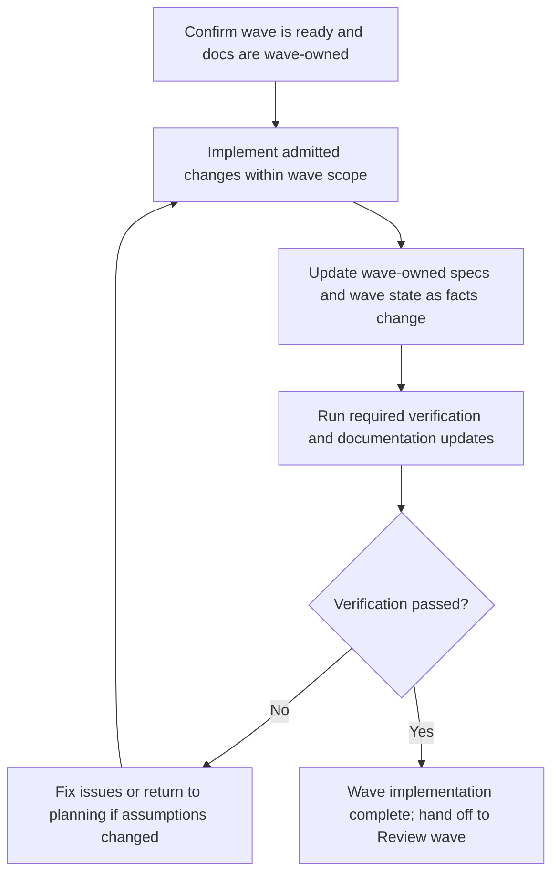
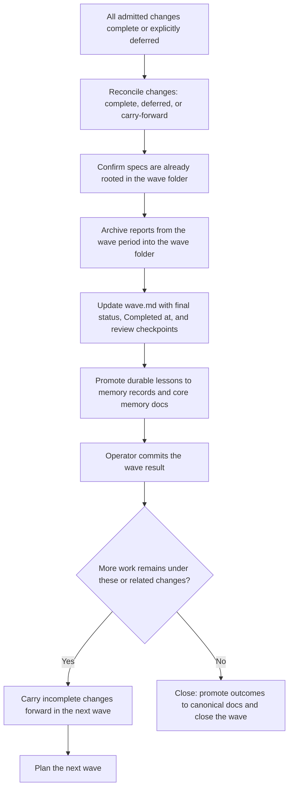

# Framework Lifecycle Overview

## Purpose

Explain the Wave Framework delivery lifecycle at a high level: how work is grouped into waves, how each wave is readied, implemented, reviewed, and closed.

**WAVE** stands for **Workflow, Agents, Verification, Engineering**.

Tagline: **Docs-first engineering for agent-driven software delivery.**

## How To Use This Doc

- Use this file as the shared conceptual overview that ships with the seed prompt package.
- Keep project-specific reviewer names, personas, artifact paths, and operating exceptions in the repo-local generated version created during **`Init Wavefoundry`** or **`Upgrade Wavefoundry`** (legacy: **`Init wave framework`** / **`Upgrade wave framework`** / **`Init wave context`** / **`Upgrade wave context`**).
- Treat the linked repo-local docs as the source of truth for exact gates and routing for a seeded project (files live in the repository).

## What The Wave System Is

WAVE is the project's docs-first engineering system for organizing workflow, coordinating agent roles, enforcing verification, and guiding delivery through canonical project context.

The **wave** is the primary delivery unit. A wave is a bounded, reviewable container for one or more changes that are planned, implemented, reviewed, and committed together as a cohesive whole.

- A wave admits one or more **changes**, each with a stable `change-id`
- All changes admitted into a wave are implemented and reviewed together as a unit
- The wave is what gets committed and delivered — individual changes do not ship independently outside a wave
- When a wave closes, admitted changes are either complete or explicitly carried forward into the next wave
- The wave folder (`docs/waves/<wave-id>/`) is the active working home and permanent archive: it holds `wave.md`, the admitted specs relocated there during `Add spec to wave`, and any reports from the wave's period

## Core Concepts

Four terms name the moving parts. A **change spec** (or **spec**) is the document that plans one change. A **change** is the unit of work a spec describes; it has an id and a status, and a wave delivers changes. The stock tools use `spec_id` to identify the spec. New stock records use `Spec ID:` and `Spec Status:`. A **wave** is the reviewed bundle of changes. A **behavior contract** is the maintained description of an implemented, tested promise across changes. Its default index is `docs/architecture/contracts/index.md`. An architecture decision record explains why a design choice was made. Earlier text calls a spec a "change doc" and a behavior contract a "spec". The earlier phrases `Plan change`, `Add change to wave`, `Remove change from wave`, `Implement change` and `Close change` remain aliases of `Plan spec`, `Add spec to wave`, `Remove spec from wave`, `Implement spec` and `Close spec`.

- **wave**: the primary delivery unit — a bounded, reviewable container for one or more changes that are planned, implemented, reviewed, and committed together
- **`wave-id`**: uniquely identifies a wave using the format `<prefix> <slug>`:
  - `<prefix>` — 5-character lowercase base36 lifecycle token (6 characters after the distant overflow horizon), time-ordered under the provisioned lifecycle policy in `docs/workflow-config.json` (`lifecycle_id_policy`), generated by the MCP `wf_create_wave`/`wf_new_*` tools or `wf lifecycle-id --kind wave --slug <slug>`
  - `<slug>` — kebab-case human-readable description of the wave's theme
  - Example: `1a2yy routine-behavior-contract`
  - The legacy baseline wave reserves `00000` as its prefix: `00000 wave-zero-plans-and-specs`
- **change**: a tracked unit of work admitted into a wave — a bug fix, feature, enhancement, refactor, or other concrete change; represented by a spec that starts in `docs/plans/<change-id>.md` and moves into `docs/waves/<wave-id>/<change-id>.md` during `Add spec to wave` before implementation
- **change-id**: identifies one tracked change within a wave, using the format `<prefix>-<kind> <slug>` where `<kind>` is one of: `bug`, `feat`, `enh`, `change`, `doc`, `debt`, `ref`, `task`, `maint`, `ops`; for example `1mgvf-enh routine-status-contract-centralization`. The `feat` kind is retired for new changes and stays valid for existing ids: a change is one scoped unit of work, so a large feature is planned as several changes (usually `enh`), possibly across waves
- **active wave**: the wave currently being implemented and reviewed
- **carry-forward**: a change not completed when a wave closed, admitted into the next wave with its unfinished work made explicit
- **close**: the wave closure step that promotes durable outcomes into canonical docs, archives completed artifacts, and marks the wave permanently closed

## Lifecycle At A Glance

The lifecycle has five stages. This table is the single owner of their facts: the README, the local lifecycle overview and the dashboard dialogs copy their rows from it, and other surfaces use the same stage names and link here. A gate marked **every repository** refuses in any seeded project; other gates say where they apply.

| Stage | What you do | What runs automatically | Councils and reviewers | Gates: where each applies and how to clear it | What comes next |
| --- | --- | --- | --- | --- | --- |
| 1. **Plan spec** | Ask for **Plan spec** (`wf_new_<kind>`). The agent writes one spec in `docs/plans/<change-id>.md` holding the outcome, requirements, acceptance criteria and tasks. Optional: **Review plan** walks each open decision with you, one question at a time. | The change id is minted, and changed docs are linted as they are edited. | None. **Review plan** records no signoff and gates nothing. | **Every repository:** no repository code is edited until the spec is admitted and its wave is readied (the stage gate). | Prepare wave. |
| 2. **Prepare wave** | **Create wave** (`wf_create_wave`), **Add spec to wave** (`wf_add_spec`), then **Prepare wave** (`wf_prepare_wave`; alias **Ready wave**). Any number of waves can be readied at once. | Docs validation and gardening, wave ownership of the admitted specs, selection of readiness lanes from declared review targets and requested lanes, and the review-policy receipt. | In ordinary review, the readiness specialist lanes record approvals and the readiness Wave Council runs: a `red-team` adversarial primer, the configured fixed seats and one rotating seat, then `council-chair` synthesis into a `council-readiness` approval. An operator-selected small change uses an independent code reviewer instead. A project with review disabled runs no council. | **Every repository:** implementation refuses until the readiness approval the current receipt requires is recorded. Editing a reviewed section of a spec rotates the receipt and lapses those approvals; record them again and call `wf_prepare_wave` again. Project-configured required sensors, when set, must pass. Readying never takes the OPEN slot. | Implement wave. |
| 3. **Implement wave** | **Implement wave** (`wf_implement_wave`). Mark each task and acceptance criterion as it completes. | The wave becomes OPEN; memory advisories for the files in scope are briefed; focused computational checks run. | None routinely; reviewer lanes run in Review wave. | **Every repository:** by default one wave is OPEN at a time, checked when a wave is activated (`record_paths.OPEN_CONTAINER_SCOPE`); pause or close the OPEN wave first. **Host hooks, framework maintenance only:** `framework_edit_allowed` and `seed_edit_allowed` guard framework and seed paths; open them with `wf_open_gate` and close them after. While closed, the host refuses those edits. They do not gate product code. | Review wave. |
| 4. **Review wave** | **Review wave** (`wf_review_wave`). | Findings and approvals are recorded as typed events in the wave's `events.jsonl` ledger and projected into the wave record. | The required delivery specialist lanes. The delivery Wave Council runs only when the receipt lists `council-delivery`: `wave_review.delivery_mode` `targeted` (the shipped default) escalates on boundary triggers such as release, trust or permission boundary, and cross-platform changes. The readiness council is not rerun; final review re-evaluates the lanes newly applicable to the delivered scope. | A blocking finding returns the wave to implementation; each repair needs independent reverification by the lane that raised it. | Close wave, or Pause wave. |
| 5. **Close wave** | Review the evidence, record your operator signoff, and tell the agent to close (`wf_close_wave`). Optional **Close spec** (`wf_close_spec`) first closes one reviewed change inside the OPEN wave; it is a workflow step, not a gate. **Pause wave** (`wf_pause_wave`) parks work in the handoff; a paused wave whose review is complete shows **Awaiting closure** and closes without reopening. | Changes are reconciled, the wave folder becomes the permanent record, and memory candidates are validated. The operator commits the result. | No new council; the operator signs off. | **Every repository:** close refuses without operator signoff or a required delivery approval, or with any acceptance criterion or task still `[ ]`; project-configured required sensors, when set, must pass; agents close only on the operator's explicit instruction. **Framework source repository only:** the framework test receipt must be current and green; in a project that consumes the packaged framework, this check is a no-op. | Plan the next wave, carrying forward unfinished work. |

- **Execution ordering:** Steps 3–4 are distinct: implementation produces complete evidence first, then **`Review wave`** runs the required inferential lanes. A high-risk boundary may request the named focused checkpoint below, but routine reviewer passes belong to Review. **Close** verifies that the delivery review is current.

## 1. Plan A Wave And Its Changes



- Start by classifying the work. Every repository-code change goes through the wave lifecycle regardless of apparent simplicity; the operator may select the small-change review lane at admission.
- Create a consolidated spec (`docs/plans/<change-id>.md`) for each tracked change admitted into the wave, then move the admitted docs into `docs/waves/<wave-id>/` during `Add spec to wave` before implementation begins.
- Define the wave record under `docs/waves/<wave-id>/wave.md` with: objective, admitted changes as `## Changes`, completion criteria, review checkpoints, and participant roster.
- A wave may admit one or more changes when their assumptions, dependencies, and review timing are compatible enough to execute together.
- For exact planning rules, use the seeded project's feature workflow, planning prompt, and spec conventions.

## 2. Ready The Wave



- A wave should not start implementation until a readiness evaluation has passed.
- Readiness includes validating that admitted specs are already in `docs/waves/<wave-id>/`, repairing staged-only drift when needed, and clearing duplicate staging copies.
- The readiness evaluation determines which implementer lanes, reviewer lanes, persona lanes, and any required Wave Council seats must participate.
- If a user asks to implement the wave directly, the coordinator should run or confirm this readiness evaluation automatically first.
- When the project enables Wave Council, readiness is not complete until the council-chair has synthesized the isolated council-seat outputs into a current `council-readiness` approval. Declared waves store that authority in `events.jsonl`; legacy waves retain their prose verdict contract.

## 3. Implement The Wave



- Implementation should stay inside the admitted wave scope; changes outside the wave must wait for the next wave.
- Implementation should start only after readiness has passed; otherwise the coordinator must block and repair the prerequisites first.
- `Prepare wave` owns the one pre-code critique: failure-first review, packet completeness, and the current readiness approval. `Implement wave` consumes that authority instead of repeating it.
- Admitted specs should already live under `docs/waves/<wave-id>/` after `Add spec to wave`; `Prepare wave` repairs drift defensively if staging copies remain.
- Verification follows the project's build, test, docs, and smoke-check procedures before wave closure.
- For exact reviewer roles, personas, and gate triggers, use the seeded project's agent-team workflow and review docs.
- When the project enables Wave Council, delivery review includes a second council pass after implementation: isolated seat outputs first, then council-chair synthesis into a recorded `council-delivery` verdict.

## 3a. Implement Loop Execution Model

The coordinator's implement loop is structured as a **ReAct-derived execution model** — a repeating cycle of explicit Reasoning, Action, and Observation that makes the coordinator's decisions auditable, the loop resumable, and findings classified at the right escalation level before looping back.

### Loop Structure

Each iteration of the implement loop follows this pattern:

```
Thought  → why this action now (recorded in Progress Log before every lane invocation)
Action   → a single, scoped implementation or computational-verification action
Observe  → structured output of that lane (test results, review findings, build state)
[Reflect] → root cause pattern when a blocking finding occurs (informs remaining tasks)
→ repeat
```

### Wave Plan

Before the first edit, the coordinator produces an ordered execution plan: which lanes run in which order, with what scoped inputs, for each serialization unit. Deviations from the plan are named events recorded in the Progress Log — not silent reorderings. This is the pre-implementation plan that the operator approves before coding begins.

### Parallel Lane Merge

Implementation and computational-verification lanes that share no dependencies run concurrently. The coordinator records a single merged `Observe:` entry synthesizing all concurrent lane outputs before emitting the next `Thought:`. Routine inferential reviewer and persona lanes belong to the distinct post-implementation `Review wave` phase; implementation requests one only for an exceptional named checkpoint at a risky boundary.

When the distinct `Review wave` phase begins and Wave Council is enabled, council seats run in parallel on an isolated first pass. The council-chair — not the wave-coordinator — owns the synthesis step, optional targeted challenge round on material disagreement, and final council verdict. The wave-coordinator remains responsible for lifecycle routing and gate enforcement.

### Finding Classification (CRITIC)

After an exceptional checkpoint or the delivery review, the coordinator evaluates every finding against the spec's `## Acceptance Criteria` before deciding which loop to activate. "All reviewer lanes clean" is not sufficient — the exit condition is "all acceptance criteria met."

### Root Cause Capture (Reflexion)

After any blocking finding the coordinator records a `Reflect:` entry identifying the root cause pattern and updating remaining tasks proactively to avoid the same class of finding recurring within the same wave. Persistent patterns from Reflexion entries are promoted to typed memory candidates.

### Three Loop Levels

The implement loop has three distinct levels. The finding type — not severity alone — determines which level activates:

| Level | Name | Trigger | Action |
|---|---|---|---|
| **1** | Micro | Implementer observes test/build failure within a single task | Fix in place; stays internal to the implementer sub-agent; no Progress Log entry required |
| **2** | Focused independent checkpoint | Implementation exposes a logic, behavior, or coverage risk that is not safely implementer-internal but does not invalidate scope or an acceptance criterion | Request one named reviewer for the affected boundary, fix and re-check that boundary, then continue; this is exceptional, not the routine delivery review |
| **3** | Wave lifecycle | Finding invalidates an acceptance criterion, contradicts the approved plan, crosses an architecture boundary, or reveals a scope or requirement ambiguity | Stop, surface to operator, route to `Plan spec` or re-`Prepare wave` before continuing |

**Finding escalation reference:**

| Finding type | Level | Coordinator action |
|---|---|---|
| Code quality, style, formatting | 1 | Fix in place and rerun focused computational checks |
| Missing test coverage | 2 | Request a named QA checkpoint for the affected boundary, add tests, and re-check it |
| Logic error, missing behavior | 2 | Request a named code-review checkpoint for the affected boundary, fix, and re-check it |
| Scope creep discovered during implementation | 3 | Stop, update spec, operator resolution, re-Prepare |
| Finding invalidates an acceptance criterion | 3 | Stop, surface to operator, route to Plan spec or re-Prepare |
| Architecture boundary violation | 3 | Stop, route to architecture-reviewer + operator, re-Prepare |
| Requirement ambiguity blocking implementation | 3 | Stop, operator resolution, update spec, re-Prepare |
| Accepted tradeoff with recorded rationale | Exit loop | Record in spec, continue |

### Auditability and Resume

The structured Thought→Action→Observe record in `## Progress Log` means any session can resume a paused wave by reading the last Observation and computing the next Thought — without reconstructing coordinator state from chat history. Level 2 is a bounded named checkpoint inside implementation; only Level 3 sends the wave back to planning or re-Prepare.

## 4. Close The Wave



- Closing a wave means reconciling every scoped change — not just marking the wave done.
- Ensure all admitted change plan files were moved from `docs/plans/` into `docs/waves/<wave-id>/` during `Add spec to wave`, then leave them there through closure.
- Move all reports from `docs/reports/` that fall within the wave's active period into `docs/waves/<wave-id>/` and summarize them in `## Reports` in `wave.md`.
- Record `Completed at` in `wave.md` when the wave is formally closed.
- Final review evaluates reviewer and persona lanes newly applicable to the delivered scope, so triggers introduced during implementation are not skipped. This is not a blanket rerun of an unchanged readiness council.
- The wave folder (`docs/waves/<wave-id>/`) becomes the self-contained permanent archive.
- If changes remain, carry them forward in the next wave — do not let incomplete work drift without a new wave home.
- If no work remains, close out: promote durable behavior into canonical docs, persona guidance, workflow memory, and typed memory records.

## Canonical References

- `.wavefoundry/framework/seeds/002-wave-framework-seeding-overview.md`
- `.wavefoundry/framework/seeds/004-wave-memory-overview.md`
- `.wavefoundry/framework/seeds/005-persona-system-overview.md`
- `.wavefoundry/framework/seeds/007-review-system-overview.md`
- `docs/contributing/change-workflow.md`
- `docs/contributing/delivery-workflow.md`
- `docs/contributing/discovery-delivery-workflow.md`
- `docs/contributing/review-and-evals.md`
- `docs/waves/README.md`
- `docs/prompts/plan-spec.prompt.md`
- `docs/prompts/implement-spec.prompt.md`
- `docs/prompts/close-spec.prompt.md`
