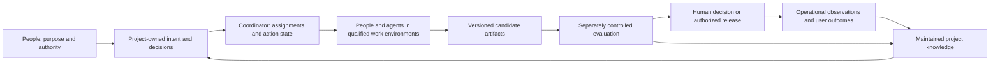

# Wavefoundry: Vision and Roadmap

Owner: Engineering
Status: active
Last verified: 2026-10-30
Adoption: canonical product vision and roadmap, adopted by the operator on 2026-10-29
Review status: revision 2026-10-30-r3 (status line only; substantive text is r2) proposes a changed entry and awaits the operator's decision; r1 was reviewed on 2026-10-30 by product strategy, domain workflow, senior architecture and independent challenge (37 findings), one bounded repair produced r2, and all four verified r2 (35 closed, 6 pending wording and accuracy findings listed in the delivery response, none a strategic disagreement); the [2026-10-29 review record](VISION-review.md) covers the previous revision only

## The destination

**Give one engineer or a small team the capacity of an exceptional engineering organization: to create, take over, transform and sustain significant software systems.**

Wavefoundry becomes an **autonomous engineering laboratory**. People supply an outcome and constraints; the laboratory investigates, designs, builds, challenges, integrates, delivers within authorized boundaries and measures the result. It carries substantial work across days or weeks, repositories and services, competing approaches and changing contributors. People direct purpose, business obligations and consequential tradeoffs. Routine execution needs progressively less supervision, while every consequential result remains inspectable and contestable.

The ambition is department-scale engineering capacity, not faster coding or tidier workflow administration. A small enterprise team should be able to take responsibility for systems that would otherwise exceed its ability to understand, change and maintain. A founder should be able to build and operate a sophisticated product. A public-interest team should be able to sustain important software without depending forever on its original experts. Scale means useful responsibility carried well, not a larger count of agents or generated changes.

The laboratory is also a portable engineering organization: it retains useful expertise and keeps caring for systems as people, tools and models change. Taking over significant existing projects, refactoring safely, removing technical debt, modernizing aging technology and retiring obsolete components are first-class outcomes alongside creation.

**What this revision changes.** The destination and the six horizons are unchanged. The entry changes emphasis: the first capability Wavefoundry builds is **independent acceptance of agent-made changes**, delivered where an accountable engineer already reviews and usable with whichever executor the team runs, followed by the continuity that lets an incoming maintainer carry the result forward. Execution is composed from qualified existing agents and only owned where a demonstrated gap requires it. Early studies on review tasks and long-horizon benchmarks show agents overclaiming completion and gaming verifiers; human reviewers already reject most pull requests whose description does not match the code, but about 28% still merge ([research](VISION-research.md#agents-overclaim-completion-and-long-horizon-success-is-rare)). These are design baselines from other tasks, not rates for any change class we will support, and they justify building the evaluation boundary first; whether teams adopt or pay for it is tested in discovery. In the same period MCP, AGENTS.md and Agent Skills moved under a Linux Foundation fund, which lowers the value of the harness surface on its own. Whether this entry is adopted, and whether acceptance is hosted locally or in the team's CI, are decisions for the operator.

### The path at a glance

| Horizon | What becomes possible | Value before the full destination arrives |
|---|---|---|
| 1. Trustworthy acceptance and qualified execution | Any agent's claimed completion is checked independently against the exact revision, with planted false completions rejected and recovery and authority qualified through the existing host. | A team can use the agents it already has with less supervision, and keep evidence it can challenge. |
| 2. A living understanding of the system | Reason about consequential behavior across code, contracts, decisions and operation, with freshness and uncertainty visible. | Safer takeover, better impact analysis and less reconstruction before a difficult change. |
| 3. Executable intent and sustained missions | Carry a substantial outcome through investigation, implementation and recovery; return meaningful decisions to the responsible person. | A small team completes work that previously required continuous coordination. |
| 4. Competing solutions and coordinated engineering | Explore materially different approaches, test them independently and integrate the best-supported result across components. | Better designs and more ambitious changes without placing one untested approach on the critical path. |
| 5. Delivery and continuing stewardship | Take a significant system through authorized modernization, release, observed outcomes and later maintenance. | Dependable service, reduced debt and the capacity to keep improving inherited systems. |
| 6. Compounding engineering intelligence | Use outcomes to improve future methods and transfer qualified expertise across contributors and projects. | Fewer recurring failures, lower cost of later work and wider access to advanced engineering capacity. |

**Status of these claims.** This adopted vision distinguishes the destination we seek, unresolved breakthroughs and a useful path through them. Unlimited development resources and a twelve-month push are planning aspirations; demonstrations govern expansion, and more developers cannot manufacture operating history, trust or research results. Later horizons remain provisional. Current capabilities and evidence limits are identified below; missing proof alone does not disprove the destination, while contrary evidence can change the path or return a strategic choice to the operator. This document grants no implementation or deployment authority.

## Why this future is worth pursuing

The enduring need is the ability to change software confidently while preserving the knowledge needed to live with the result. A team's scarce capacity is distributed across understanding, decisions, coordination, verification and maintenance. Automating implementation moves the bottleneck into those other activities. A tool that produces more changes while increasing the burden of checking and caring for them makes the team worse off.

That diagnosis is no longer only ours. Agents now generate changes faster than teams can verify them, and early public evidence shows the verification burden is real: in a file-review study agents gave misleading completion reports in over half of runs, a long-horizon benchmark found verifier gaming in a fifth of attempts, and reviewers spend their attention discovering which claims are true. Human review already catches much of this, so the addressable gap is the residue a careful reviewer misses, and its size is unmeasured. Every executor vendor is improving its own self-checks, but a worker's report of its own work is structurally the wrong evidence of record. The opportunity is to make **the continuing relationship between intent, software and observed consequences** a maintained product capability: acceptance a worker cannot rewrite, decisions and obligations that survive the conversation, and evidence that helps the next action rather than becoming an archive.

The repository establishes foundations for this idea, not demand. The operator's request establishes ambition and desired value. A [public-source landscape and evidence review](VISION-research.md), checked on 2026-10-29 and extended on 2026-10-30, grounds the product comparisons and proposed methods. No customer interviews, willingness-to-pay results or comparative Wavefoundry field trials have occurred. The timing hypothesis is modest: current agents and existing engineering tools make the proposed integration practical to test, and the measured overclaiming problem gives the first capability a concrete target. No forecast of model progress is required for the first useful product.

**The first market hypothesis is a small team assuming responsibility for an important existing system, with incomplete knowledge and a consequential change to deliver.** This includes enterprise transfers between teams or suppliers, and departures of key specialists; the knowledge may be fragmented rather than lost. Small describes the delivery team, not the organization or the importance of the system. A suitable initial partner has an accountable engineer, a usable test environment and a reason to preserve knowledge. Its engineering lead is the likely adopter; whoever bears delivery and maintenance cost is the candidate budget owner. This is a proposed initial beneficiary, not a settled market. The acceptance product serves that team first, but it is usable by any team that lets agents change important code, which widens discovery without changing the beneficiary we design for.

The first discovery work should examine recently completed and abandoned changes with such a team. Where did effort go? What had to be reconstructed? How is a consequential change accepted today, who signs, and how long does it take? Do they let agents change this system at all, and if not, what would have to be true? Which agent claims turned out to be false, and how were they discovered? Who could write characterization checks, and with how much time? Which work would they choose to repeat through Wavefoundry? If the dominant need is a faster patch and existing tools already handle everything around it cheaply, a lighter product is the stronger answer. Lightweight conversations of this kind need no system access and should precede fixing the first change class.

## The choice among different futures

Four product futures were developed before this recommendation. They differ in who benefits and what Wavefoundry takes responsibility for, not in packaging.

**A vendor-neutral engineering workflow harness.** This is today's product, improved: one lifecycle (plan, prepare, implement, review, close) with typed review evidence, rendered into every agent host a team uses. The beneficiary is a team working across Claude Code, Codex, Cursor and others that wants one process and one evidence trail; the engineering lead who standardizes tooling would pay. The value is consistency and portable work. Its obligations are modest: keep hosts current and the ceremony proportionate. Its weakness is structural: the surfaces it renders (MCP, AGENTS.md, Agent Skills) are now hosted by the Linux Foundation's Agentic AI Foundation, and free spec-driven frameworks occupy the "workflow for agents" position. Its uncertainty is that our only field evidence of burden is two self-reported runs on the operator's own projects. It would be the right choice if teams prove to value one evidence trail across hosts more than lightness. A harness competing on process alone is likely to lose to free and lighter tools.

**Independent engineering assurance.** The capability checks what any agent claims to have done. An engineering lead keeps using the executor the team prefers; Wavefoundry binds the requested outcome to the exact revision, runs acceptance in a context the worker cannot write to, qualifies that acceptance with known-bad controls, and produces evidence an incoming maintainer or auditor can challenge. The beneficiary is whoever is accountable for a change they did not write; the engineering or change-management lead who owns review cost would pay. The failure is measurable today; our value is not yet, because existing review already rejects most phantom-change pull requests and the residue it misses is unmeasured. It fits existing change-management controls without waiting for AI-specific regulation. Its obligations are evaluator separation, which a single-user local host cannot enforce on its own, holdout authorship and upkeep, and acceptance when specifications are weak, which depends on system understanding. Its risks are being indistinguishable from review-comment products, whose discrimination rates are unpublished and which our research has not yet examined, and an evaluator tuned to its own planted cases. It needs no execution runtime of our own, but qualified separation needs a boundary such as a CI runner or separate account. It would be the right final destination if teams keep paying for acceptance evidence while declining delegation.

**A portable engineering organization.** The capability carries obligations, decisions, evidence and useful methods across people, tools and models. An engineer who inherits a system six months after the original team left asks why a rating rule was changed, finds the obligation it protected, the evidence that was accepted and the assumption that has since expired, and completes the next change without the departed expert. The beneficiary is the inheriting team and the public-interest maintainer; the organization that bears handover and incident cost would pay. Its value is continuity, which is exactly the inherited-system problem. Its obligations are provenance, invalidation and curation; our own memory store has accumulated past its budget, and no controlled evidence shows persistent agent memory improves outcomes. Instruction portability alone is now a commodity. It would be the right choice if handover cost proves to be the beneficiary's dominant pain; attached to acceptance evidence, it is the durable half of the same product.

**An autonomous engineering laboratory.** The product directs sustained missions: investigation, competing implementations, integration, authorized delivery and observation. The beneficiary is the small team that wants department-scale capacity; the budget owner is whoever funds the engineering it replaces or enables. The value is the largest, and so are the obligations: runtime qualification, authority and recovery across partial effects, hostile inputs, concurrency and operational partnership. The evidence is the thinnest: a long-horizon benchmark reports under 20% task success on its twenty tasks, no independent intervention rate exists for any named product, and managed-agent services already supply the execution infrastructure. It would be the right entry only if a partner with a qualified environment and an accountable owner were already in hand.

A fifth possibility was not developed: decision-support workflows such as Envision and decision evaluation are the only capability outside users have so far chosen to run, in two self-reported runs on the operator's own projects. That is too little to rank it, and the operator may weigh it as an entry; it is not ruled out here.

**Recommendation.** Keep the laboratory as the destination; it is the only future that answers the operator's ambition and the only one in which the other three are complete. Build independent acceptance first, because it targets a measured failure, needs no executor of our own, works with the agents teams already run and leaves a valuable capability behind if sustained autonomy takes longer. It is first built as the laboratory's evaluation subsystem inside the existing lifecycle; whether it becomes a standalone product, and whether its qualified form runs in the team's CI rather than on the developer's machine, are open decisions tested by the first advance, not conclusions of this document. Make continuity the second increment, because acceptance evidence is the natural thing to carry forward and because the inherited-system beneficiary needs it. The harness is today's product and the entry's delivery vehicle; we no longer expect it to differentiate on its own, and acceptance must be deliverable without the full ceremony. Compose execution from qualified providers and own only a demonstrated gap. The sacrifice is deliberate: we do not lead with the most exciting capability, and the assurance entry can look narrower than the destination. Choosing assurance or continuity as the final destination would be an explicit operator decision; this revision does not make it.

The nearest alternatives in a real purchase decision are the team's current human-led workflow with its preferred agent and CI, its own scripts, conventional engineering services, free spec-driven frameworks, or leaving lower-value work undone. Wavefoundry must beat the strongest viable alternative for the chosen task, including onboarding and continuing upkeep. The competitive baseline is substantial: Copilot, Cursor, Devin and Factory cover broad engineering workflows; AWS Transform documents business-logic extraction and modernization; OpenRewrite and Moderne supply repeatable transformations; Sourcegraph supports change campaigns; managed agent services supply execution; code intelligence and ownership catalogs are established categories. See the [sourced product comparison](VISION-research.md#available-products-and-where-they-overlap). None of this proves an empty market or an exclusive gap.

Deliberately do not start by replacing IDEs, issue trackers, CI, observability systems or every agent host. Do not begin with unsupervised high-consequence operations, a universal enterprise model, or a marketplace with no repeatable demand behind it. A simple change must stay simple; users should not administer a committee to receive a small fix.

## What the product feels like

**The first week.** A small team has just inherited a billing platform. Their existing agent changes a rating rule. On the pull request, a check bound to that exact revision reports which of the agent's claims hold, which characterization checks of current behavior failed, and what remains uncertain. The accountable engineer reads the evidence instead of re-deriving it, returns the rejection reason to the agent, and records the one override they chose to make. Nothing else about their workflow changed.

**The destination.** Imagine that same team, months later, taking over the whole platform from departing specialists. Several business units depend on partly documented behavior. The team gives Wavefoundry an outcome:

> Make this platform support ten times the traffic. Preserve its billing and API obligations, keep infrastructure cost growth below 30%, replace the obsolete integration, and make the migration recoverable. Bring us the decisions that need our judgment.

These numbers are imagined mission constraints, not product targets or present capabilities. The system first tests whether they can coexist and whether scaling is the right intervention. It identifies which promises require business decisions, what evidence is missing and where access or a service owner is needed. It reconstructs the relevant system from code, history and authorized observations, using the installed map and retrieval already available.

Over days or weeks, specialist contributors investigate bottlenecks and obligations. Independent teams compare a modest optimization, a component redesign and a broader migration where those are credible alternatives. They build runnable candidates, replay representative workloads, test compatibility and failure recovery, and expose the tradeoffs. Mechanical transformations use established recipes. Every candidate's claim of completion is checked by acceptance its author could not see; a candidate that passes its own tests but fails a holdout check is rejected with the reason preserved, and planted known-bad cases separately show that the acceptance still discriminates. Unknown business meaning returns to people; routine implementation decisions stay with the assigned contributors.

The operator sees objectives, alternatives, evidence, cost and consequential decisions. A promising approach may fail an independent test; its lesson informs the next experiment without hiding the failed attempt. A host disconnects; another contributor continues with current scope and observed effects, avoiding an uncertain duplicate operation. The team can stop work, inspect the reason for a choice, change constraints or recover ownership.

With explicit release authority and a qualified operational boundary, Wavefoundry rehearses the migration, coordinates component changes, observes a limited rollout and expands or stops against the agreed conditions. Irreversible effects have an explicit disposition; a promise to roll back does not substitute for one. Acceptance follows business behavior and operating outcomes, not the appearance of a finished report.

Months later, a different maintainer and model make the next change. They can explain why the design won, challenge expired assumptions and preserve the relevant obligations. The team can export its records and replace providers without losing the meaning of its work.

For a new product, the same loop begins with the intended user experience rather than an inherited system.

## Value and a sustainable product

Financial value can come from earlier useful releases, less rework and incident cost, reduced review and coordination effort, or engineering work that becomes economical for the first time. For an enterprise inheriting important systems, proposed benefits also include a shorter path to effective ownership, removal of costly debt and obsolete dependencies, and modernization without unnecessary replacement of working capabilities. These benefits must be measured separately: faster delivery can be valuable even when labor does not fall, and fewer labor hours are not valuable if defects or future maintenance rise. The proposed value must survive full-cost and quality comparison.

Nonfinancial value includes less interruption, more time for judgment and creative work, continuity when people leave, more accessible expertise and software that remains dependable. Teams should gain agency rather than depend on an opaque service. A successful product could also let maintainers sustain neglected public or internal software where direct revenue is limited.

**Engineering evidence is a potential enterprise asset.** Connect obligations, authorized decisions, exact changes, acceptance methods and later consequences. Test a concrete package with an engineering or change-management owner for reduced review effort, better handover and clearer decisions. Practitioners argue that existing change-management controls such as SOC 2 CC8.1 apply identically to agent-made changes, which would make the package relevant now; AI-specific high-risk obligations in the EU begin in December 2027 and do not name an agent-acceptance artifact ([research](VISION-research.md#audit-readiness-has-dates-and-no-named-artifact)). Audit readiness requires qualification for a named use: authenticated independence, tamper resistance, completeness and recipient acceptance remain unproven. Willingness to pay also needs testing.

The initial sustainability hypothesis is an openly usable local foundation with paid support, qualified integrations and, if customers want it, managed operation under explicit data and authority boundaries. The first commercial experiment is the acceptance capability itself: whether an engineering or change-management lead will pay for independent, revision-bound acceptance evidence on agent-made changes, delivered in their existing review path. Internal platform funding remains a credible alternative. This is a commercial experiment, not a chosen license or business model. Obtain a budget owner's concrete willingness to sustain repeated use after observing full cost; compliments and trial participation are insufficient.

Possible durable advantages are trusted acceptance practice, well-maintained integration contracts, useful evaluation methods and project knowledge that demonstrably improves later work. None is a proven moat. Open contracts and export reduce lock-in while increasing confidence in adoption. Serving a customer should earn recurring value through continuing usefulness, not by making their history impossible to leave behind.

## Starting point and the distance to travel

Today's Wavefoundry (1.39.0) is a framework of 62 seed prompts and about 186,000 lines of Python excluding tests, a stdio MCP server exposing 91 tools, a local dashboard and a release pipeline, verified by 12,291 tests. Its [project overview](docs/references/project-overview.md) and [architecture hub](docs/ARCHITECTURE.md) establish the boundary between canonical framework source and each project's visible operating surface. Capability classifications below were checked against current source on 2026-10-30 ([inventory basis](VISION-research.md)); they describe what ships, not its efficacy in other teams.

| Capability | Status and evidence | Consequence for the roadmap |
|---|---|---|
| Installation, orientation and codebase map | Working. Installation renders the operating surface, builds the semantic and graph index and generates a graceful-scaling codebase map; the operator reports it performs much of the discovery an existing project needs. | Reuse. Investigate specific missing or stale knowledge, not a new onboarding inventory. |
| Cross-agent and cross-host work | Working, with limitations. Skills and agent surfaces render for Claude Code, Codex and the shared skills folder; Cursor receives rules. The operator reports agents finishing one another's work. This is attributed experience, not a comparative trial. | Preserve. Instruction delivery is becoming a standard; the next advance must add capability, not re-demonstrate handover. |
| Lifecycle with typed review evidence | Working. `events.jsonl` is the sole review authority; typed approvals, council readiness, intent-fit verdicts, focused re-review by lane, a wave work area and a framework test receipt checked at close all ship. | This is the harness the acceptance product grows from. Its checks decide contradictions from the record; they do not authenticate the caller. |
| Independent acceptance of a claimed completion | Genuinely missing as a product mechanism. Distinct review context and actor are enforced as declared strings, not authenticated. Mutation and known-bad controls exist as review practice in this repository, not as a product gate. No evidence binds to a source revision; the test receipt binds only this repository's framework tree and is not checked in installed targets. Intent-fit at delivery is an agent judgment producing a non-blocking advisory. | The first advance, and the baseline it is measured against. |
| Code intelligence | Working, with limitations. One SQLite index holds dense vectors, lexical search and the graph; graph builder v56 covers Python by AST and fifteen programming languages (26 grammars including markup and configuration) by tree-sitter, with some heuristic call edges. The query surface exposes extractor vocabulary and is golden-tested but unversioned. `code_ask` gathers and reranks citations but does not synthesize. Optional Tensorwell inference shares resident models. | Foundation for H2. State the query contract as a versioned interface, then compare composing an index format or graph server before extending the extractor. |
| Project memory | Working, with limitations. Typed records, consolidation, purge and evaluation tools ship; the store holds about 175 active records against a budget of 50, and our own evaluation found combined retrieval no better than lexical. | Continuity is the second increment; curation and retrieval quality are its first obligations. |
| Accounting of agent effort | Estimated, not measured. Context-efficiency credits are byte-based estimates; exploration-avoided is an explicitly labeled counterfactual never added to totals. | Useful diagnostics; not evidence of productivity. Full-cost claims need measured baselines. |
| Sensors, secret scanning, release qualification, Windows support | Working, with limitations. Bounded subprocess checks, secret scanning and release-only qualification reports ship; Windows is x64 only with package tests pending. | Preserve. Qualify per environment rather than assume parity. |
| Envision and decision workflows | Shipped in 1.39.0 and revised in the open wave; two field runs on other hosts by the operator's own projects, self-reported, not independently audited. | Early evidence that the harness can deliver judgment-support workflows, not evidence of demand. |
| Sustained missions, competing solutions, multi-repository coordination, organizational autonomy | Partial groundwork at most: pause, handoff, reopen and the work area exist; subagent orchestration is prompt guidance with no scheduler, isolation, budget or cancellation runtime; the single-OPEN-wave rule blocks parallel candidates; tools accept a target root but nothing coordinates across repositories. | Destination capabilities and research questions, not failed features. Compose before owning. |

**Binding commitments and current choices.** Explicit commitments, binding until changed by decision: local-first operation with no network dependency; project-visible contracts; canonical seeds as the source of framework behavior; `events.jsonl` as the sole review authority, with prose carrying no evidential weight; the stage gate (plan, admit, ready before code edits); typed tools over arbitrary shell within allowed roots; one OPEN wave per activation scope (the repository by default, with lifecycle and publication locks repository-wide); and operator ownership of commits and wave closure. The review authority, the OPEN-wave rule and the locks are mechanically enforced; the stage gate and edit gates are enforced by hooks on the agent host; commit and closure ownership are instructions. These are foundations, not accidents. The stdio server, the Python implementation, the single SQLite index and the agent-guided seed reconciliation at upgrade are current implementation choices that can change on evidence. Remote execution and organization-wide collaboration are deferred capabilities. The assurance entry proposes a change of product responsibility: Wavefoundry would vouch for other agents' work. That introduces obligations the harness never carried, namely enforced evaluator separation, revision binding and a demonstrable discrimination rate, and it strains the local-first commitment, because separation that a worker cannot defeat needs a boundary outside the worker's reach. Both are named in Horizon 1 rather than assumed.

## Breakthroughs that make the ambition real

The largest gap is not generating more code. It is sustaining justified action through ambiguous goals, incomplete knowledge, long sequences and real consequences. Five research and engineering problems connect the destination to the horizons:

- **Know what success means.** Translate intent into challengeable acceptance without confusing a passing test with solving the right problem. Research specification discovery, business invariants and uncertainty calibration; use human decisions where evidence cannot determine values or obligations.
- **Understand enough to act, and know what is missing.** Connect behavior, dependencies and operational evidence without pretending to possess a perfect replica. Establish freshness, provenance, contradiction handling and prediction limits on task-relevant slices.
- **Sustain execution without losing control.** Reconcile partial effects, interruption, authority and changing plans across qualified providers. Unfamiliar repositories, comments, documents, issues and dependencies can carry hostile instructions, poisoned knowledge or executable supply-chain threats. Keep observed content separate from trusted authority and test enforcement at the actual effect boundary; a persuasive prompt or a content filter is insufficient. The [security research note](VISION-research.md#hostile-inputs-are-part-of-the-takeover-problem) motivates this boundary without qualifying an implementation.
- **Choose well among plausible solutions.** Compare materially different approaches using independent experiments, representative conditions and honest accounting. Detect shared mistakes, contaminated evaluation and candidates that exploit incomplete tests; a long-horizon benchmark already observes that in a fifth of attempts.
- **Learn without certifying ourselves.** Convert incidents, rejected experiments and outcomes into improvements that survive withheld cases and changing models. Keep success criteria and promotion authority separate from the system proposing the change.

None must be solved universally before delivering value. Each horizon attacks a bounded part and leaves useful capability behind. Repeated evidence against a necessary premise should trigger an explicit decision about the destination or domain; lack of current proof alone does not.

## Horizon 1 — Trustworthy acceptance and qualified execution

**Useful release:** an accountable engineer can let any supported agent make a bounded change and receive acceptance evidence the agent could not write: bound to the exact revision, qualified against planted false completions, and reporting what remains uncertain. Supervision falls because the engineer reads evidence instead of re-deriving it. Existing onboarding, review records and cross-host handover remain the foundation; this horizon adds the discriminating check that is missing today. It has two parts that advance separately: **acceptance evidence** for change classes with an executable specification, and the **qualified execution boundary** for authority and recovery. Acceptance of changes with weak specifications depends on the understanding Horizon 2 builds.

Select one real change class in a supported environment. Keep acceptance under a separate owner's control: a context that did not author the change, inputs the worker cannot modify, and holdout checks the worker never sees. On a single-user local host this separation is declared, not enforced: worker, evaluator and ledger share one account, one disk and usually one model family, and a worker with shell access can read anything on that disk. Qualified separation therefore needs a boundary the worker cannot write to, such as a CI runner, a separate account or container, holdouts stored outside the worker's filesystem, or a different model family, with results hashed against the judged artifact. Each demonstration states which of these it used; local-only operation remains the developer preview and must say so. Bind acceptance to a working-tree content fingerprint (per-path blob hashes plus environment and evaluator version), so an approval lapses when the fingerprint changes and evidence from the wrong revision is rejected rather than trusted; commit identifiers follow closure.

For an inherited system, holdouts start as characterization checks of current observed behavior, created without the worker's involvement; business-meaning checks are added only where an owner confirms them. Name the holdout author, the time to create them and the upkeep per change class as a cost borne by the beneficiary. Each verdict states its basis and uncertainty. A rejection returns a reproducible reason the executor can act on; an engineer override is recorded with its reason; a false acceptance found later becomes a regression case for the evaluator and suspends the change class's authority until the evaluator is requalified. Planting known-bad cases (a completion never made, a change described but not present, a test weakened to pass) is a qualification and periodic requalification activity, not a per-change step; the planted cases come from someone other than the evaluator's author, are rotated between batches, and their rejection rate is reported by case type. Make failures and unresolved claims inspectable by an incoming maintainer.

Qualify the existing host and CI for the authority, budgets, cancellation and recovery behavior the change class needs. Where partial effects cross providers, define durable action identity and reconciliation. Implement a missing adapter or control only when a demonstrated gap requires it; do not assume every provider offers equivalent guarantees, and do not build an execution runtime to deliver acceptance.

**Demonstration and exit:** complete a useful change whose independent acceptance rejects planted false completions, phantom changes and wrong-revision evidence while accepting valid outcomes, delivered where the engineer already reviews. For the execution boundary, in a disposable environment, interrupt execution around an uncertain action result; the successor reconciles from the qualified provider's observations before retrying, and the actual worker boundary prevents a deliberately forbidden effect. Report which mechanisms already worked and which increment is new; the unchanged baseline must fail the specific incremental claim.

The leading indicators are **operator interventions per accepted change** and **the share of planted false-completion, phantom-change and wrong-revision cases that acceptance rejects**, reported by case type with false rejections, accepted-outcome coverage, intervention time and every failed, abandoned or rescued attempt. The published overclaiming and phantom-change figures are design baselines from other tasks, not comparators; the comparator is the team's current review on the same cases, and acceptance that cannot beat a careful human reviewer on the planted cases has not earned the claim. Predeclare case mix and count review, evaluator-upkeep and support effort so that rejecting everything, selecting easy work or moving labor elsewhere cannot look like progress.

Advance for the tested environment when repeated demonstrations preserve useful outcomes and quality while lowering recurring supervision under complete effort accounting. A false acceptance, duplicate effect or unauthorized action fails its respective claim and prevents expanding the authority it depends on. This horizon leaves a valuable acceptance and evidence product even if sustained autonomy takes longer.

## Horizon 2 — A living understanding of the system

**Useful release:** an incoming maintainer can answer consequential questions and plan a difficult change without reconstructing everything. Connect the existing code and document retrieval, graph and project records to the relevant APIs, schemas, service ownership, tests, deployment state and authorized incident or workload evidence.

Begin with the slice needed for H1 and the next mission, not an enterprise-wide model. Distinguish declarations, observations and inferences; attach provenance, revision, freshness and unknown coverage. A business owner remains authoritative for business meaning. Integrate maintained catalogs and observability rather than establishing competing sources of truth. Representative data, privacy approval and an available domain owner can gate progress before any engineering dependency does.

Code intelligence is a composed layer, not a differentiator. Mature index formats and open graph servers exist ([research](VISION-research.md#composable-code-intelligence)). The current query surface is a partial seam: it exposes extractor vocabulary and is unversioned. State it as a versioned contract (node identity, edge relations, confidence tiers including compiler-resolved, freshness and coverage), list the tools that depend on extractor internals, and then compare adopting an external engine against extending the current extractor before investing further in language coverage. Memory records are continuity's raw material and need curation and retrieval quality before they can carry a mission; our own store shows how fast uncurated records accumulate.

**Demonstration and exit:** on an unfamiliar but bounded subsystem, identify the obligations and downstream effects of a proposed change, then check them against independent characterization tests and owner review. Deliberately change a consequential premise; the maintained model must surface invalidated conclusions and the need for fresh evidence. Contrast against today's retrieval on this exact freshness or relationship question. A complete-looking but stale answer, hidden coupling or overconfident extrapolation fails its claim.

Include a takeover case in which a consequential legacy behavior is undocumented, affected owners disagree, or the outgoing expert is unavailable. Distinguish observed behavior, stated obligation and inference; identify affected consumers and decision rights; present a concise choice with compatibility and operating consequences. Preserve a justified provisional behavior or pause the dependent effect until an accountable decision is made. Record unresolved exposure, outgoing-expert assistance and stakeholder decision effort. Owner absence is not agreement. This horizon enables safer modernization and impact analysis independently of autonomy, and can advance alongside H1.

## Horizon 3 — Executable intent and sustained missions

**Useful release:** an engineer supplies a substantial outcome and constraints, then returns to a working result or a concise set of decisions instead of coordinating every step. A mission carries the work through investigation, implementation, integration and recovery across sessions and contributor changes.

Translate the outcome into invariants, acceptance experiments, dependencies, authority, resources and decision points. Build missing instrumentation when necessary. Use the qualified H1 boundary and enough H2 understanding for the selected mission; neither needs universal completion. Keep project-owned approval and scope distinct from runtime action state, and synchronize readable contracts with executable state under explicit ownership. Today's pause, handoff, reopen and work-area mechanisms are the seed of this; a mission runtime, durable action identity and reconciliation of partial effects do not yet exist and should be composed from a qualified managed-agent provider before being built.

The provisional demonstration is a substantial single-repository maintenance or product change over an extended run, including failed experiments, context loss and a changed assumption. Test whether the system escalates a consequential business choice while resolving routine engineering details itself. Replanning must preserve the remaining authority and explain any proposed scope change. It must be possible to stop work and regain ownership.

Advance when repeated representative missions establish the prospectively chosen value claim: lower effort and attention for comparable work, or greater accepted capacity or timeliness within declared budgets. Concealed rescue, unbounded retry or quietly weakening acceptance defeats the capacity claim. Owning the runtime is an implementation choice, not the purpose. A narrower supervised mission product remains useful if broader unattended operation is delayed.

## Horizon 4 — Competing solutions and coordinated engineering

**Useful release:** a small team can seriously explore several plausible designs and complete changes spanning components or repositories without betting the program on one generated solution.

Independent contributors investigate alternatives in isolated environments with explicit interfaces and integration ownership. Compare candidates against acceptance that implementers cannot rewrite. Reuse deterministic recipes for mechanical transformations and combine property testing, mutation, replay, fault injection or targeted formal methods where they address the actual claim. More review voices alone do not establish independent evidence.

The provisional demonstration is a consequential scaling, modernization or capability objective with at least two meaningfully different approaches, a rejected but plausible candidate and an integrated result. Compare quality, compatibility, operating cost and maintainability under representative conditions. A superficially parallel run that shares the same hidden error, tests only favored cases or defers every integration problem fails its claim.

Advance where the benefit of exploration exceeds its compute, evaluation and coordination cost, and shared contracts support reliable integration. The single-OPEN-wave rule remains in force until an explicit lifecycle design establishes concurrent ownership, conflict detection, integration scheduling and stopping rules. This horizon improves high-consequence design choices even if sustained stewardship remains limited.

## Horizon 5 — Delivery and continuing stewardship

**Useful release:** a small team takes responsibility for a significant inherited system or grows a new one, delivering useful changes while keeping service dependable and the result maintainable. Refactoring, debt removal, modernization and retirement are outcomes when they improve useful capacity, risk or cost, not when they merely rewrite code.

For weakly documented systems, establish important behavior and obligations before replacing them. Stage changes around compatibility and integration seams. [Migration experience and incremental-modernization guidance](VISION-research.md#repeatable-transformations-can-beat-free-form-generation) support hybrid recipes, agents and human decisions rather than free-form generation alone.

The provisional demonstration is a cross-component modernization, rehearsed migration and authorized rollout, followed by an unrelated maintainer's change. Bind release artifacts to observed deployment; use canaries, explicit stop conditions and recovery where appropriate. Name irreversible effects and compensation. An operational partner, permitted representative data, incident responder and accountable service owners are prerequisites to live effects.

During an agreed observation period, include an operating signal or dependency change that invalidates an assumption while another mission is active. Identify the affected obligation, propose a bounded response, reconcile it with current work and obtain the named human decision when priority or authority changes. The organization retains an accountable service owner and operational fallback when Wavefoundry is unavailable or its authority is revoked.

Also test the value of the objective itself. Compare the request with doing nothing and a smaller or non-code intervention; people choose consequential tradeoffs. Advance where useful outcomes survive operation and later maintenance, and total effort, incidents and cost support the claimed benefit. A simulation cannot alone qualify production.

## Horizon 6 — Compounding engineering intelligence

**Useful release:** the laboratory becomes more capable through experience, while a project keeps its expertise as contributors and providers change. Incidents, failed approaches, operator corrections and successful outcomes become reproducible evaluations and qualified reusable methods.

Version candidate changes to retrieval, prompts, planning, evaluation, models and orchestration. Keep protected holdouts, success criteria and promotion decisions outside the evaluated worker's control. Curated human learning is a valid initial mechanism; automatic promotion needs its own evidence and authority. A stored lesson earns retention by improving later action.

The provisional demonstration is improvement on withheld projects or task families under comparable budgets, alongside a different maintainer completing subsequent work and replacing a qualified execution provider. Separate harness effects from model improvements, leaked examples and additional evaluator effort. Gains that disappear outside remembered tasks, degrade other outcomes or depend on founder rescue do not establish compounding capacity.

Wider access grows from repeatable demand and supported contracts: an internal utility, commercial offering or public-interest commons can share qualified adapters and methods without a marketplace. Cross-project sharing requires consent, provenance and retention rules; private source is not a default contribution. Outside maintainers must be able to adopt, upgrade, recover and leave.

## Architecture for endurance

Keep the project as the owner of its goals, source, accepted decisions, authority and durable evidence. Treat indexes, summaries and inferred models as derived state that can be rebuilt or corrected. Execution state records what was attempted and observed; it cannot enlarge project authority. Every consequential effect needs a stable identity, an accountable owner and a recovery interpretation.

The evaluation box is the product's center of gravity. It must have its own inputs, its own holdouts and its own owner, and the artifacts it judges must carry a revision identity it can verify. For everything upstream of it to be composable from other vendors, the evaluator must consume only the artifact (diff and fingerprint), the declared intent and its own inputs; its verdict cannot rely on upstream lifecycle gates, edit hooks or the work area having been honored, because an external or CI-hosted executor bypasses the host-side hooks, the device-keyed work-area ownership and the repository-wide locks that enforce them today. Everything downstream of the evaluator depends on its honesty.

Implement these boundaries first through local files and qualified existing tools with explicit contracts. Introduce a service only when a demonstrated coordination or reliability need warrants it. Local operation remains useful. Remote execution or organization-wide collaboration is an optional expansion requiring authentication, isolation, secrets handling, revocation and policy ownership; today's process account is not an authenticated organizational identity.

Retain portable, versioned records with documented migration and export. Keep evaluator inputs and protected holdouts away from implementer write access. Retrieved and retained content remains data with provenance, not permission to expand scope or alter acceptance. Enforce least privilege and effect authorization outside the worker model; constrain dependency and build execution and data egress separately from instruction screening. Review promotion of inferred knowledge into trusted decisions, and preserve a way to invalidate poisoned derivatives. Test layered controls against defined attacks and report residual exposure. Bind evidence to artifact, environment and evaluator versions; separate recorded approval from observed correctness. More reviewers of the same model are not independent evidence.

Keep models, hosts and code-intelligence engines replaceable at narrow interfaces that reflect actual needs. Build capability negotiation and clear degraded behavior when an adapter cannot cancel, isolate or resume work. A human must always have a usable way to inspect state, stop new work and recover ownership. Retention and deletion are product obligations.

Qualify existing managed runtimes, index formats and enterprise integrations before building substitutes. Shared skills or MCP compatibility do not establish equivalent effect, recovery or authority semantics. Periodically retest and remove harness workarounds and ceremony that no longer earn their cost; enduring project contracts should not freeze today's agent limitations into permanent process.

The costly commitments are authority design, record semantics, operational hosting and ecosystem contracts. Prototype them before broad distribution and keep migration obligations visible. Durability also needs maintainers, support funding and a way to retire obsolete integrations.

## A twelve-month push with evidence on the critical path

Use the year to attempt the full destination through an expanding set of real demonstrations. Do not turn it into fixed release dates.

| Window of emphasis | Integrated outcome to attempt | Work that can proceed in parallel |
|---|---|---|
| Early: the acceptance product | H1 with task-relevant H2: independent acceptance rejects planted false completions and wrong-revision evidence on a real change class, with recovery and authority qualified through the selected host. | Design-partner discovery, evidence-package test with a change-management owner, composition comparison for code intelligence, memory curation, measured runtime diagnosis. |
| Middle: continuity and sustained outcomes | H2 takeover case; H3 sustained single-repository outcomes on a composed execution provider; first H4 competing-candidate comparison under the acceptance product. | Broader system understanding, evaluation research, operational partnerships, migration rehearsals, adoption support. |
| Later: the full demonstration | H4/H5 across services and repositories, observed authorized delivery and subsequent maintenance; H6 withheld improvement where evidence exists. | Distribution and support experiments, provider replacement, external-maintainer trials, long-term follow-up. |

The critical path is **a willing team and accountable owner → a meaningful objective and permitted environment → independent acceptance and task-relevant understanding → recoverable delegated effects → sustained missions and integrated experiments → authorized operational evidence → transferable improvement**. Access to business owners, representative observations and an operational partner can gate the engineering path. Sustainable support and repeat use matter alongside technical success.

With unlimited resources, fund independent alternatives to the hardest problems: weak specifications, trustworthy evaluation, maintained understanding and recovery across partial effects. Build representative environments and qualified integrations in parallel, with domain specialists and independent evaluators. Some experiments will fail; their purpose is to discriminate among approaches, not to produce a favorable demonstration at any cost.

Twelve months cannot prove years of reliability or guarantee a research breakthrough. Report completed demonstrations, early indicators and unresolved exposure separately. Delay or failure of a horizon may change the method, sequence or supported domain; changing the destination returns explicitly to the operator.

## How we will know whether it is working

Use a small set of beneficiary outcomes: **more useful changes accepted and sustained, less total human effort for comparable work, and preserved or improved software quality and maintainability**. Aim for a **10× reduction in operator time on a predefined portfolio of substantial missions** as a stretch ambition, measured alongside capacity and quality rather than treated as a universal threshold. Operator time alone cannot establish department-scale capacity: also report accepted-outcome coverage, all-person effort, cost, quality and later maintenance. Set each pilot's decision thresholds prospectively after measuring its baseline.

For the acceptance capability specifically, report the **planted-case rejection rate by case type**, the **false-rejection rate on valid changes**, **evaluator upkeep effort** and **per-change engineer time**, against the beneficiary's current review practice on the same cases. An acceptance layer that rejects less than a careful reviewer, or costs more to maintain than the review it replaces, has not earned adoption.

Declare whether a demonstration tests efficiency on comparable work or expanded capacity, responsibility or timeliness within a budget. Do not switch claims after seeing results. Compare the team's strongest viable existing workflow, selected prospectively. Predeclare task classes, difficulty, acceptance, budgets and observation windows. Count failures, abstentions, timeouts, rescues, abandoned work and delayed regressions. Correct escalation is successful only for a task whose declared outcome allowed that decision.

Measure operator attention separately from all-person work: setup, evaluation creation and upkeep, support, review, incident response and maintenance all count. Track compute and infrastructure expense. Compare quality by severity and report uncertainty; zero severe failures in a small pilot cannot establish safety. Include later follow-up work by a different maintainer so immediate speed does not conceal future cost.

Independent acceptance must exercise real behavior, identify the tested artifact and detect known-bad controls. Repeated trials and held-out cases are necessary for broad capacity or learning claims. No present evidence justifies general autonomous reliability, commercial demand, a productivity multiplier or the ability to predict every operational consequence.

## What would change the direction

| Risky assumption | Cheap discriminating experiment | Consequence if it fails |
|---|---|---|
| Independent acceptance catches what a worker's own checks and a careful reviewer miss. | Planted false completions, phantom changes and wrong-revision evidence in a real change class, scored against the team's current review. | Narrow the supported domain or change the acceptance method; hold authority expansion until it discriminates. |
| Additional delegation solves a real problem beyond the working harness and handover. | Observe where a consequential change still needs intervention; compare a narrowly extended workflow against today's strongest setup. | Preserve existing strengths, change the increment, or return a smaller destination as an explicit option. |
| Delegation reduces real work rather than hiding it. | Repeated bounded tasks with all-person and full-cost accounting, independent acceptance and voluntary repeat use. | Keep useful supervised capabilities; reconsider the scope and economics of autonomous execution. |
| The harness stays proportionate enough that teams keep it. | Measure ceremony per accepted change and compare against a free spec-driven framework on the same tasks; count operator complaints about evidence burden. | Cut ceremony, make evidence response-only by default, or deliver acceptance as a component inside the team's existing workflow. |
| The evaluator discriminates beyond the cases it was tuned on. | Hold out planted-case classes the evaluator's author never saw; rotate them between batches; score against a reviewer from a different model family. | Treat the evaluator as overfitted; widen authorship of controls or change the acceptance method. |
| Holdouts stay secret from the worker across batches. | After each batch, check whether holdout content appears in the worker's context, retained memory or committed tests. | Move holdouts outside the worker's reach or requalify the boundary. |
| An evaluator from the worker's model family catches the worker's mistakes. | Score the same batch with an evaluator of a different model family and compare the planted-case rejection rates. | Require cross-family evaluation for qualified acceptance. |
| Acceptance stays meaningful when specifications are thin. | On a change class with no executable specification, compare acceptance verdicts with an owner's judgment. | Restrict qualified acceptance to specified change classes until H2 supplies the understanding. |
| Hostile material cannot convert access into unauthorized authority or corrupt acceptance. | In a disposable takeover fixture, plant instructions in retrieved material and retained knowledge; include a malicious dependency or build action. Check effects, egress and evidence changes at the boundary. | Constrain access and supported effects, repair the boundary and requalify; narrow attack coverage is not general security proof. |
| The evidence package is useful to an enterprise decision owner. | Ask an engineering or change-management owner to assess a real change package against their current practice and controls. | Improve or narrow the evidence product; do not market audit readiness or assume willingness to pay. |
| Knowledge remains useful as systems and contributors change. | A new maintainer handles a later change after a deliberately invalidated assumption and host or model substitution; measure retrieval against a lexical baseline. | Reduce what is retained, improve expiry and provenance, or stop claiming compounding expertise. |
| Composed execution providers are good enough to carry missions. | Run the H3 demonstration on a qualified managed-agent provider before building any runtime; record intervention and rescue rates. | Build only the demonstrated missing control; if no provider qualifies, narrow the supported mission class. |
| Others will sustain the product. | An outside maintainer installs, upgrades, recovers and exports; a budget owner makes a concrete continuing-use decision. | Narrow support commitments or change funding and distribution before wider release. |

The hardest unresolved research is recognizing the right problem, obtaining independent evidence when specifications are weak, managing partial effects across real systems, and separating useful learning from shared error or benchmark contamination. Each horizon should expose the next uncertainty without making its own value depend on solving everything that follows.

Revisit the proposal when a horizon's exit conditions fail, a team declines repeat use, a false success is discovered, an adapter loses essential capabilities, or new beneficiary evidence changes the opportunity. Preserve the purpose where justified; bring a changed destination back to the operator explicitly. A different commercial model is not necessarily a different purpose, but shrinking the ambition to workflow administration would be a strategic change.

## Immediate advances toward the destination

These priorities extend current strengths. They are a recommended order for subsequent planning, not implementation authorization or a complete backlog.

**Prerequisite: hear from inheriting teams, then secure a design partner.** Before fixing the first change class or where its evidence is delivered, hold lightweight discovery conversations with several teams that have inherited a system; these need no system access and ask the questions listed under the market hypothesis. Then recruit a willing design partner with an accountable owner; review completed and abandoned changes with permission, including agent claims that proved false; choose a consequential mission; and agree access, outcomes and full-cost measurement. Record participation barriers and readiness effort. Test an evidence package with the decision owner against their existing change-management controls. [Downstream evidence](VISION-research.md#downstream-experience-and-design-partner-selection) supports bounded use and usability, leaving demand, ROI and willingness to pay unproven; Waveforge remains an uncommitted candidate route. Owner agreement and permitted representative evidence gate H2 field claims and H5 live operation. Without a suitable partner, label mechanism tests internal and revisit the beneficiary hypothesis. Results on this repository are internal mechanism evidence only; here the accountable engineer is the author, the system is not inherited and the agents are not foreign.

1. **Make acceptance independent, revision-bound and qualified against planted failures.** This is the genuinely missing mechanism. Prototype inside the existing lifecycle: at review and close, bind the evidence to a working-tree content fingerprint rather than the framework tree alone; run acceptance in a context that did not author the change, with holdout checks the worker cannot see; and qualify it with planted known-bad cases written by someone other than the evaluator's author. Then the first useful release delivers the verdict where the accountable engineer already reviews, as a pull-request check or CI status bound to the revision, with adoption of the wave lifecycle optional; a CI runner is also the first candidate for enforced evaluator separation, and the operator decides between CI-hosted and local acceptance as the first entry decision. Report rejection and false-rejection rates by case type and per-change engineer time against current review from the first batch. For a routine change, acceptance adds no authored artifact and no separate approval step. Qualify recovery and authority through the existing host and CI; build only a demonstrated missing control. This advances H1; whether it becomes a standalone product is tested by running it on a change made by an outside executor with no Wavefoundry lifecycle. Continue when the new behavior rejects the planted cases while accepting valid outcomes under complete effort accounting; if today's setup already satisfies it, preserve that evidence and select the next gap.

2. **Connect a task-relevant system model to a difficult engineering decision, composing code intelligence where it is commodity.** For the same mission, extend existing retrieval and project orientation only where needed: a business invariant, downstream dependency, runtime observation or stale assumption. Use representative examples and an accountable owner to compare two credible approaches. Before extending the graph extractor, state the query contract as a versioned interface and list the tools that depend on extractor internals; then run the composition comparison, an existing index format or graph server behind that contract against the current extractor, on this mission's questions. Produce challengeable impact and compatibility evidence and a runnable candidate, not an inventory. This advances H2 toward H4, and supplies the characterization checks the first advance needs on an inherited system. Continue if the added evidence changes a consequential decision or catches a counterexample; otherwise keep the simpler workflow and the cheaper engine.

3. **Make continuity earn its keep.** Bring the memory store within its budget through the existing consolidation and purge tools, measure retrieval against a lexical baseline, and attach provenance and invalidation conditions to records that survive. Then run the H2 takeover case: a new maintainer completes a change after a deliberately invalidated assumption. This is the second product increment and the first test of the portable-organization claim. Continue if retained records change a decision or catch a stale conclusion; otherwise reduce what is retained.

4. **Remove demonstrated operating and ceremony costs that would prevent adoption.** Measure the representative workload: startup and retrieval latency, memory by component, cancellation and recovery behavior, installation friction, maintenance effort, and ceremony per accepted change against a free spec-driven framework. Distinguish repaired incidents from current failures. Compare tuning the current design, replacing a constrained component, composing an existing service and broader migration only where credible; no language or rewrite has been selected. The deliverable is the smallest useful improvement supported by the measurements. Evidence against a rewrite is a useful result; evidence that the harness is heavier than its value is a product finding, not a tuning task.

Define one finite demonstration batch with the participating team before executing it. Keep task difficulty, executor and environment comparable when isolating Wavefoundry's contribution; include a strong existing tool or recipe where relevant. Count failures, rescues, evaluator upkeep and later repair. Reuse the [research and comparison discipline](VISION-research.md#next-evidence-and-stopping-rules). If a required outcome remains unproven at the stopping point, access is absent or a repair fails its recheck, return evidence and options before broadening.

Discovery conversations precede the first advance's design; design-partner recruitment runs alongside internal work and selects the field mission. The first advance can be prototyped on this repository's own lifecycle while the second develops the missing model slice; the third and fourth run in parallel and feed the first field batch. Each selected implementation should name the horizon and incremental outcome it advances. Planning and delivery evidence inform this roadmap; changes to the vision remain an Envision revision or explicit operator edit.

Open decisions include the first representative mission and participating owner, the supported execution boundary and provider, whether acceptance ships as a standalone product or a component inside the team's existing workflow, the sustaining model, and conditions for broader operational authority. Adoption establishes the direction; those implementation and commercial choices remain open.

## The ultimate demonstration

An independent participating team supplies an unfamiliar, messy and consequential system, or a demanding new product outcome, with explicit boundaries and a representative portfolio of continuing obligations. One engineer or a small team directs the work. The portfolio includes substantial planned engineering, emerging maintenance or operational demand, and a consequential priority or resource conflict over a prospectively declared observation window.

Wavefoundry investigates, compares real alternatives, carries coordinated implementation across interruptions and components, verifies independently, delivers within granted authority and measures the result in use. People choose business priorities and consequential tradeoffs; the laboratory carries dependency coordination, routine replanning and qualified execution. Show what was completed, delayed, rejected or left exposed, and whether the operator's decision queue and maintenance backlog remained manageable within the declared attention and resource budgets. A serial collection of successful projects alone does not establish department-scale capacity.

A different maintainer can later understand and improve the result. The laboratory performs better on new work because of what it learned, with that benefit demonstrated independently. Compare accepted responsibility, timeliness, full all-person cost, quality and later maintenance against the strongest feasible current workflow; expose any supporting specialists rather than treating their effort as free. Report unmeasured counterfactuals honestly. Short exercises are early indicators, not years of stewardship, and the existing concurrency contract remains until deliberately changed.

The people receive demonstrably improved systems and a small set of meaningful decisions, not a growing job of supervising agents. This combination of substantial capacity, continuing responsibility and retained control is the future Wavefoundry is trying to make real.
