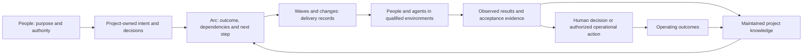

# Wavefoundry: Vision and Roadmap

**Wavefoundry gives one engineer or a small team the capacity of an exceptional engineering organization—to create, take over, improve, modernize, replace and sustain significant software systems. Its destination is an autonomous engineering laboratory that turns human intent into independently tested outcomes, carries substantial work across changing contributors and tools, and preserves the knowledge needed to care for the result. People retain control of purpose, consequential tradeoffs and authority, while routine coordination and execution require progressively less supervision.** This is the selected long-term destination; the full capacity remains to be demonstrated.

## Roadmap

Build toward the laboratory by connecting the dependable delivery that already works to larger outcomes, then earning greater responsibility through observed results. The six horizons describe increasing capability. They overlap: an arc can advance coordination while exposing the particular understanding or execution control it needs.

| Horizon | What becomes possible | Value along the way |
| --- | --- | --- |
| 1. Dependable delivery on the existing foundation | Plan, implement, review and accept useful changes with current agents, evidence and handoffs; qualify additional controls where a task needs them. | Teams keep a working delivery process and address specific operating limits. |
| 2. A living understanding of the system | Connect intent, behavior, code, decisions and operation, with provenance, freshness and uncertainty visible. | Better design and product decisions, safer modernization and less reconstruction during takeover. |
| 3. Arcs carried through useful waves | Carry a bounded outcome through dependent waves and contributor changes, returning consequential choices to its owner. | A small team completes larger work with less repeated explanation and coordination. |
| 4. Competing solutions and coordinated engineering | Explore materially different approaches and integrate a supported result across components or repositories. | Ambitious creation and transformation with less dependence on one untested design. |
| 5. Delivery and continuing stewardship | Deliver within authority, observe outcomes, and maintain, modernize or retire what no longer serves its purpose. | Software remains useful and dependable after its first release or original experts leave. |
| 6. Compounding engineering intelligence | Turn experience into methods and knowledge that improve later work across contributors and projects. | Fewer recurring failures, lower later effort and broader access to advanced engineering capacity. |

**The next advance is to carry one real outcome through the shipped Plan arc workflow, several useful waves and a contributor change.** Use current acceptance, retrieval and handoffs. Establish whether the connection helps the team decide what is ready next, preserve why it matters and adapt when an assumption changes. Arc planning now has a workflow and record convention; its effect on sustained delivery and human effort is still to be established.

This path rests on three connected propositions: existing delivery is a foundation worth extending; continuity can help a small team take on larger outcomes; and autonomy should expand with demonstrated capacity and continuing care. The sections below develop those propositions and the conditions under which they would fail.

## Give a small team greater engineering capacity

The enduring need is to turn intent into valuable software and remain responsible for it as conditions change. A team's scarce capacity is spread across understanding, decisions, coordination, implementation, verification and maintenance. Faster code generation helps. The larger opportunity is to carry a useful purpose through all of that work without making people manage an expanding fleet of agents.

The beneficiary is a small engineering team whose work would otherwise exceed its available expertise, attention or continuing capacity. A founder should be able to build and operate a sophisticated new product. An enterprise team should be able to improve or replace important systems while preserving the obligations they serve. A public-interest team should be able to sustain software beyond its original experts. Inherited systems are an important enterprise use case, alongside new development, improvement and deliberate replacement.

The operator reports that different agent systems already plan and implement waves, and that another agent can finish work an earlier one started. Installation and retrieval already perform useful existing-project discovery. Acceptance and lifecycle enforcement are established capabilities. The proposed gain is less work reconnecting successive deliveries to an outcome, its dependencies and unresolved decisions. It must be observed rather than inferred from the existence of another planning document.

An engineering lead is a likely adopter; whoever funds delivery and continuing operation is a candidate budget owner. A commercial entry segment remains open. Personal usefulness, internal platform value, paid engagements and public-interest stewardship can all serve the same product purpose. None is established as the best market by repository evidence.

### Make the value survive full-cost comparison

Financial value can come from earlier useful releases, reduced rework and incident cost, less repeated investigation and coordination, or engineering that becomes economical for the first time. Modernization can remove costly debt and obsolete dependencies without discarding working capabilities. More capacity or a faster release can be valuable even when labor does not fall; fewer hours are not a benefit if defects and later maintenance rise.

Nonfinancial value includes fewer interruptions, continuity when people leave, access to expertise, more time for judgment and software that remains dependable. Teams should be able to inspect their records and replace providers while retaining the meaning of their work.

Engineering evidence may become an enterprise asset: connect obligations, authorized decisions, changes, acceptance methods and later consequences. Test a concrete package with an engineering or change-management owner for better handover, clearer decisions or less review effort. Audit readiness is a qualification to earn for a named use, including completeness, tamper resistance, authenticated independence where needed and recipient acceptance. Willingness to pay for that package remains untested.

The sustainability hypothesis is an openly usable local foundation supported by paid services, qualified integrations or managed operation where customers want it. Internal funding and public-interest stewardship remain credible alternatives. Test whether an outside team voluntarily repeats substantial work and an owner accepts the full support and operating burden before committing to a business model. License and pricing choices are not settled here. Durable advantage would have to come from continuing usefulness, qualified integrations and knowledge that improves later action; accumulated records alone are not a moat.

## Connect intent to delivery without rebuilding what works

### Use the foundation already available

The repository now carries the 1.40.0 framework line and subsequent source changes. Its [project overview](docs/references/project-overview.md) and [architecture hub](docs/ARCHITECTURE.md) distinguish the framework product from each project's visible operating surface. Current source and targeted checks support the classifications below. Operating experience is attributed separately from reproduced behavior.

| Capability | Current position | Roadmap consequence |
| --- | --- | --- |
| Installation, orientation and retrieval | Working, with coverage and freshness limits. Setup, project maps, indexed retrieval and source navigation exist; the operator reports useful discovery in existing projects. | Reuse them and extend missing task-relevant relationships instead of repeating installation as a new capability. |
| Cross-agent work and handoff | Working, with host-dependent limits. The operator reports agents planning, implementing and finishing one another's waves. | Test continuity between useful outcomes and waves, while preserving successful handoffs. |
| Acceptance and lifecycle enforcement | Working within their declared scope. [Close gates](.wavefoundry/framework/scripts/lifecycle_gates.py) and [typed review records](.wavefoundry/framework/scripts/review_evidence.py) constrain completion, required approvals and review chronology. | Preserve the foundation. Additional controls need a concrete unmet requirement or observed failure. |
| Stronger execution and trust boundaries | Limited and environment-specific. Recorded reviewer identity is not authenticated organizational identity; separate contexts or model families alone do not establish access isolation. | Qualify stronger effect, artifact and evaluation boundaries when expanded authority requires them. |
| Project knowledge | Retrieval, code graphs and typed memory work, with incomplete relationships, staleness and retention costs. | Test whether a maintained task-relevant conclusion helps later decisions; stored volume does not establish understanding. |
| Vision and decision support | Authored workflows exist. Tensorwell and Solaris reports show useful choices and factual corrections, alongside framing and review costs. | Carry selected intent into delivery and check whether users need to explain it again. |
| Arc planning | [Plan arc](docs/prompts/plan-arc.prompt.md) and its skill ship, with one concise record, profile-aware naming and links to waves. | Use the workflow now. There is no need to invent another outcome record before testing continuity. |
| Sustained coordination across waves | Arc guidance, lifecycle records and handoffs provide groundwork. Reduced human coordination, accurate ongoing dependency handling and extended autonomous continuation remain unproven. | Demonstrate the integrated outcome before adding a scheduler, service or additional authority. |
| Wider engineering autonomy | Competing-candidate coordination, continuing cross-repository responsibility and transferable autonomous improvement remain proposed capabilities with partial groundwork. | Grow through discriminating demonstrations rather than extrapolate from isolated successful waves. |

[Arc naming and record paths](.wavefoundry/framework/scripts/record_paths.py) and [their maintained tests](.wavefoundry/framework/scripts/tests/test_arc_records.py) distinguish a shipped record mechanism from evidence that it improves team outcomes. This checkout has no authored `docs/arcs/` corpus at the time of this revision. That is an opportunity for a real application, not proof that the workflow is missing or ineffective.

The source-framework test receipt covers its declared framework inputs; it is not a test of every target product or a guarantee of future autonomous behavior. Agent-effort accounting also contains estimates: byte-based context and counterfactual exploration estimates are diagnostics, not observed productivity. Use actual human effort and accepted outcomes for the claims in this vision.

### Carry one outcome through arcs and waves

**Vision → Horizon → Arc → Wave → Change** connects long-term purpose to bounded delivery. A horizon can involve several arcs; an arc can require several waves; changes are implemented inside waves. Features can describe capabilities without becoming a required extra layer.

| Level | Decision it supports | Example in a target project |
| --- | --- | --- |
| Vision | What future matters and why? | A small team can build and sustain a sophisticated service. |
| Horizon | What useful capacity comes next, and what evidence permits advancing? | Customers can complete an important workflow reliably without staff assistance. |
| Arc | What bounded outcome should we carry through several increments? | Launch self-service onboarding, or replace it while preserving customer access. |
| Wave | What coordinated increment can we deliver and verify? | Deliver a pilot path for one customer group. |
| Change | What bounded work and acceptance does that increment require? | Add migration, implement recovery or validate the workflow with users. |

The target project owns its horizons and arc outcomes. Wavefoundry's Horizon 3 describes the coordination capability that helps deliver them. A target need not adopt Wavefoundry's product roadmap or invent a horizon for routine maintenance.

Plan arc keeps outcome, path, progress and next step in one lifecycle-named document under the configured arcs root. Waves remain at their own root and are linked rather than moved or duplicated. A distribution can use Epic terminology through its profile. Existing project-owned planning keeps its ownership; do not copy it into a competing tracker. A standalone wave remains legitimate without an arc.

The further capability to earn is continuity: after an accepted wave, another contributor can explain what the arc still needs, which dependency matters and why the next proposed increment follows. Progress must be supported by accepted work and observed outcomes; closed tasks alone do not establish an arc's benefit or a horizon's exit conditions. Derive summaries from the records that own those facts and expose contradictions.

No new scheduling service is required for that first demonstration. Use the existing arc record and handoff, following only references needed for the next decision. Add maintained state or automation for a demonstrated gap. The operator continues to choose consequential scope, priority and authority changes; an arc record does not authorize its later waves.

### Choose the contribution that helps the work

The laboratory destination and the need to connect long-term direction to useful delivery are selected. Different starting conditions can justify different immediate approaches:

- **Keep individual waves simple.** A team gives its preferred agent a bounded change, reviews the result and chooses the next task. Existing records and handoffs may be sufficient. This remains the better approach for small or unrelated work; an arc that merely renames it adds upkeep.
- **Carry an arc across waves.** A team chooses a new service, replacement or improvement outcome. Contributors use the same outcome, dependencies and accepted evidence to deliver successive increments and explain the next decision. This is the recommended next demonstration because it tests greater capacity using the shipped foundation. Its cost includes keeping the arc useful and current.
- **Deepen understanding when it blocks progress.** A team considering replacement establishes the current system's obligations, affected consumers and decision rights before selecting an intervention. This can lead the next arc step when missing knowledge is the binding constraint, without waiting for a universal enterprise model.
- **Offer assurance separately if demand warrants it.** A team might value an additional acceptance capability alongside another workflow. That requires evidence of incremental detection, adoption and upkeep, plus an evaluation boundary suited to that offering. It is an available hypothesis, not the selected next investment or a prerequisite to using current acceptance.

Compose execution from capable agents and tools; own the connection among intent, accountable decisions, acceptance records and continuity. Composition still leaves Wavefoundry responsible for the promises of its complete workflow. Discover control gaps as responsibilities expand rather than presume that another acceptance program or a new runtime is the first step.

### Compare complete workflows and integrate useful tools

Current official documentation, checked on 2026-11-08, shows substantial overlap around planning and engineering:

- [GitHub Spec Kit](https://github.com/github/spec-kit) supplies structured processes, reusable templates and documented outcomes for coding agents. A structured workflow alone is not a sufficient differentiation claim.
- [8090 Software Factory work orders](https://docs.8090.ai/modules/work-orders) connect requirements and blueprints with tasks, dependencies, parent/child relationships and pull requests. Its [codebase connection and Drift Bot](https://docs.8090.ai/codebase/overview) describe repository indexing and checks against requirements and blueprints. Compare the complete experience; traceability is already an offered capability.
- [AWS Transform for .NET](https://docs.aws.amazon.com/transform/latest/userguide/dotnet.html) documents modernization planning, transformation and build/test support within a defined scope. [Moderne](https://docs.moderne.io/) combines code analysis, recipes and agent tools for multi-repository modernization. Reuse qualified transformation capabilities when they fit instead of recreating every engine.

These are documented vendor capabilities, not Wavefoundry trials or comparative productivity evidence. The inference for Wavefoundry is to test a project-owned, portable connection from purpose through delivery and continuing care against the strongest feasible combination of agent, tracker, CI and engineering practice. Integrate that combination when it already serves the need. A tool's local or private deployment does not itself prove the complete workflow is cheaper or more dependable.

## Grow through useful horizons

Each horizon leaves value if later autonomy takes longer. Near horizons need concrete demonstrations; distant ones retain intended outcomes, important assumptions and conditions for advancing or reconsidering. Dates and numerical targets should follow a real mission or pilot, not decorate an uncertain future.

### Horizon 1 — Dependable delivery on the existing foundation

A team plans, implements, reviews and accepts bounded changes using its existing agents, with explicit evidence and handoffs. Much of this capability already works. For a selected arc, recover what current controls enforce and what its host supports, then deliver a useful wave under those controls. Another contributor continues with accepted evidence and outstanding decisions.

That establishes the working baseline. Existing success is a foundation to reuse. Where the next task introduces deployment effects, interruption, a new provider or greater autonomy, qualify the particular ownership, cancellation and recovery requirement before relying on it. Add a control for an observed need or a concrete scope requirement; a new control must demonstrate its incremental claim against an unchanged baseline, including relevant forbidden-effect or interruption cases.

Advance when the next work retains current controls and meets additional prerequisites. Failure limits the proposed expansion and identifies what must change. It does not erase working acceptance. Bounded delivery remains useful independently of extended autonomy.

### Horizon 2 — A living understanding of the system

An incoming maintainer can answer consequential questions and plan a difficult change without reconstructing everything. Connect code and documents with relevant APIs, schemas, service ownership, tests, deployment state and authorized incident or workload observations. Begin with the slice needed for the arc.

For new products, establish user needs, domain concepts and interface contracts. For replacement or takeover, establish current behavior, consumer dependencies and decision ownership. Distinguish declarations, observations and inferences; retain provenance, revision, freshness and unknown coverage. Business owners remain authoritative for business meaning. Integrate maintained catalogs and observability rather than introduce a second authority for their facts.

**Demonstration:** on an unfamiliar bounded subsystem, identify a proposed change's obligations and downstream effects, then check them against characterization tests and owner review. Deliberately change a consequential premise. The maintained knowledge must surface invalidated conclusions and the need for fresh evidence. Compare today's retrieval on that same relationship or freshness question; a stale but confident answer fails the new claim.

Include a case with undocumented behavior, disputed obligations or an unavailable outgoing expert. Identify affected consumers, decision rights, provisional behavior and unresolved exposure. Owner absence is not agreement. Advance where the resulting decisions are better grounded and later contributors can distinguish what remains unknown. This yields safer impact analysis and modernization even without broader autonomy.

### Horizon 3 — Arcs carried through useful waves

A team pursues a substantial outcome across several waves without one person continually reconnecting the plan and decisions. Use Plan arc's existing outcome, path, progress and next-step record. Make the next ready increment concrete, keep later work provisional, and carry accepted results, changed assumptions and unresolved questions to the next contributor.

A useful coordinator can explain ready and blocked work, propose a smaller route around an obstacle and show how a changed assumption affects the remaining outcome. The existing workflow guides this reasoning; accurate integrated continuity and its reduction of human effort still need demonstration. More autonomous continuation requires a separately explicit authority policy and qualified execution.

**First demonstration:** choose one real creation, improvement, replacement or takeover arc spanning multiple waves. Preserve normal acceptance and include a contributor or host change. Introduce a consequential finding—a missing dependency, failed approach or changed user need. The next wave should use accepted evidence and revised dependency order without the operator reconstructing them. Return scope or priority choices to the owner.

Compare operator coordination, repeated investigation, missed dependencies and accepted useful outcomes against the team's current workflow. Count arc upkeep and agent rescues. Advance when the connection meets its declared claim: lower total effort for comparable outcomes, or greater useful capacity within its agreed attention and resource budget, with quality preserved. Count added coordination and recordkeeping against that budget; clear documentation alone is not a benefit. If current handoffs already supply that benefit, preserve that result and address the next observed gap. Concealed rescue, unbounded retries or unsupported progress defeat the claim.

This can run serially under current activation policy. A clear supervised workflow remains useful if unattended continuation takes longer. Scheduling, durable effect reconciliation or a service should follow a demonstrated need, not precede this application.

### Horizon 4 — Competing solutions and coordinated engineering

A small team can seriously investigate plausible designs and complete cross-component or cross-repository work without betting everything on one generated solution. Contributors explore in isolated environments with explicit interfaces and integration ownership. Qualify independence at the actual evaluation boundary where the claim requires it; separate model names and review voices are insufficient.

The provisional demonstration is a consequential scaling, modernization or new-capability objective with meaningfully different approaches, a rejected but plausible candidate and an integrated result. Compare quality, compatibility, operating cost and maintainability under representative conditions. Use deterministic recipes, property testing, mutation, replay, fault injection or targeted formal methods where they address the actual claim.

Advance where the benefit of exploration exceeds its compute, evaluation and coordination cost and shared contracts support integration. Shared hidden errors, favored-only tests or deferred integration problems fail the claim. Existing activation policy remains binding until a deliberate design changes ownership, conflict handling and stopping rules. Better design choices provide value even before sustained operational autonomy.

### Horizon 5 — Delivery and continuing stewardship

A small team grows a new service or takes responsibility for an important existing system, delivering useful change while keeping it dependable and maintainable. Refactoring, debt removal, modernization and retirement count when they improve useful capacity, risk or cost. Weakly documented behavior must be understood before it is replaced.

The provisional demonstration is cross-component work, a rehearsed migration and authorized rollout, followed by an unrelated maintainer's change. Bind release artifacts to observed deployment. Use compatibility checks, limited rollout, stop conditions and recovery; name irreversible effects and compensation. An accountable service owner, permitted representative data, operating access and incident response are prerequisites to live effects.

During an agreed observation period, include an operating signal or dependency change while another mission is active. Identify affected obligations, reconcile the response with existing work and return priority or authority changes to the responsible person. The organization retains an operational fallback if Wavefoundry is unavailable or its authority is revoked.

Advance where useful outcomes survive operation and later maintenance, with total effort, incidents and cost supporting the claimed benefit. Compare the objective with doing nothing, a smaller change or a non-code intervention. A simulation is an early test, not production qualification. [Earlier modernization research](VISION-research.md#repeatable-transformations-can-beat-free-form-generation) preserves dated examples and their limits.

### Horizon 6 — Compounding engineering intelligence

The laboratory improves through experience while a project retains expertise across people and provider changes. Incidents, rejected approaches, operator corrections and successes become reproducible evaluations and reusable methods. Curated human learning is a valid beginning; automatic promotion requires its own evidence and authority.

The provisional demonstration is improvement on withheld projects or task families under comparable budgets, a different maintainer completing later work, and replacement of a qualified execution provider. Separate harness effects from better models, leaked examples and extra evaluator work. Keep protected cases, success criteria and promotion decisions outside the evaluated worker's control. Gains confined to remembered tasks, regressions elsewhere or founder rescue do not establish compounding capacity.

Advance when retained lessons improve later action and support costs remain sustainable. Outside maintainers must be able to adopt, upgrade, recover and leave. Cross-project sharing needs consent, provenance and retention rules; private source is not a default contribution. A commercial offering, internal platform or public-interest commons can share qualified methods without requiring a marketplace.

## Build for continuing responsibility

The laboratory must remain understandable and controllable as its responsibilities grow. Keep the project as owner of goals, source, accepted decisions, authority and durable evidence. Treat indexes, summaries and inferred models as derived state that can be rebuilt or corrected. Stable records should preserve why work happened and what was observed without freezing today's implementation into permanent process.

The diagram shows the intended connection, not an automatic execution engine. Arc documents describe outcomes and references; wave records and typed ledgers own lifecycle and review authority. Execution providers own their action semantics. Summaries must not create competing progress authorities or silently rewrite the vision. Every consequential effect needs an accountable owner and a recovery interpretation.

Preserve local-first use, project-visible contracts, canonical framework sources and operator-owned consequential choices. Plan, admission and readiness precede code edits. Current activation-scope policy and repository-wide lifecycle/publication locks remain binding. Some boundaries are mechanically enforced and others are operating instructions; qualification must establish which matters for a particular claim.

Compose qualified hosts, code intelligence and transformation engines through replaceable interfaces. A shared service, new runtime or language migration is justified by measured constraints and transition costs. Remote or organization-wide execution can serve the same product purpose, but requires authentication, isolation, revocation, policy ownership, support and migration. A local process account is not an organizational identity.

Unfamiliar repositories, comments, documents, issues and dependencies can carry hostile instructions, poisoned knowledge or executable supply-chain threats. Preserve the distinction between observed content and trusted authority. Enforce least privilege, authorized effects, dependency/build execution and data egress at actual boundaries; prompt persuasion and content filters are insufficient. Keep protected evaluation away from implementer control when required, bind evidence to its artifact and environment, and retain ways to invalidate poisoned derivatives. The [security research note](VISION-research.md#hostile-inputs-are-part-of-the-takeover-problem) motivates testing; it does not qualify a general defense.

Human inspection, stopping new work, recovery of ownership, export and deletion are product obligations. Retest integrations and remove ceremony or workarounds that no longer earn their cost. Authority design, record semantics, operational hosting and ecosystem contracts are costly to reverse; prototype their consequential boundaries before broad commitments. Endurance needs maintainers and sustainable support as well as architecture.

## Resolve the breakthroughs through real work

Five unresolved problems connect the roadmap to the full ambition:

- **Know what success means.** Recover user needs, business invariants and weak specifications without confusing a passing test with the right outcome. Human judgment remains necessary where evidence cannot determine values or obligations.
- **Understand enough to act.** Connect behavior, dependencies and operation with freshness, provenance, contradiction handling and honest limits, rather than promise a perfect model of every system.
- **Sustain justified action.** Reconcile partial effects, interruption, changing plans and authority across qualified providers without losing responsibility or hiding uncertainty.
- **Choose among plausible solutions.** Use experiments that discriminate under representative conditions and reveal shared mistakes, contaminated evaluation or candidates exploiting incomplete tests.
- **Learn beyond the example.** Promote methods that improve withheld work while preserving success criteria, promotion authority and evidence of regressions.

Research stages must name the uncertainty they retire, a stopping condition and the useful value they enable. None of these problems needs a universal solution before the next useful wave. A failed premise may change the method or domain; a proposed reduction of the selected destination returns to the operator.

### Pursue an ambitious year without inventing distant precision

A twelve-month push remains an aspiration for attempting the full destination, not a forecast or fixed release schedule. Early emphasis is one useful H3 arc with current H1 controls and the H2 understanding it needs. Next, repeat on contrasting creation and transformation work and attempt a consequential H4 comparison. Later, attempt H4/H5 across components or repositories, authorized operating observation and H6 learning where the evidence exists. Detail decreases with distance; outcomes and conditions for advancing remain explicit.

The critical path is **an accountable outcome owner → a meaningful arc and permitted environment → enough understanding to deliver a useful wave under current controls → continuity across waves and changed assumptions → coordinated experiments and authorized operational evidence → transferable improvement**. Beneficiary discovery, domain research, integration qualification and support arrangements can proceed in parallel. Access, service owners, permissions and sustainable support can gate value before engineering does.

Unlimited resources could fund independent alternatives to weak specification, maintained understanding and recovery problems, representative environments and qualified integrations in parallel. They cannot manufacture user trust, operating history or research results. Report completed demonstrations and unresolved exposure separately; a year of work cannot prove years of reliability.

## Measure useful capacity and total effort

The primary outcomes are **greater capacity for useful work accepted and sustained within a declared budget, or less total human effort for comparable outcomes, with quality and maintainability preserved in either case**. Retain the **10× reduction in operator time on a predefined portfolio of substantial missions** as a stretch ambition. It is not a universal threshold or an achieved result. Report capacity, accepted-outcome coverage, all-person effort, cost, quality and later maintenance alongside operator attention.

For the first arc, measure coordination time, repeated investigation, missed dependencies and accepted useful outcomes. Include record upkeep, setup, research, evaluation creation, support, review, incident response and subsequent maintenance. Fewer prompts are useful only if the work and decisions remain visible. Set decision thresholds prospectively after measuring the team's baseline; an existing effective handoff is a strong comparator, not something to make artificially weak.

Declare whether a demonstration tests efficiency on comparable work or greater capacity, responsibility or timeliness within a budget. Select the strongest feasible comparator, task classes, acceptance, budgets and observation window before judging results. Count failed attempts, abstentions, timeouts, abandoned work, human rescues and delayed regressions. Correct escalation is a successful outcome only when the declared task allowed it. Independent and held-out cases are needed where the breadth of the claim requires them.

### Change the path when the evidence changes

| Assumption to test | Discriminating evidence | Response if it fails |
| --- | --- | --- |
| Connecting horizons, arcs and waves helps delivery. | One real outcome across waves and a contributor change, compared with current coordination and upkeep. | Simplify the connection or keep the existing workflow; more hierarchy is not progress. |
| The outcome matters to its beneficiary. | A prototype, usable increment or operating result assessed by its intended user and accountable owner. | Change the approach or return the objective to its owner before expanding. |
| Greater delegation reduces real work. | Repeated bounded work with all-person effort, support, rescue and later maintenance included. | Retain useful supervised capability and reconsider the autonomy scope. |
| Knowledge remains useful as the system changes. | A later contributor acts after a consequential assumption has been invalidated. | Improve provenance and invalidation or retain less knowledge. |
| The complete workflow improves on alternatives. | Comparable work using the strongest viable agent, tracker, CI and engineering practice. | Integrate more, narrow the contribution or change the entry approach. |
| The next operating scope is controlled. | Representative interruption, forbidden-effect and hostile-input cases at its actual boundaries. | Limit that scope, repair the demonstrated gap and requalify. |
| Creation, improvement, replacement and takeover share enough foundations. | Contrasting real cases that expose the differences in obligation and evidence. | Support explicit case-specific paths instead of forcing one template. |
| Outside use can be supported sustainably. | A team repeats the work and an owner accepts the full support and operating burden. | Revise funding, support scope or distribution before wider commitment. |

Revisit after failed exit conditions, declined repeat use, a false success, loss of an essential provider capability or new beneficiary evidence. Explain what remains useful and which decision needs reconsideration. These triggers adapt the path; they do not silently reduce the ambition to workflow administration.

## Demonstrate department-scale responsibility

A participating team supplies an unfamiliar consequential system, or a demanding new product outcome, with explicit boundaries and a representative portfolio of continuing obligations. One engineer or a small team directs the work. Include substantial planned engineering, emerging maintenance or operational demand, and a consequential priority or resource conflict over a prospectively declared observation window.

For example, an enterprise team might ask the laboratory to support ten times a billing platform's traffic, keep infrastructure cost growth below 30%, preserve billing/API obligations, replace an obsolete integration and make migration recoverable. Those are imagined mission constraints, not Wavefoundry performance claims. The laboratory first tests whether they coexist and whether scaling is the right intervention. Business meaning and consequential compromises return to the responsible people.

Contributors investigate bottlenecks, compare optimization with redesign or staged replacement, build candidates and test compatibility and recovery. They integrate the supported result, carry work across interruptions and components, deliver within granted authority and observe use. A disconnect should leave the next contributor enough state to avoid an uncertain duplicate effect; unresolved effects require reconciliation rather than a confident restart.

People see alternatives, cost, evidence and the decisions that need them. The laboratory carries dependency coordination, routine replanning and qualified execution. Show what was completed, delayed, rejected or left exposed, and whether the decision queue and maintenance backlog stayed manageable within declared attention and resource budgets. A serial collection of successful projects alone does not establish this capacity.

A different maintainer later understands and improves the result. The laboratory performs better on new work because of what it learned, demonstrated independently rather than inferred from accumulated records. Compare accepted responsibility, timeliness, quality, full cost and later maintenance with the strongest feasible current workflow; supporting specialists' effort counts. Short exercises are early indicators, not years of stewardship.

For a new product, the same responsibility begins with a valuable user experience and testing its riskiest assumptions. Replacement adds compatibility, migration and deliberate retirement. Takeover adds fragmented knowledge and decision rights. In every case, people receive useful systems and meaningful decisions rather than a growing job supervising agents.

## Take the next useful steps

These are recommendations for subsequent planning. They grant no implementation, closure, commit or deployment authority.

1. **Apply Plan arc to one meaningful outcome.** Choose a creation, improvement, replacement or takeover outcome with an accountable owner. Ground that choice in an observed coordination difficulty or a prospectively declared capacity gain within the team’s attention and resource budget. Use the shipped record and link its relevant horizon, useful increments, dependencies and next wave. Recover evidence from existing records rather than duplicate task lists. Establish the team's current coordination baseline. The first value is a usable answer to what advances the outcome, what is blocked and which decision matters next—not a new planning mechanism.
2. **Carry it across contributors and a changed assumption.** Deliver useful waves under the current gates. Have another contributor recover the remaining outcome, accepted results and reason for the next proposal from the arc and its references. Include a real dependency or approach change. Compare repeated explanation, missed or repeated work and total upkeep. Preserve what current handoffs already achieve; address the next observed gap rather than rebuild that capability.
3. **Resolve the constraint that limits the next outcome.** It may be an uncertain user need, a business invariant, an adoption dependency, a migration seam or an operating limit. Architecture, security, modernization, reliability and performance work belong where they enable that outcome. Measure startup, memory, latency, recovery or maintenance burden before selecting a shared service, component replacement or language migration. Each investigation needs a discriminating test and useful continuation; no particular rewrite or runtime replacement is selected.

Alongside delivery, invite a willing team to choose a representative outcome and agree access, ownership, support, quality and full-effort observation. The [earlier downstream research](VISION-research.md#downstream-experience-and-design-partner-selection) identifies possible routes, not a committed partner. Internal work can test continuity immediately; user participation and domain authority are necessary for field value claims, and service owners and operating access for live stewardship. Without a partner, retain useful internal results and revisit the adoption hypothesis.

Declare a finite demonstration batch and continuation conditions before execution. Return evidence and options to the operator if a required outcome remains unproven at the stopping point. The first arc's concrete outcome and any later automation policy remain planning choices. Routine unrelated maintenance stays legitimate. Delivery evidence informs horizon progress; recording a vision revision remains Envision work or an explicit operator edit.

---

Owner: Engineering
Status: active
Last verified: 2026-11-08
Evidence: current repository source and attributed operator/field reports; selected official product documentation refreshed on 2026-11-08. No customer interviews, comparative productivity study or broad operational qualification ran for this revision. Historical [research](VISION-research.md) and [review](VISION-review.md) records remain unchanged and retain their original scope.
Adoption: existing canonical designation and operator-selected destination retained; roadmap proposals grant no implementation authority.
Review status (2026-11-08): product strategy, domain/workflow, senior architecture and independent challenge reviewed A; product, workflow and challenge verified B’s shared repair. No pending review repairs; delivery adds only this unreviewed status update. Separate contexts shared author framing; workflow also saw an earlier product summary. External adoption and support hypotheses remain open.
