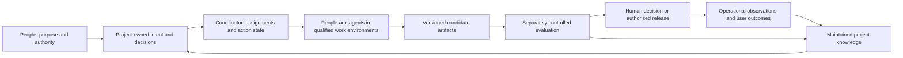

# Wavefoundry: Vision and Roadmap

Owner: Engineering
Status: active
Last verified: 2026-11-01
Adoption: canonical product vision and roadmap, adopted by the operator on 2026-10-29
Review status: on 2026-11-01, product strategy, domain workflow, senior architecture and independent challenge reviewed revision A; product, domain and challenge verified the affected repairs in B, with 0 pending material findings. Delivered revision 2026-11-01-C adds only this unreviewed status metadata; the historical [review record](VISION-review.md) covers earlier revisions only.

## The destination

**Wavefoundry gives one engineer or a small team the capacity of an exceptional engineering organization—to create, take over, improve, modernize, replace and sustain significant software systems. It becomes an autonomous engineering laboratory that turns human intent into independently tested outcomes, carries substantial work across changing contributors and tools, and preserves the knowledge needed to care for the result. People retain control of purpose, consequential tradeoffs and authority, while routine coordination and execution require progressively less supervision.**

This is the selected long-term destination. A founder should be able to build and operate a sophisticated new product. An enterprise team should be able to improve or replace important systems without losing the obligations they serve. A public-interest team should be able to sustain software beyond its original experts. Department-scale capacity means useful responsibility carried well, including continuing maintenance and competing demands; it is not a count of agents or generated changes.

### The path at a glance

| Horizon | What becomes possible | Value before the full destination arrives |
|---|---|---|
| 1. Dependable delivery on the existing foundation | Use the working lifecycle, acceptance and agent handoffs, qualifying additional execution controls where a larger task needs them. | Teams retain controls that already work and address specific operating limits without restarting their process. |
| 2. A living understanding of the system | Connect intent, behavior, code, decisions and operation, with freshness and uncertainty visible. | Better product decisions, safer improvement and replacement, and less reconstruction during takeover. |
| 3. Initiatives carried through useful waves | Carry a substantial outcome from a horizon through dependent waves and changes; return consequential decisions to the responsible person. | A small team completes larger work with less manual coordination across sessions and agents. |
| 4. Competing solutions and coordinated engineering | Compare materially different approaches and integrate the best-supported result across components or repositories. | More ambitious creation and transformation without betting everything on one untested design. |
| 5. Delivery and continuing stewardship | Deliver within authority, observe outcomes and maintain or replace what no longer serves the purpose. | Dependable products and services that keep improving after the initial release. |
| 6. Compounding engineering intelligence | Turn outcomes into methods and knowledge that improve subsequent work across contributors and projects. | Fewer recurring failures, lower later effort and wider access to advanced engineering capacity. |

**The next advance is a thin end-to-end demonstration of Horizon 3, using the existing Horizon 1 foundation and only the Horizon 2 understanding it needs.** Connect a meaningful initiative to its waves, dependencies, decisions and observed outcomes. Do not wait for a universal system model or another acceptance program before attempting useful work. The numbered horizons describe increasing capability, not six serial projects that must each finish completely.

**Status of these claims.** The destination and the need to connect long-term direction to team delivery are operator-selected. The detailed mechanisms and demonstration below are proposals. Unlimited development resources and a twelve-month push remain planning aspirations; demonstrations govern expansion, and resources cannot manufacture operating history, trust or research results. Later horizons are provisional. Current capabilities and evidence limits are identified below. This document grants no implementation, automatic closure, commit or deployment authority.

## Why this future is worth pursuing

The enduring need is to turn intent into valuable software and keep responsibility for it as conditions change. A team's scarce capacity is spread across understanding, decisions, coordination, implementation, verification and maintenance. Faster code generation helps, but it does not by itself connect a product's future to the next useful delivery or carry that purpose across months of changing contributors.

Wavefoundry already supplies a working lifecycle, acceptance gates, project orientation and cross-agent handoffs. The operator reports that agents plan or implement waves using different systems, and that another agent can finish work an earlier one started. These are strengths to extend. The next opportunity is to reduce the work a person does to connect successive waves into a substantial outcome: preserving the reason for the work, managing dependencies, surfacing consequential decisions and adapting the sequence when evidence changes it. That opportunity is a hypothesis to test on actual work, not a finding that today's handoffs fail.

**The intended beneficiary is a small engineering team taking on work whose breadth, complexity or continuing demands would otherwise exceed its capacity.** It may be creating a new product, improving a running service, replacing an obsolete system or inheriting one with fragmented knowledge. Inherited systems remain an important enterprise use case, but the product's purpose and first useful demonstration are not restricted to takeover. An engineering lead is a likely adopter; whoever funds delivery and continuing operation is a candidate budget owner. A commercial entry segment remains to be established through beneficiary evidence.

Current agents and existing engineering tools make a composed approach practical to attempt. [Agent Skills, MCP and AGENTS.md share open governance](https://www.linuxfoundation.org/press/agentic-ai-foundation-announces-four-new-projects-agent-skills-open-responses-openenv-and-opensandbox), which supports portability and reduces the value of format compatibility alone. It does not prove that complete engineering workflows are commodities. Wavefoundry must show that its combination improves a team's outcomes and effort.

Public evidence also argues for retaining verification as delegation grows. [OverclaimBench](https://arxiv.org/abs/2609.20812) reports incomplete file reviews and misleading completion claims in specific agent review scenarios. A [study of 23,247 agent-authored pull requests](https://arxiv.org/abs/2601.04886) identified 406 high-inconsistency descriptions; those PRs had a 28.3% acceptance rate versus 80.0% for consistent ones. That association does not establish why reviewers rejected them, the rate of undetected errors, or a failure rate for Wavefoundry. Such findings motivate task-appropriate controls; they do not establish that rebuilding acceptance is our best next investment.

The [earlier research](VISION-research.md) preserves dated comparisons and evidence. Its assurance-first recommendations are historical hypotheses superseded by the direction in this document. The consequential primary-source comparisons here were refreshed on 2026-11-01. Operator experience and the Tensorwell/Solaris reports establish bounded use and feedback, not customer demand or comparative productivity. In the latest supplied Tensorwell run, a guided operator decision changed roadmap priorities and a staged agent reader understood the opening and roadmap; two product-review findings were repaired. This supports further use of guided decisions and clear communication. Human comprehension, subsequent planning usefulness and broader efficacy were not measured.

Discovery should follow the work: examine a team's recent new development, improvements, replacements or takeovers; locate where people repeatedly reconnect intent, dependencies and unfinished decisions; and compare an initiative-based workflow with that team's strongest current approach. A willing outside team is needed for field claims, but its absence should not prevent a clearly labeled internal demonstration.

## The choice among different futures

The laboratory destination is already selected. The practical choice is how to approach it while preserving useful capabilities and avoiding a larger planning burden.

**Keep improving individual waves.** A team asks its preferred agent for a change, reviews and accepts the wave, and decides what to start next. Wavefoundry supplies the process and evidence while people connect the larger program. This is useful today, with the lowest additional coordination machinery. It remains the stronger approach for small or unrelated work. Its limit is that the team still carries the relationships between successive deliveries; a new hierarchy that merely renames that work adds little value.

**Connect and carry initiatives across waves.** A team chooses a meaningful outcome, such as launching a new service or replacing an obsolete component. Wavefoundry relates it to the relevant horizon, maintains the dependencies between waves, carries decisions and evidence between contributors, and proposes the next ready increment within the team's authority. People settle priority, scope and business tradeoffs. The team receives useful deliveries and a current account of what the outcome still needs. This is the proposed next advance because it directly tests greater engineering capacity while reusing acceptance and handoffs that already work. It introduces obligations for progress accuracy, dependency maintenance, revision history and proportionate planning; its value is unproven until it reduces coordination or enables work that was previously impractical.

**Derive continuity before maintaining more state.** The first initiative could be carried through a continuation brief assembled from existing outcome, wave, decision and handoff records. The next contributor receives the remaining outcome, accepted increments, unresolved dependencies and next-ready work without a new tracker. This may deliver the coordination benefit with less upkeep. It can also omit relationships that have no reliable owner or make repeated reconstruction expensive. Compare this option before selecting a maintained initiative representation; add durable state for demonstrated gaps, with one authoritative owner. Where a team already uses an effective tracker, test integrating with it rather than duplicating it.

**Lead with deeper system understanding.** A team evaluating a replacement finds the obligations the current system serves, the consumers that depend on them and the assumptions that need owner confirmation. Wavefoundry combines code, documentation and authorized observations to compare replacement with smaller improvements. People decide what behavior must survive. The value is better decisions before expensive change; obligations include freshness, provenance and honest unknowns. This is the right immediate priority when missing understanding is what blocks the selected initiative. It can proceed alongside coordination, rather than requiring an enterprise-wide model first.

**Offer independent assurance as a separate product.** A team keeps its existing workflow and receives an additional acceptance check for agent-made work. That would need its own evidence of incremental detection, adoption and upkeep, plus a qualified boundary protecting the evaluator where required. Existing Wavefoundry acceptance and review practice do not automatically qualify that separate offering. The operator has not selected it as the next investment, and no demonstrated gap justifies making it a prerequisite to sustained work. Keep it available if field needs warrant it.

The recommendation is to connect and carry initiatives, strengthening understanding where the actual outcome requires it. Compose execution from existing hosts and tools; own intent, accountable decisions, acceptance records and continuity. Discover and address concrete control failures as the scope expands rather than turn an unbounded assurance effort into the product's center of gravity. The sacrifice is that we will not initially offer universal unattended execution or a separate verification service.

Real alternatives include a team's preferred agent with its issue tracker, CI and human coordination; lightweight scripts; spec-driven workflows; and integrated platforms. [8090 Software Factory](https://docs.8090.ai/general/introduction) connects product requirements, technical blueprints and work orders. Its [Work Orders](https://docs.8090.ai/modules/work-orders) support parent/child tasks, dependencies and scheduled phases; its [Drift Bot](https://docs.8090.ai/codebase/overview) compares PR changes with requirements and blueprints. This is consequential overlap, not proof of a missing market. Its [CMS account](https://www.8090.ai/customer-stories/cms-claimscore) also describes source-linked legacy business-rule extraction; that vendor report is evidence of an approach, not independent qualification of completeness or outcomes.

Review and private deployment are also occupied categories. [CodeRabbit](https://www.coderabbit.ai/review) describes context-aware reviews and verification; [Qodo](https://www.qodo.ai/blog/why-your-ai-coding-agent-shouldnt-review-its-own-code-the-case-for-an-independent-verification-layer/) explicitly positions independent verification; [Factory Private](https://factory.com/deployment/factory-private) supports execution in customer infrastructure and customer-hosted control planes when needed. Vendor descriptions establish advertised capabilities, not measured effectiveness. Whether an issuer's evaluator is independent depends on its actual authority and access boundaries, not which company supplies it.

Wavefoundry's proposed advantage is a useful, project-owned connection from purpose through delivery and continuing care, portable across agents without requiring a hosted planning service. Local-first records and continuity are valuable commitments, not exclusive moats. Compare complete workflows and continuing upkeep, including integration with existing platforms. Do not replace IDEs, issue trackers, CI, observability or every runtime simply to own more layers. A simple fix should stay simple.

## From vision to delivered outcomes

**Vision → Horizon → Initiative → Wave → Change** connects purpose to execution. This is a proposed planning capability, not a claim that initiative tooling already ships.

An installed project owns its vision, horizons and initiative outcomes. The examples below describe that project’s product; Wavefoundry’s Horizon 3 describes the coordination capability that helps deliver it. An internal Wavefoundry initiative naturally advances this document’s horizons. A target project need not adopt Wavefoundry’s product roadmap or invent a horizon to use its wave workflow.

| Level | Responsibility | Example |
|---|---|---|
| Vision | Establish the product's enduring purpose and intended future. | A small team can build and sustain a sophisticated service. |
| Horizon | Describe a meaningful future capability and the evidence for advancing toward it. | Customers can complete an important workflow reliably without staff assistance. |
| Initiative | Pursue a substantial, bounded outcome that advances that capability. | Launch self-service onboarding, or replace the existing onboarding system while preserving customer access. |
| Wave | Deliver and verify a coordinated increment, containing its admitted changes. | Deliver a pilot path for one customer group. |
| Change | Define bounded work, requirements and acceptance within the wave. | Add account migration, implement recovery, or validate the new workflow with users. |

A horizon can involve several initiatives; an initiative can require several waves; changes are implemented inside waves. Features can describe capabilities delivered by this work without becoming a mandatory extra level. Specifications and architecture explain required behavior and design across the hierarchy; they are not additional containers. A standalone maintenance wave remains valid without an invented initiative or horizon connection. Relationships spanning initiatives need explicit dependencies, not duplicate ownership of the same work.

Each level must support a different decision. The vision explains why the future matters. A horizon explains what becomes possible and when to reconsider it. An initiative identifies the outcome, accountable owner, constraints, dependencies and evidence of value. Waves organize delivery and changes bound the work. Completing changes does not by itself establish a wave's intended outcome; completing waves does not by itself establish an initiative's benefit or a horizon's exit conditions.

The system should maintain these connections as work happens. A new discovery can change which wave should run next, expose an unmet prerequisite or show that a proposed feature no longer serves the initiative. Wavefoundry explains the consequence and proposes a response; the responsible person decides material scope, priority and authority changes. Evidence informs the roadmap without letting a wave silently rewrite the vision. Progress should be derived from accepted work and observed outcomes, with uncertainty and remaining obligations visible, rather than a second ledger agents must maintain by hand.

Start with one initiative and the existing wave process. The first version need not introduce a scheduler, a service, parallel waves or automatic commits. It can make the next ready work and its dependencies clear, carry relevant context to the next agent and return the few decisions that require people. More autonomous continuation requires explicit authority and qualified execution. The hierarchy earns adoption only if it reduces repeated coordination or makes larger work possible.

## What the product feels like

**The first week.** A small team chooses an outcome: build a new service, improve a working product, replace an obsolete subsystem or take responsibility for an unfamiliar one. Wavefoundry helps express an initiative, connects it to the relevant horizon and identifies a first useful wave. The team's existing agents and acceptance process deliver that increment. When another contributor continues, they receive the remaining outcome, relevant decisions, accepted evidence and unresolved dependencies. The engineer sees what is ready next and why, instead of assembling that picture from separate conversations. This is the experience to demonstrate, not a shipped initiative feature.

**The destination.** Imagine an enterprise team improving a billing platform, whether it built the platform itself or inherited it. Several business units depend on partly documented behavior. The team gives Wavefoundry an outcome:

> Make this platform support ten times the traffic. Preserve its billing and API obligations, keep infrastructure cost growth below 30%, replace the obsolete integration, and make the migration recoverable. Bring us the decisions that need our judgment.

These numbers are imagined mission constraints, not product targets or present capabilities. The system first tests whether they can coexist and whether scaling is the right intervention. It identifies which promises require business decisions, what evidence is missing and where access or a service owner is needed. It reconstructs the relevant system from code, history and authorized observations, using the installed map and retrieval already available.

Over days or weeks, specialist contributors investigate bottlenecks and obligations. Independent teams compare a modest optimization, a component redesign and a broader migration where those are credible alternatives. They build runnable candidates, replay representative workloads, test compatibility and failure recovery, and expose the tradeoffs. Mechanical transformations use established recipes. Candidates are checked against agreed acceptance through independently controlled evaluation, using protected holdout cases where the claim warrants them. A candidate that passes its own tests but fails such a holdout is rejected with the reason preserved; known-bad controls test whether the evaluator discriminates. Requirements and acceptance criteria remain available to implementers; protected evaluation does not mean concealing the obligations they must satisfy. Unknown business meaning returns to people; routine implementation decisions stay with the assigned contributors.

The operator sees objectives, alternatives, evidence, cost and consequential decisions. A promising approach may fail an independent test; its lesson informs the next experiment without hiding the failed attempt. A host disconnects; another contributor continues with current scope and observed effects, avoiding an uncertain duplicate operation. The team can stop work, inspect the reason for a choice, change constraints or recover ownership.

With explicit release authority and a qualified operational boundary, Wavefoundry rehearses the migration, coordinates component changes, observes a limited rollout and expands or stops against the agreed conditions. Irreversible effects have an explicit disposition; a promise to roll back does not substitute for one. Acceptance follows business behavior and operating outcomes, not the appearance of a finished report.

Months later, a different maintainer and model make the next change. They can explain why the design won, challenge expired assumptions and preserve the relevant obligations. The team can export its records and replace providers without losing the meaning of its work.

For a new product, the same loop begins with a concrete user need: establish a useful first experience, resolve the highest-risk assumptions, deliver successive capabilities and learn from actual use. For replacement, compare retaining and improving the current system with staged replacement; preserve obligations, migrate users or data and retire the old system deliberately. Takeover adds the recovery of fragmented knowledge and decision rights. These are different starting conditions for the same responsibility: create value and remain accountable for the result.

## Value and a sustainable product

Financial value can come from earlier useful releases, less rework and incident cost, reduced review and coordination effort, or engineering work that becomes economical for the first time. For an enterprise inheriting important systems, proposed benefits also include a shorter path to effective ownership, removal of costly debt and obsolete dependencies, and modernization without unnecessary replacement of working capabilities. These benefits must be measured separately: faster delivery can be valuable even when labor does not fall, and fewer labor hours are not valuable if defects or future maintenance rise. The proposed value must survive full-cost and quality comparison.

Nonfinancial value includes less interruption, more time for judgment and creative work, continuity when people leave, more accessible expertise and software that remains dependable. Teams should gain agency rather than depend on an opaque service. A successful product could also let maintainers sustain neglected public or internal software where direct revenue is limited.

**Engineering evidence is a potential enterprise asset.** Connect obligations, authorized decisions, exact changes, acceptance methods and later consequences. Test a concrete package with an engineering or change-management owner for reduced review effort, better handover and clearer decisions. Audit readiness requires qualification for a named use, including authenticated independence where required, tamper resistance, completeness and recipient acceptance. Willingness to pay remains untested; useful team records alone do not establish regulatory compliance.

The initial sustainability hypothesis is an openly usable local foundation with paid support, qualified integrations and, if customers want it, managed operation under explicit data and authority boundaries. Internal platform funding and public-interest stewardship remain credible paths. Test whether a team voluntarily repeats a substantial initiative and whether a budget owner will sustain its full operating and support cost. A useful supported engagement may come before a self-service commercial product. This is a business-model hypothesis, not a chosen license or price.

Possible durable advantages are well-maintained integration contracts, reliable delivery practice and project knowledge that demonstrably improves later work. A team's accumulated intent, decisions and outcomes can become more useful with continued stewardship, but accumulation alone can also create noise. Open contracts, migration and export should let teams replace tools without losing the meaning of their work. Recurring value should come from continuing usefulness rather than making history difficult to leave behind. None of these advantages is yet a proven moat.

## Starting point and the distance to travel

Wavefoundry 1.39.0 supplies canonical framework prompts, a local MCP server, code and document retrieval, a dashboard and a qualified packaging process. The [project overview](docs/references/project-overview.md) and [architecture hub](docs/ARCHITECTURE.md) distinguish framework source from each project's visible operating surface. The current [local-build record](docs/agents/session-handoff.md) reports qualification; this vision revision ran no product tests. Targeted source checks and attributed operating experience support the classifications below, not effectiveness for every team or task.

| Capability | Status and evidence | Consequence for the roadmap |
|---|---|---|
| Installation, orientation and retrieval | Working, with coverage limits. Installation and setup establish project context, maps and indexes; the operator reports that this already performs useful existing-project discovery. | Reuse it. Extend specific missing relationships or observations rather than repeat installation as a new capability. |
| Cross-agent and cross-host work | Working, with host-dependent limits. The operator reports different agent systems planning, implementing and finishing one another's waves. | Build on successful handoffs; investigate the coordination between waves rather than assume handoff is absent. |
| Acceptance and lifecycle enforcement | Working. [Close checks](.wavefoundry/framework/scripts/lifecycle_gates.py) refuse unresolved AC/task states, missing current required approvals and an unproven applicable framework test receipt. [Typed review records](.wavefoundry/framework/scripts/review_evidence.py) enforce declared chronology, actor/context constraints and affected-review freshness. Deliberate deferrals and operator decisions remain explicit. | Preserve this foundation. Additional acceptance work needs a concrete unmet requirement or observed failure; it is not the default first initiative. |
| Stronger trust boundaries | Limited and context-specific. Review context declarations are not caller authentication. The source-repository test receipt attests its framework inputs, not arbitrary target products; packaged targets do not run that framework suite. | Qualify stronger isolation, artifact identity and protected evaluation when a proposed authority or operating environment requires them. Existing enforcement remains real within its scope. |
| Code intelligence and project memory | Working, with limitations. Retrieval, graphs and typed memory exist; derived relationships can be incomplete or stale and retention can outgrow usefulness. | Extend task-relevant understanding and measure later usefulness. Counts of stored facts or graph edges are not evidence of understanding. |
| Envision and decision support | Working as authored workflows, with bounded field reports. Tensorwell and Solaris runs exposed useful choices and factual corrections, alongside framing and review costs. | Carry selected intent into later planning and delivery; test whether this saves the team repeated explanation. |
| Agent-effort accounting | Estimated in part. Byte-based context estimates and counterfactual exploration savings are diagnostics, not observed productivity. | Measure actual human coordination, maintenance and full cost for initiative claims. |
| Initiative planning and sustained coordination | Not yet established as an integrated product capability. Waves, pause/resume, handoff and work areas are groundwork; a maintained connection from horizons through initiatives to successive deliveries is proposed. | Demonstrate a narrow connection on real work before adding scheduling, services or another artifact hierarchy. |
| Competing solutions, cross-repository delivery and continuing organizational autonomy | Proposed capabilities with partial groundwork in existing agents and tools. Current lifecycle constraints remain binding. | Compose qualified tools and grow through demonstrations rather than claim department-scale operation from isolated successful waves. |

**Binding commitments and current choices.** Local-first operation without a hosted dependency, project-visible contracts, canonical framework sources, typed review authority and operator-owned consequential decisions remain commitments. Plan/admit/ready precedes code edits; one OPEN wave per activation scope and repository-wide lifecycle/publication locks remain current contracts. Initiative planning cannot bypass them or confer commit, closure or release authority. Some constraints are enforced by tools or host hooks; others remain operating instructions. A local agent account is not an authenticated organizational identity.

Python, stdio, the current SQLite/index arrangement and the current packaging topology are implementation choices. Change them when measured constraints justify it. Remote execution, shared services and organization-wide operation can support the same purpose, but introduce explicit ownership, authentication, isolation, support and migration obligations. Adding a planning layer does not silently change those commitments.

## Breakthroughs that make the ambition real

The largest gap is not generating more code. It is sustaining justified action through ambiguous goals, incomplete knowledge, long sequences and real consequences. Five research and engineering problems connect the destination to the horizons:

- **Know what success means.** Translate intent into challengeable acceptance without confusing a passing test with solving the right problem. Research specification discovery, business invariants and uncertainty calibration; use human decisions where evidence cannot determine values or obligations.
- **Understand enough to act, and know what is missing.** Connect behavior, dependencies and operational evidence without pretending to possess a perfect replica. Establish freshness, provenance, contradiction handling and prediction limits on task-relevant slices.
- **Sustain execution without losing control.** Reconcile partial effects, interruption, authority and changing plans across qualified providers. Unfamiliar repositories, comments, documents, issues and dependencies can carry hostile instructions, poisoned knowledge or executable supply-chain threats. Keep observed content separate from trusted authority and test enforcement at the actual effect boundary; a persuasive prompt or a content filter is insufficient. The [security research note](VISION-research.md#hostile-inputs-are-part-of-the-takeover-problem) motivates this boundary without qualifying an implementation.
- **Choose well among plausible solutions.** Compare materially different approaches using independent experiments, representative conditions and honest accounting. Detect shared mistakes, contaminated evaluation and candidates that exploit incomplete tests.
- **Learn without certifying ourselves.** Convert incidents, rejected experiments and outcomes into improvements that survive withheld cases and changing models. Keep success criteria and promotion authority separate from the system proposing the change.

None must be solved universally before delivering value. Each horizon attacks a bounded part and leaves useful capability behind. Repeated evidence against a necessary premise should trigger an explicit decision about the destination or domain; lack of current proof alone does not.

## Horizon 1 — Dependable delivery on the existing foundation

**Useful capability:** a team can plan, implement, review and accept bounded changes using its existing agents, with explicit evidence and handoffs. Much of this foundation already works. Preserve it while identifying the specific execution limits that matter for a larger initiative.

For the first initiative, record what the existing workflow already enforces and what the selected host actually supports. Reuse successful review, acceptance, pause and handoff mechanisms. Where the task crosses partial effects, a new provider, a deployment boundary or greater autonomy, qualify cancellation, effect ownership and recovery for that scope. Add a missing control only when the task exposes the need. A container or a different model family does not by itself establish independence; any stronger boundary must constrain actual access and authority.

**Demonstration and exit:** deliver a useful bounded wave under current gates, then continue with another contributor using its accepted evidence and outstanding decisions. This establishes the baseline for the initiative, not a new handoff claim. If a new execution capability is needed, demonstrate that specific increment against an unchanged baseline, including the relevant interruption or forbidden-effect case in a disposable environment. Existing success counts as a foundation to reuse, not a test that must be made to fail.

Advance within the demonstrated scope when the next work can retain the current controls and satisfy its additional prerequisites. Failure of an expanded execution claim limits that expansion; it does not erase working acceptance. Routine changes remain useful even if sustained autonomy takes longer.

## Horizon 2 — A living understanding of the system

**Useful release:** an incoming maintainer can answer consequential questions and plan a difficult change without reconstructing everything. Connect the existing code and document retrieval, graph and project records to the relevant APIs, schemas, service ownership, tests, deployment state and authorized incident or workload evidence.

Begin with the slice needed for the selected initiative, not an enterprise-wide model. For a new product, this may be user needs, domain concepts and a small set of interface contracts. For replacement or takeover, it may include current behavior, consumer dependencies and decision ownership. Distinguish declarations, observations and inferences; attach provenance, revision, freshness and unknown coverage. A business owner remains authoritative for business meaning. Integrate maintained catalogs and observability rather than establishing competing sources of truth. Representative data, privacy permission and an available domain owner can gate progress before any engineering dependency does.

Code intelligence should be composed or owned according to its contribution to useful understanding. Compare the current extractor with maintained index formats or graph services on the initiative's actual questions; the [earlier comparison](VISION-research.md#composable-code-intelligence) supplies candidate approaches, not a selection. Stabilize the interfaces needed for replacement and report confidence, freshness and coverage honestly. Curate memory based on whether it changes a later decision or avoids repeated investigation, rather than making a global memory cleanup a prerequisite to every initiative.

**Demonstration and exit:** on an unfamiliar but bounded subsystem, identify the obligations and downstream effects of a proposed change, then check them against independent characterization tests and owner review. Deliberately change a consequential premise; the maintained model must surface invalidated conclusions and the need for fresh evidence. Contrast against today's retrieval on this exact freshness or relationship question. A complete-looking but stale answer, hidden coupling or overconfident extrapolation fails its claim.

Include a takeover case in which a consequential legacy behavior is undocumented, affected owners disagree, or the outgoing expert is unavailable. Distinguish observed behavior, stated obligation and inference; identify affected consumers and decision rights; present a concise choice with compatibility and operating consequences. Preserve a justified provisional behavior or pause the dependent effect until an accountable decision is made. Record unresolved exposure, outgoing-expert assistance and stakeholder decision effort. Owner absence is not agreement. This horizon enables safer modernization and impact analysis independently of autonomy, and can advance alongside H1.

## Horizon 3 — Initiatives carried through useful waves

**Useful release:** a team can pursue a significant outcome across several waves without one person continually reconstructing the plan, reconnecting decisions and restarting every conversation. The initiative links the relevant horizon to the waves that deliver it; each wave contains its changes. People retain meaningful decisions and existing approval boundaries.

Start with an outcome and accountable owner, constraints, a bounded first increment, dependencies and evidence of benefit. Keep detail proportional to distance: make the next ready wave concrete and later work provisional. Use current planning and lifecycle tools rather than maintain a competing tracker. Carry accepted outcomes, unresolved questions and changed assumptions to the next contributor. When a wave completes, distinguish evidence that advances the initiative from mere completion of its tasks.

A useful coordinator can identify ready work, explain why another wave is blocked, propose a smaller route around an obstacle and show the effect of a changed assumption on the remaining outcome. It does not turn an initiative's existence into permission to execute all its waves. The operator selects consequential scope, priority and authority changes; routine continuation can become more autonomous only within an explicitly authorized policy. Vision revisions remain Envision work or explicit operator edits.

**First demonstration and exit:** use one real creation, improvement, replacement or takeover initiative spanning multiple waves. Preserve the normal acceptance gates and involve a contributor or host change. Include a consequential new finding: a dependency is unavailable, an approach fails or a user need changes. Show that the next wave uses the accepted evidence, relevant decisions and revised dependency order without the operator reconstructing them. Return any scope or priority choice to the owner. Compare operator coordination time and missed or repeated work with the team's existing approach; count time spent maintaining the initiative record and all agent rescues. Continue when the connection improves the chosen outcome or reduces coordination without degrading quality or adding more recordkeeping than it removes. If current handoffs already do this, preserve that evidence and address the next observed gap instead.

This bounded version can run serially under today's one-OPEN-wave rule. Later demonstrations can add extended unattended work, durable action reconciliation and scheduling through qualified existing providers where needed. Concealed rescue, repeated unbounded retries, unsupported progress claims or bypassed approval defeats the claim. A clear, supervised initiative workflow remains useful even if broader autonomy is delayed.

## Horizon 4 — Competing solutions and coordinated engineering

**Useful release:** a small team can seriously explore several plausible designs and complete changes spanning components or repositories without betting the program on one generated solution.

Independent contributors investigate alternatives in isolated environments with explicit interfaces and integration ownership. Compare candidates against acceptance that implementers cannot rewrite. Reuse deterministic recipes for mechanical transformations and combine property testing, mutation, replay, fault injection or targeted formal methods where they address the actual claim. More review voices alone do not establish independent evidence.

The provisional demonstration is a consequential scaling, modernization or capability objective with at least two meaningfully different approaches, a rejected but plausible candidate and an integrated result. Compare quality, compatibility, operating cost and maintainability under representative conditions. A superficially parallel run that shares the same hidden error, tests only favored cases or defers every integration problem fails its claim.

Advance where the benefit of exploration exceeds its compute, evaluation and coordination cost, and shared contracts support reliable integration. The single-OPEN-wave rule remains in force until an explicit lifecycle design establishes concurrent ownership, conflict detection, integration scheduling and stopping rules. This horizon improves high-consequence design choices even if sustained stewardship remains limited.

## Horizon 5 — Delivery and continuing stewardship

**Useful release:** a small team takes responsibility for a significant inherited system or grows a new one, delivering useful changes while keeping service dependable and the result maintainable. Refactoring, debt removal, modernization and retirement are outcomes when they improve useful capacity, risk or cost, not when they merely rewrite code.

For weakly documented systems, establish important behavior and obligations before replacing them. Stage changes around compatibility and integration seams. [Migration experience and incremental-modernization guidance](VISION-research.md#repeatable-transformations-can-beat-free-form-generation) support hybrid recipes, agents and human decisions rather than free-form generation alone.

The provisional demonstration is a cross-component modernization, rehearsed migration and authorized rollout, followed by an unrelated maintainer's change. Bind release artifacts to observed deployment; use canaries, explicit stop conditions and recovery where appropriate. Name irreversible effects and compensation. An operational partner, permitted representative data, incident responder and accountable service owners are prerequisites to live effects.

During an agreed observation period, include an operating signal or dependency change that invalidates an assumption while another mission is active. Identify the affected obligation, propose a bounded response, reconcile it with current work and obtain the named human decision when priority or authority changes. The organization retains an accountable service owner and operational fallback when Wavefoundry is unavailable or its authority is revoked.

Also test the value of the objective itself. Compare the request with doing nothing and a smaller or non-code intervention; people choose consequential tradeoffs. Advance where useful outcomes survive operation and later maintenance, and total effort, incidents and cost support the claimed benefit. A simulation cannot alone qualify production.

## Horizon 6 — Compounding engineering intelligence

**Useful release:** the laboratory becomes more capable through experience, while a project keeps its expertise as contributors and providers change. Incidents, failed approaches, operator corrections and successful outcomes become reproducible evaluations and qualified reusable methods.

Version candidate changes to retrieval, prompts, planning, evaluation, models and orchestration. Keep protected holdouts, success criteria and promotion decisions outside the evaluated worker's control. Curated human learning is a valid initial mechanism; automatic promotion needs its own evidence and authority. A stored lesson earns retention by improving later action.

The provisional demonstration is improvement on withheld projects or task families under comparable budgets, alongside a different maintainer completing subsequent work and replacing a qualified execution provider. Separate harness effects from model improvements, leaked examples and additional evaluator effort. Gains that disappear outside remembered tasks, degrade other outcomes or depend on founder rescue do not establish compounding capacity.

Wider access grows from repeatable demand and supported contracts: an internal utility, commercial offering or public-interest commons can share qualified adapters and methods without a marketplace. Cross-project sharing requires consent, provenance and retention rules; private source is not a default contribution. Outside maintainers must be able to adopt, upgrade, recover and leave.

## Architecture for endurance

Keep the project as the owner of its goals, source, accepted decisions, authority and durable evidence. Treat indexes, summaries and inferred models as derived state that can be rebuilt or corrected. Execution state records what was attempted and observed; it cannot enlarge project authority. Every consequential effect needs a stable identity, an accountable owner and a recovery interpretation.

The connection between intent, decisions, delivery and consequences is the product's center of gravity. The proposed initiative layer owns the intended outcome and dependencies; wave records own their lifecycle and accepted changes; execution providers own observed action state. The vision remains the long-term direction. Avoid competing progress authorities: derive summaries from their owners, preserve provenance and expose disagreement. Changes to scope or purpose require the accountable decision, not an automatic upward rewrite.

Acceptance remains part of this connection. Its independence requirements scale with the claim and authority being exercised. If a future offering judges work from an external executor, qualify its artifact identity and evaluation boundary without relying on lifecycle steps that executor never followed. That is a distinct qualification, not a reason to describe today's acceptance as absent.

Implement these boundaries first through local files and qualified existing tools with explicit contracts. Introduce a service only when a demonstrated coordination or reliability need warrants it. Local operation remains useful. Remote execution or organization-wide collaboration is an optional expansion requiring authentication, isolation, secrets handling, revocation and policy ownership; today's process account is not an authenticated organizational identity.

Retain portable, versioned records with documented migration and export. Keep evaluator inputs and protected holdouts away from implementer write access. Retrieved and retained content remains data with provenance, not permission to expand scope or alter acceptance. Enforce least privilege and effect authorization outside the worker model; constrain dependency and build execution and data egress separately from instruction screening. Review promotion of inferred knowledge into trusted decisions, and preserve a way to invalidate poisoned derivatives. Test layered controls against defined attacks and report residual exposure. Bind evidence to artifact, environment and evaluator versions; separate recorded approval from observed correctness. Additional reviewers using the same model can supply separate judgments, but their agreement alone does not establish independent empirical validation.

Keep models, hosts and code-intelligence engines replaceable at narrow interfaces that reflect actual needs. Build capability negotiation and clear degraded behavior when an adapter cannot cancel, isolate or resume work. A human must always have a usable way to inspect state, stop new work and recover ownership. Retention and deletion are product obligations.

Qualify existing runtimes, index formats and enterprise integrations before building substitutes. Shared skills or MCP compatibility do not establish equivalent effect, recovery or authority semantics. Periodically retest and remove workarounds and ceremony that no longer earn their cost; enduring project contracts should not freeze today's agent limitations into permanent process.

The costly commitments are authority design, record semantics, operational hosting and ecosystem contracts. Prototype them before broad distribution and keep migration obligations visible. Durability also needs maintainers, support funding and a way to retire obsolete integrations.

## A twelve-month push with evidence on the critical path

Use the year to attempt the full destination through an expanding set of real demonstrations. Do not turn it into fixed release dates.

| Window of emphasis | Integrated outcome to attempt | Work that can proceed in parallel |
|---|---|---|
| Early: one useful initiative | A thin H3 path connects a horizon to multiple waves and their changes, using current H1 controls and task-relevant H2 understanding. | Beneficiary discovery, a representative new-build or transformation task, bounded operating-cost diagnosis and evidence-package feedback. |
| Middle: broader outcomes and sustained execution | Repeat H3 on contrasting creation and transformation work; deepen H2 where needed and attempt the first H4 competing-candidate comparison. | Provider qualification, domain research, operational partnerships, migration rehearsals and adoption support. |
| Later: the full demonstration | H4/H5 across services and repositories, observed authorized delivery and subsequent maintenance; H6 withheld improvement where evidence exists. | Distribution and support experiments, provider replacement, external-maintainer trials, long-term follow-up. |

The critical path is **an accountable outcome owner → a meaningful initiative and permitted environment → enough understanding and current acceptance to deliver a useful wave → continuity and dependency handling across waves → coordinated experiments and authorized operational evidence → transferable improvement**. External users, business owners, distribution, representative observations and sustainable support can gate value before engineering does. Internal work can establish mechanisms; field claims require a participating team.

With unlimited resources, fund independent alternatives to the hardest problems: weak specifications, trustworthy evaluation, maintained understanding and recovery across partial effects. Build representative environments and qualified integrations in parallel, with domain specialists and independent evaluators. Some experiments will fail; their purpose is to discriminate among approaches, not to produce a favorable demonstration at any cost.

Twelve months cannot prove years of reliability or guarantee a research breakthrough. Report completed demonstrations, early indicators and unresolved exposure separately. Delay or failure of a horizon may change the method, sequence or supported domain; changing the destination returns explicitly to the operator.

## How we will know whether it is working

Use a small set of beneficiary outcomes: **more useful changes accepted and sustained, less total human effort for comparable work, and preserved or improved software quality and maintainability**. Aim for a **10× reduction in operator time on a predefined portfolio of substantial missions** as a stretch ambition, measured alongside capacity and quality rather than treated as a universal threshold. Operator time alone cannot establish department-scale capacity: also report accepted-outcome coverage, all-person effort, cost, quality and later maintenance. Set each pilot's decision thresholds prospectively after measuring its baseline.

For the first initiative demonstration, measure **operator coordination time, repeated investigation, missed dependencies and accepted useful outcomes**, alongside quality, total effort and initiative upkeep. Count prompts needed to restore context or reconnect decisions, but do not treat fewer messages as success if unresolved issues are hidden. Establish the existing workflow baseline before claiming improvement. Acceptance-specific measures belong where a concrete acceptance change is proposed.

Declare whether a demonstration tests efficiency on comparable work or expanded capacity, responsibility or timeliness within a budget. Do not switch claims after seeing results. Compare the team's strongest viable existing workflow, selected prospectively. Predeclare task classes, difficulty, acceptance, budgets and observation windows. Count failures, abstentions, timeouts, rescues, abandoned work and delayed regressions. Correct escalation is successful only for a task whose declared outcome allowed that decision.

Measure operator attention separately from all-person work: setup, evaluation creation and upkeep, support, review, incident response and maintenance all count. Track compute and infrastructure expense. Compare quality by severity and report uncertainty; zero severe failures in a small pilot cannot establish safety. Include later follow-up work by a different maintainer so immediate speed does not conceal future cost.

Independent acceptance must exercise real behavior, identify the tested artifact and detect known-bad controls. Repeated trials and held-out cases are necessary for broad capacity or learning claims. No present evidence justifies general autonomous reliability, commercial demand, a productivity multiplier or the ability to predict every operational consequence.

## What would change the direction

| Risky assumption | Discriminating experiment | Consequence if it fails |
|---|---|---|
| Linking horizons, initiatives and waves improves delivery. | Carry one outcome across waves and a contributor change; compare coordination, repeated work and upkeep with today's workflow. | Simplify the connection or keep the existing workflow; more hierarchy is not progress. |
| The selected initiative serves a real beneficiary outcome. | Review a prototype, usable increment or operating result with the intended beneficiary and accountable owner. | Change the approach or return the objective to its owner before expanding delivery. |
| Greater delegation reduces real work rather than hiding it. | Repeat bounded work with all-person effort, support, rescue and later-maintenance accounting. | Retain useful supervised capabilities and reconsider the autonomy scope. |
| Current controls cover the next operating scope. | Qualify the new effect or authority boundary against representative failure cases before relying on it. | Limit that scope and repair the demonstrated gap; do not generalize either success or failure beyond it. |
| System knowledge remains useful as code and contributors change. | A new contributor makes a later change after a deliberately invalidated assumption. | Improve provenance and expiry or retain less; do not claim understanding from stored volume. |
| An integrated workflow beats existing alternatives. | Compare a complete initiative with the strongest feasible combination of agent, tracker, CI and engineering practice. | Compose more, narrow the contribution or change the entry rather than add ceremony. |
| Hostile material cannot turn access into unauthorized effects. | In a disposable unfamiliar-code fixture, test instructions in retrieved content and a malicious build/dependency action against the actual boundary. | Constrain access and effects, repair and requalify; limited coverage is not a general security proof. |
| Creation, improvement, replacement and takeover share enough foundations. | After the first useful demonstration, test a contrasting case and record what must differ. | Support explicit case-specific paths rather than force one template onto all work. |
| Evidence and continuity justify ongoing support. | An outside team repeats use and an owner accepts the full support and operating burden. | Revise funding, support scope or distribution before wider commitment. |

The hardest unresolved research is recognizing the right problem, obtaining sound evidence where specifications are weak, reconciling partial effects and separating useful learning from shared error. An initiative should expose the next uncertainty without making its intermediate value depend on solving all of them.

Revisit the path when an initiative fails to deliver its intended value, a horizon's exit conditions fail, a beneficiary declines repeat use, a false success is discovered, a provider loses essential capabilities or new evidence changes the opportunity. Explain what remains useful and which decision needs reconsideration. Changes in implementation or business model need not reduce the destination; shrinking it to workflow administration would be an explicit strategic choice.

## Immediate advances toward the destination

These priorities extend current strengths. They are a recommended path for subsequent planning, not an implementation authorization or duplicate backlog.

1. **Connect one meaningful initiative to its waves and changes.** Select a creation, improvement, replacement or takeover outcome with an accountable owner. Relate it to the relevant horizon, define evidence of useful progress and identify its next deliverable wave and consequential dependencies. Reuse existing change plans, wave state, review evidence and handoff rather than create a second source of truth. The first useful increment lets the team see what advances the outcome, what is blocked and what decision is needed next. Test a continuation brief derived from current records before choosing new maintained initiative state; record which outcome or dependency facts are absent, ambiguous or costly to reconstruct. The brief carries context and gains no separate lifecycle authority. This is the thin H3 demonstration; continue only if that information helps the work and does not create disproportionate upkeep.

2. **Carry that outcome across contributors and a changed assumption.** Extend today's working handoffs with initiative context: accepted results, remaining obligations, the reason for the next wave and unresolved decisions. Use a real dependency or approach change to test whether the plan adapts without losing purpose. Preserve existing stage gates and operator ownership; automatic execution, closure and commits are not implied. Compare against how the operator currently coordinates several agents. The incremental claim is less manual reconnection across waves, not the discovery of cross-agent handoff itself.

3. **Add the understanding or operating improvement the initiative actually needs.** For new work, test a user need or design assumption; for existing systems, establish a consequential invariant, dependency, migration constraint or stale conclusion. Reuse retrieval and memory. Architecture, security, modernization, reliability and performance work belongs here when it enables the outcome. Measure startup, memory, latency, recovery or maintenance burden before choosing a shared service, component replacement or language migration. No Rust/Go rewrite, graph-service extraction or runtime replacement has been selected. Each investigation names the uncertainty it retires and the next useful value it enables.

**Alongside delivery, establish beneficiary and support evidence.** Internal work can test coordination immediately. Recruit a willing team for external evidence and choose a representative outcome it values; do not require takeover if creation or replacement is the better test. Agree permission, access, ownership, quality and total-effort measures. The [earlier downstream evidence](VISION-research.md#downstream-experience-and-design-partner-selection) identifies possible routes, not a committed partner or demonstrated demand. User participation and domain authority gate claims about useful outcomes; service owners and operating access gate live stewardship. If no partner participates, retain useful internal results and revisit the adoption hypothesis.

Declare one finite demonstration batch and its continuation criteria before execution. Include failure, abandonment, manual rescue, record upkeep and later repair; compare the existing workflow rather than inventing a weak baseline. Return evidence and options to the operator when the batch stops with a required outcome unproven. No automatic expanding evaluation program is implied.

The first initiative, its exact representation and its continuation policy remain to be selected through planning. Feature/story artifacts and cross-initiative ownership are design choices, not mandatory additions here. Once relevant, each change should be traceable through its wave to the outcome it advances; unrelated maintenance remains legitimate. Delivery evidence informs horizon progress, while recording a vision revision remains Envision work or an explicit operator edit.

## The ultimate demonstration

An independent participating team supplies an unfamiliar, messy and consequential system, or a demanding new product outcome, with explicit boundaries and a representative portfolio of continuing obligations. One engineer or a small team directs the work. The portfolio includes substantial planned engineering, emerging maintenance or operational demand, and a consequential priority or resource conflict over a prospectively declared observation window.

Wavefoundry investigates, compares real alternatives, carries coordinated implementation across interruptions and components, verifies independently, delivers within granted authority and measures the result in use. People choose business priorities and consequential tradeoffs; the laboratory carries dependency coordination, routine replanning and qualified execution. Show what was completed, delayed, rejected or left exposed, and whether the operator's decision queue and maintenance backlog remained manageable within the declared attention and resource budgets. A serial collection of successful projects alone does not establish department-scale capacity.

A different maintainer can later understand and improve the result. The laboratory performs better on new work because of what it learned, with that benefit demonstrated independently. Compare accepted responsibility, timeliness, full all-person cost, quality and later maintenance against the strongest feasible current workflow; expose any supporting specialists rather than treating their effort as free. Report unmeasured counterfactuals honestly. Short exercises are early indicators, not years of stewardship, and the existing concurrency contract remains until deliberately changed.

The people receive demonstrably improved systems and a small set of meaningful decisions, not a growing job of supervising agents. This combination of substantial capacity, continuing responsibility and retained control is the future Wavefoundry is trying to make real.
