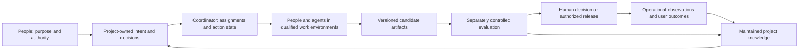

# Wavefoundry: Vision and Roadmap

Owner: Engineering
Status: active
Last verified: 2026-10-29
Adoption: canonical product vision and roadmap, adopted by the operator on 2026-10-29

## The destination

**Give one engineer or a small team the capacity of an exceptional engineering organization—to create, take over, transform and sustain significant software systems.**

Wavefoundry becomes an **autonomous engineering laboratory**: people supply an outcome and constraints; the system investigates, designs, builds, challenges, integrates, delivers within authorized boundaries, and measures the result. It carries substantial work across days or weeks, repositories and services, competing approaches and changing contributors. People direct purpose, business obligations and consequential tradeoffs. Routine execution should need progressively less supervision, while every consequential result remains inspectable and contestable.

The ambition is department-scale engineering capacity, not merely faster coding or better workflow administration. A small enterprise team should be able to take responsibility for systems that would otherwise exceed its ability to understand, change and maintain. A founder should be able to build and operate a sophisticated new product. A public-interest team should be able to sustain important software without depending forever on its original experts. Scale means useful responsibility carried well, not a larger count of agents or generated changes.

The laboratory is also a portable engineering organization: it retains useful expertise and continues caring for systems as people, tools and models change. Taking over significant existing projects, refactoring safely, removing technical debt, modernizing aging technology and retiring obsolete components are first-class outcomes alongside creation. Software the team did not build, incomplete documentation and cross-team dependencies belong in the ambition.

### The path at a glance

| Horizon | What becomes possible | Value before the full destination arrives |
|---|---|---|
| 1. Trustworthy acceptance and qualified execution | Delegate a bounded improvement with acceptance independent of the worker and qualified host controls for authority and recovery. | Less supervision and more dependable use of the agents and handoffs that already work. |
| 2. A living understanding of the system | Reason about consequential behavior across code, contracts, decisions and operation, with uncertainty visible. | Safer takeover, better impact analysis and less reconstruction before a difficult change. |
| 3. Executable intent and sustained missions | Carry a substantial outcome through investigation, implementation and recovery; return meaningful decisions to the responsible person. | A small team completes work that previously required continuous coordination. |
| 4. Competing solutions and coordinated engineering | Explore materially different approaches, test them independently and integrate the best-supported result across components. | Better designs and more ambitious changes without placing one untested approach on the critical path. |
| 5. Delivery and continuing stewardship | Take a significant system through authorized modernization, release, observed outcomes and subsequent maintenance. | Dependable service, reduced debt and the capacity to keep improving inherited systems. |
| 6. Compounding engineering intelligence | Use outcomes to improve future methods and transfer qualified expertise across contributors and projects. | Fewer recurring failures, lower cost of later work and wider access to advanced engineering capacity. |

**Status of these claims.** This adopted vision distinguishes the destination we seek, unresolved breakthroughs and a useful path through them. Unlimited development resources and a twelve-month push are planning aspirations; demonstrations govern expansion, and more developers cannot manufacture operating history, trust or research results. Later horizons remain provisional. Current capabilities and evidence limits are identified below; missing proof alone does not disprove the destination, while contrary evidence can change the path or return a strategic choice to the operator. This document grants no implementation or deployment authority. [Advisory review — 2026-10-29](VISION-review.md) records draft identities, findings and open decisions.

## Why this future is worth pursuing

The enduring need is the ability to change software confidently while preserving the knowledge needed to live with the result. Our working diagnosis is that a team's scarce capacity is distributed across understanding, decisions, coordination, verification and maintenance. Automating implementation can move the bottleneck into those other activities. A tool that produces more changes while increasing the burden of checking and caring for them can make the team worse off.

Wavefoundry's pivotal opportunity is to make **the continuing relationship between intent, software and observed consequences** a maintained product capability. A conversation can end; a contributor can leave; a model can be replaced. The project should still know which problem a change addressed, what was decided, what evidence supported it, what remains uncertain and what would justify revisiting it. This knowledge must help the next action, rather than become a growing archive nobody can use.

The repository establishes foundations for this idea, not demand. The operator's request establishes ambition and desired value. A [public-source landscape and evidence review](VISION-research.md), checked on 2026-10-29, grounds the product comparisons and proposed methods. It distinguishes documented capabilities, empirical studies and practitioner accounts; no customer interviews, willingness-to-pay results or comparative Wavefoundry field trials have occurred. The timing hypothesis is modest: current agents and existing engineering tools make the proposed integration practical to test. No forecast of model progress is required for the first useful product.

**The first market hypothesis is a small team assuming responsibility for an important existing system, with incomplete knowledge and a consequential change to deliver.** This includes enterprise transfers between teams or suppliers, and departures of key specialists; the knowledge may be fragmented rather than entirely lost. Small describes the delivery team, not the organization or the importance of the system. Recurring maintenance, debt reduction and modernization work cross sessions and contributors. A suitable initial partner has an accountable engineer, a usable test environment and a reason to preserve knowledge. This is a proposed initial beneficiary, not a settled market. Its engineering lead is the likely adopter; whoever bears delivery and maintenance cost is the candidate budget owner. Users of the software benefit from reliability and improvements; incoming maintainers benefit from retained understanding. Those groups can have conflicting needs, so a faster release is not automatically a better outcome.

The first discovery work should examine actual recently completed and abandoned changes with such a team. Where did effort go? What had to be reconstructed? What evidence did people trust? Which work would they choose to repeat through Wavefoundry? If the dominant need is simply a faster patch and existing tools already handle everything around it cheaply, a lighter product is the stronger answer.

## The choice among different futures

The autonomous laboratory combines ambitious execution with enduring enterprise responsibility. **Compose execution by default; maintain the connection between project-owned intent, acceptance, decisions and consequences.** Turn intent into challengeable acceptance that a worker cannot rewrite, retain useful knowledge, and preserve why a change was made across providers. Qualify existing executors for isolation, cancellation and recovery. Build only the minimum additional runtime capability justified by a demonstrated coordination or recovery gap. Composition does not outsource responsibility for the complete workflow; unsupported provider behavior must remain visible and limit the claimed capability.

| Direction | What it contributes | Its place in this vision |
|---|---|---|
| A strong local agent harness | Project-visible guidance, retrieval, checks, portable work and recovery across contributors. | The working foundation to preserve and improve, not the ceiling on capacity. |
| Independent engineering assurance | Acceptance that can challenge any implementer's claims. | An essential capability that can also deliver value on its own. |
| An autonomous engineering laboratory | Sustained outcome-directed execution, competing experiments, integration and measured delivery. | The central ambition; execution may be composed from qualified providers rather than owned entirely by WF. |
| A portable engineering organization | Retained knowledge, continuity of responsibility, supported integrations and maintainability across time. | The endurance and stewardship dimension of the laboratory, rather than a competing narrower destination. |

An assurance-only product or a simpler harness remains a credible fallback if the broader approach repeatedly fails its value or feasibility tests. Choosing either as the final destination would be an explicit operator decision. Integrating a stronger existing executor, reducing initial supported scope or changing the business model can preserve the destination while changing how we reach it.

The nearest alternatives in a real purchase decision are the team's current human-led workflow with its preferred agent and CI, its own scripts, conventional engineering services, or leaving lower-value work undone. Wavefoundry must beat the strongest viable alternative for the chosen task, including onboarding and continuing upkeep. The current version of Wavefoundry is useful as a diagnostic baseline, but removing overhead that it introduced is not by itself a reason for someone else to adopt it.

The competitive baseline is substantial: Copilot, Cursor, Devin and Factory cover broad engineering workflows; AWS Transform documents business-function analysis, business-logic extraction and generated documentation as well as modernization, while OpenRewrite/Moderne supply repeatable transformations; Sourcegraph supports change campaigns; managed agent services supply execution infrastructure. Code intelligence and ownership catalogs are established categories too. Their documented capabilities are not proof of efficacy, but they rule out treating coordination, persistent instructions or modernization alone as an empty market. See the [sourced product comparison](VISION-research.md#available-products-and-where-they-overlap).

The proposed distinction to test is continuity of responsibility across changes, people and tools: a maintainer can recover the business obligation, challenge the evidence and safely carry the system forward. Integrate strong existing components before duplicating them. Prove the benefit of the connections, including their maintenance cost. No reviewed evidence establishes an exclusive market gap or selects the broader product over an assurance-only offering.

Deliberately do not start by replacing IDEs, issue trackers, CI, observability systems or every agent host. Do not begin with unsupervised high-consequence operations, a universal enterprise model, or a marketplace that has no repeatable demand behind it. Supporting fewer environments well sacrifices breadth in exchange for a credible first experience. A simple change should stay simple; users should not need to administer a committee to receive a small fix.

## What the product feels like

Imagine a small enterprise team taking over a long-lived billing platform from departing specialists. Several business units depend on partly documented behavior. The team gives Wavefoundry an outcome:

> Make this platform support ten times the traffic. Preserve its billing and API obligations, keep infrastructure cost growth below 30%, replace the obsolete integration, and make the migration recoverable. Bring us the decisions that need our judgment.

These numbers are imagined mission constraints, not universal product targets or present capabilities. The system first tests whether they can coexist and whether scaling is the right intervention. It identifies which promises require business decisions, what evidence is missing and where access or a service owner is needed. It reconstructs the relevant system from code, history and authorized observations, using the installation and retrieval capabilities already available rather than beginning from a blank slate.

Over days or weeks, specialist contributors investigate bottlenecks and obligations. Independent teams compare a modest optimization, a component redesign and a broader migration where those are credible alternatives. They build runnable candidates, replay representative workloads, test compatibility and failure recovery, and expose the tradeoffs. Mechanical transformations use established recipes when appropriate. Unknown business meaning returns to people; routine implementation decisions stay with the assigned contributors.

The operator sees objectives, alternatives, evidence, cost and consequential decisions. A promising approach may fail an independent test; its lesson informs the next experiment without hiding the failed attempt. A host disconnects; another contributor continues with current scope and observed effects, avoiding an uncertain duplicate operation. The team can stop work, inspect the reason for a choice, change constraints or recover ownership.

With explicit release authority and a qualified operational boundary, Wavefoundry rehearses the migration, coordinates component changes, observes a limited rollout and expands or stops against the agreed conditions. Irreversible data or external effects have an explicit disposition; a promise to roll back does not substitute for one. Acceptance follows business behavior and operating outcomes, not the appearance of a finished report.

Months later, a different maintainer and model make the next change. They can explain why the design won, challenge expired assumptions and preserve the relevant obligations. The system learns which methods helped, which failed and where the evidence is too weak to generalize. The team can export its records and replace providers without losing the meaning of its work.

For a new product, the same loop begins with the intended user experience rather than an inherited system. Discovery, prototype comparisons and evidence of user value precede scaling the implementation. Both cases aim at the same result: a small team directing consequential engineering work while the laboratory carries the investigation and execution forward.

## Value and a sustainable product

Financial value can come from earlier useful releases, less rework and incident cost, reduced coordination and maintenance effort, or engineering work that becomes economical for the first time. For an enterprise inheriting important systems, proposed benefits also include a shorter path to effective ownership, removal of costly technical debt and obsolete dependencies, lower support burden, and modernization without unnecessary replacement of working capabilities. These benefits must be measured separately: faster delivery can be valuable even when labor does not fall, and fewer labor hours are not valuable if defects or future maintenance rise. The proposed value must survive full-cost and quality comparison.

Nonfinancial value includes less interruption, more time for judgment and creative work, continuity when people leave, more accessible expertise and software that remains dependable. Teams should gain agency rather than become dependent on an opaque service. A successful product could also let maintainers sustain neglected public or internal software where direct revenue is limited.

**Engineering evidence is a potential enterprise asset.** Connect obligations, authorized decisions, exact changes, acceptance methods and later consequences. Test a concrete package with an engineering or change-management owner for reduced review effort, better handover and clearer decisions. Audit readiness requires qualification for a named use: authenticated independence, tamper resistance, completeness and recipient acceptance remain unproven. Willingness to pay also needs testing.

The initial sustainability hypothesis is an openly usable local foundation with paid support, qualified integrations and, if customers want it, managed operation under explicit data and authority boundaries. Internal platform funding and an assurance-only offering remain credible alternatives. This is a commercial experiment to run, not a chosen license or business model. Obtain a budget owner's concrete willingness to sustain repeated use after observing full cost; compliments and trial participation are insufficient.

Possible durable advantages are trusted operational practice, well-maintained integration contracts, useful evaluation methods and project knowledge that demonstrably improves later work. None is a proven moat. Open contracts and export can reduce lock-in while increasing confidence in adoption. Serving a customer should earn recurring value through continuing usefulness, not through making their history impossible to leave behind. Unlimited development resources do not remove the eventual cost of compute, evaluation, support, upgrades or maintenance.

## Starting point and the distance to travel

Today's Wavefoundry ships a framework, local tools, a stdio MCP server and a local dashboard. Its [project overview](docs/references/project-overview.md) and [architecture hub](docs/ARCHITECTURE.md) establish the boundary between canonical framework source and each project's visible operating surface. This proposal would extend that boundary through explicit future design decisions; it does not describe a shipped organizational service.

| Capability | Current evidence and status | Consequence for the roadmap |
|---|---|---|
| Installation and project orientation | Existing framework behavior; the operator reports that installation already performs much of the discovery and grounding needed in an existing project. The [installation workflow](docs/prompts/install-wavefoundry.prompt.md) is the current contract. | Reuse the installed map and contracts. Investigate specific missing or stale knowledge, not a new generic onboarding inventory. |
| Cross-agent and cross-host work | The operator reports successful planning, implementation and completion by different agent systems, including one agent finishing another's work. This is attributed operating experience, not a new comparative trial. | Preserve this strength. A useful next advance must add a capability such as dependable effect recovery or reduced supervision, not demonstrate handover as though it were absent. |
| Local serving and checks | Direct source reads confirm `main` in [server.py](.wavefoundry/framework/scripts/server.py) serves stdio and `run_sensor` in [sensor_runner.py](.wavefoundry/framework/scripts/sensor_runner.py) runs bounded subprocess checks. | Build on local tooling. These functions alone do not establish a sustained mission runtime, isolation or a complete correctness oracle. |
| Review evidence and project memory | `_validate_evidence_shape` in [review_evidence.py](.wavefoundry/framework/scripts/review_evidence.py) checks structured evidence fields; `load_memory_records` in [memory_records.py](.wavefoundry/framework/scripts/memory_records.py) loads contained, parseable records with optional status filtering. | Preserve useful records and review practice; qualify actual acceptance separation and future learning rather than equating valid records with truth. |
| Organizational autonomy and long-term results | No evidence in this authoring pass establishes department-scale autonomous capacity, secure multi-organization execution or sustained causal learning. | These remain destination capabilities and research questions, not failed features or descriptions of today's product. |

Current-source inspection supports these narrow mechanism claims. Installation efficacy and cross-agent success are operator reports within this repository's experience; their generality is unmeasured. The present single-OPEN-wave rule, local authority and project-visible contracts remain policy. Concurrent programs and organizational execution require explicit future contract evolution. A messaging service alone is not that transition.

## Breakthroughs that make the ambition real

The largest gap is not generating more code. It is sustaining justified action through ambiguous goals, incomplete knowledge, long sequences and real consequences. Five research and engineering problems connect the destination to the horizons:

- **Know what success means.** Translate intent into challengeable acceptance without confusing a passing test with solving the right problem. Research specification discovery, business invariants and uncertainty calibration; use human decisions where evidence cannot determine values or obligations.
- **Understand enough to act, and know what is missing.** Connect behavior, dependencies and operational evidence without pretending to possess a perfect digital replica. Establish freshness, provenance, contradiction handling and prediction limits on task-relevant slices.
- **Sustain execution without losing control.** Reconcile partial effects, interruption, authority and changing plans across qualified providers. Unfamiliar repositories, comments, documents, issues and dependencies can carry hostile instructions, poisoned knowledge or executable supply-chain threats. Keep observed content separate from trusted authority and test enforcement at the actual effect boundary. A persuasive prompt or a content filter is insufficient. The [security research note](VISION-research.md#hostile-inputs-are-part-of-the-takeover-problem) motivates this boundary; it does not qualify an implementation.
- **Choose well among plausible solutions.** Compare materially different approaches using independent experiments, representative conditions and honest accounting. Detect shared mistakes, contaminated evaluation and candidates that exploit incomplete tests.
- **Learn without certifying ourselves.** Convert incidents, rejected experiments and outcomes into improvements that survive withheld cases and changing models. Keep success criteria and promotion authority separate from the system proposing the change.

None must be solved universally before delivering value. Each horizon attacks a bounded part and leaves useful capability behind. Failure of one approach should inform an alternative; repeated evidence against the necessary premise should trigger an explicit decision about the destination or domain. Lack of current proof alone does neither.

## Horizon 1 — Trustworthy acceptance and qualified execution

**Useful release:** a small team can delegate a bounded engineering improvement with less supervision and acceptance it can independently challenge. Existing onboarding, review records and cross-agent handover remain the foundation. The first increment strengthens the relationship between requested outcome, exact artifact and acceptance; it does not recreate working handover or require a new runtime.

Select one real change class in a supported environment. Locate an actual gap in acceptance freshness, evidence quality or recurring intervention. Keep acceptance under a separate owner's control, bind it to source and environment, and make failures and unresolved claims inspectable. Qualify the existing host and CI for the required authority, budgets, cancellation and recovery behavior. Where partial effects cross providers, define durable action identity and reconciliation; implement a missing adapter or control only when a demonstrated gap requires it. Do not assume every provider offers equivalent guarantees.

**Demonstration and exit:** complete a useful change whose independent acceptance rejects planted false completions and wrong-revision evidence while accepting valid outcomes. In a disposable environment, interrupt execution around an uncertain action result; the successor uses the qualified provider's observations to reconcile before retrying. The actual worker boundary must prevent a deliberately forbidden effect. Report which mechanisms already worked and which WF increment is new: the unchanged baseline must fail that specific incremental claim, not every host qualification check.

The first leading indicators are **operator interventions per accepted change** and **the share of planted false-completion and wrong-revision cases acceptance rejects**, reported separately by case type. Also report intervention time, false rejections, accepted-outcome coverage and all failed, abandoned or rescued attempts. Predeclare case mix and count review/support effort so rejecting everything, selecting easy work or moving labor elsewhere cannot look like progress.

Advance for the tested environment when repeated demonstrations preserve useful outcomes and quality while lowering recurring supervision under complete effort accounting. A false acceptance, duplicate effect or unauthorized action fails its respective claim and prevents expanding the authority it depends on. If existing controls suffice, integrate them; if no incremental gap exists, retain that evidence and select another useful advance. This horizon leaves a valuable acceptance and evidence capability even if sustained autonomy takes longer.

## Horizon 2 — A living understanding of the system

**Useful release:** an incoming maintainer can answer consequential questions and plan a difficult change without reconstructing everything from scratch. Connect the existing code/document retrieval and project records to the relevant APIs, schemas, service ownership, tests, deployment state and authorized incident or workload evidence.

Begin with the slice needed for H1 and the next mission, not an enterprise-wide modeling project. Distinguish declarations, observations and inferences; attach provenance, revision, freshness and unknown coverage. A business owner remains authoritative for business meaning. Integrate maintained catalogs and observability rather than establishing competing sources of truth. Representative data, privacy approval and an available domain owner can gate progress before any engineering dependency does.

**Demonstration and exit:** on an unfamiliar but bounded subsystem, identify the obligations and downstream effects of a proposed change, then check them against independent characterization tests and owner review. Deliberately change a consequential premise; the maintained model should surface invalidated conclusions and the need for fresh evidence. Contrast against today's retrieval on this exact freshness or relationship question. A complete-looking but stale answer, hidden coupling or overconfident extrapolation fails its corresponding claim.

Include a takeover case in which a consequential legacy behavior is undocumented, affected owners disagree, or the outgoing expert is unavailable. Distinguish observed behavior, stated obligation and inference; identify affected consumers and decision rights; present a concise choice with compatibility and operating consequences. Preserve a justified provisional behavior or pause the dependent effect until an accountable decision is made; independent useful work can continue within existing authority. Record unresolved exposure, outgoing-expert assistance and stakeholder decision effort and delay. Owner absence is not agreement.

A reproducible environment and workload replay can test forecasts, but measured divergence from reality stays visible. Broader coverage follows consequence and demonstrated usefulness. This horizon enables safer modernization and impact analysis independently of autonomy, and can advance alongside H1.

## Horizon 3 — Executable intent and sustained missions

**Useful release:** an engineer supplies a substantial outcome and constraints, then returns to a working result or a concise set of decisions instead of coordinating every step. A mission carries the work through investigation, implementation, integration and recovery across sessions and contributor changes.

Translate the outcome into invariants, acceptance experiments, dependencies, authority, resources and decision points. Build missing instrumentation when necessary. Use a qualified H1 boundary and enough H2 understanding for the selected mission; neither horizon needs universal completion. Keep project-owned approval and scope distinct from runtime action state, and synchronize readable contracts with executable state under explicit ownership.

The provisional demonstration is a substantial single-repository maintenance or product change over an extended run, including failed experiments, context loss and a changed assumption. Test whether the system escalates a consequential business choice while resolving routine engineering details itself. Replanning must preserve the remaining authority and explain any proposed scope change. It must be possible to stop work and regain ownership.

Advance when repeated representative missions establish the prospectively chosen value claim: lower effort and attention for comparable work, or greater accepted capacity or timeliness within declared human, compute and support budgets. Preserve quality and full-cost accounting in either case. Concealed rescue, repeated unbounded retry or quietly weakening acceptance defeats the capacity claim. Compare qualified existing coordinators with any WF-owned execution needed; owning the runtime is an implementation choice, not the purpose. A narrower supervised mission product remains useful if broader unattended operation is delayed.

## Horizon 4 — Competing solutions and coordinated engineering

**Useful release:** a small team can seriously explore several plausible designs and complete changes spanning components or repositories without betting the entire program on one generated solution.

Independent contributors investigate alternatives in isolated environments with explicit interfaces and integration ownership. Compare candidates against acceptance that implementers cannot unilaterally rewrite. Reuse deterministic recipes for mechanical transformations and combine property testing, mutation, replay, fault injection or targeted formal methods where they address the actual claim. More review voices alone do not establish independent evidence.

The provisional demonstration is a consequential scaling, modernization or capability objective with at least two meaningfully different approaches, a rejected but plausible candidate and an integrated result. Compare quality, compatibility, operating cost and maintainability under representative conditions. Preserve useful failed experiments and show which evidence changed the choice. A superficially parallel run that shares the same hidden error, tests only favored cases or defers every integration problem fails its corresponding claim.

Advance where the benefit of exploration exceeds its compute, evaluation and coordination cost, and shared contracts support reliable integration. Today's single-OPEN-wave rule remains in force until an explicit lifecycle design establishes concurrent ownership, conflict detection, integration scheduling and stopping rules. This horizon improves high-consequence design choices even if sustained production stewardship remains limited.

## Horizon 5 — Delivery and continuing stewardship

**Useful release:** a small team takes responsibility for a significant inherited system or grows a new one, delivering useful changes while keeping service dependable and the result maintainable. Refactoring, debt removal, modernization and retirement are outcomes when they improve useful capacity, risk or cost—not when they merely rewrite code.

For weakly documented systems, establish important behavior and obligations before replacing them. Unknown dependencies remain unknown until evidence or accountable owners resolve them. Stage changes around compatibility and integration seams. [Migration experience and incremental-modernization guidance](VISION-research.md#repeatable-transformations-can-beat-free-form-generation) support testing hybrid recipes, agents and human decisions rather than assuming free-form generation is always the best method.

The provisional demonstration is a cross-component modernization, rehearsed migration and authorized rollout, followed by an unrelated maintainer's change. Bind release artifacts to observed deployment; use canaries, explicit stop conditions and recovery where appropriate. Name irreversible effects and compensation rather than promising universal rollback. An operational partner, permitted representative data, incident responder and accountable service owners are prerequisites to live effects.

During an agreed observation period, include an operating signal or dependency change that invalidates an assumption while another mission is active. Integrate existing observability and issue systems: identify the affected obligation, propose a bounded response, reconcile it with current work and obtain the named human decision when business priority or authority changes. Trace observation to disposition, response effort, delay and unresolved exposure. The organization retains an accountable service owner and operational fallback when WF is unavailable or its authority is revoked. A controlled exercise can establish the mechanism early; later authorized operating evidence must test continuing care.

Also test the value of the objective itself. Compare the request with doing nothing and a smaller or non-code intervention using beneficiary and operational evidence; people choose consequential tradeoffs. Later observations can show that an accepted implementation did not help. Engineering success alone does not settle product value.

Advance where useful outcomes survive operation and later maintenance, and total effort, incidents and cost support the claimed benefit. A simulation cannot alone qualify production; hidden coupling, worsening maintenance or lack of an operational owner requires a changed approach or narrower supported setting. Continuing care remains valuable even before self-improvement is established.

## Horizon 6 — Compounding engineering intelligence

**Useful release:** the laboratory becomes more capable through experience, while a project keeps its expertise as contributors and providers change. Incidents, failed approaches, operator corrections and successful outcomes become reproducible evaluations and qualified reusable methods.

Version candidate changes to retrieval, prompts, planning, evaluation, models and orchestration. Keep protected holdouts, success criteria and promotion decisions outside the evaluated worker's unilateral control. Curated human learning is a valid initial mechanism; automatic promotion needs its own evidence and authority. A stored lesson earns retention by improving later action.

The provisional demonstration is improvement on withheld projects or task families under comparable budgets, alongside a different maintainer completing subsequent work and replacing a qualified execution provider. Separate harness effects from model improvements, leaked examples and additional evaluator effort. Gains that disappear outside remembered tasks, degrade other outcomes or depend on founder rescue do not establish compounding capacity.

Wider access grows from repeatable demand and supported contracts: an internal engineering utility, commercial offering or public-interest commons can share qualified adapters and methods without making a marketplace a prerequisite. Cross-project sharing requires consent, provenance and retention/deletion rules; private source is not a default contribution. Outside maintainers must be able to adopt, upgrade, recover and leave. If ecosystem costs exceed reuse, preserve a smaller supported surface while keeping the broader purpose explicit.

## Architecture for endurance

Keep the project as the owner of its goals, source, accepted decisions, authority and durable evidence. Treat indexes, summaries and inferred models as derived state that can be rebuilt or corrected. Execution state records what was attempted and observed; it cannot independently enlarge project authority. Every consequential effect needs a stable identity, an accountable owner and a recovery interpretation.

A proposed flow makes these boundaries explicit:

Implement this proposed boundary first through local files and qualified existing tools with explicit contracts. Introduce a service only when a demonstrated coordination or reliability need warrants it. Local operation should remain useful. Remote execution or organization-wide collaboration is an optional expansion requiring authentication, isolation, secrets handling, revocation and policy ownership; today's process account is not an authenticated organizational identity.

Retain portable, versioned records with documented migration and export. A supported upgrade must preserve the meaning of old decisions and provide recovery from interrupted migration. Keep evaluator inputs and protected holdouts away from implementer write access. Retrieved and retained content remains data with provenance, not permission to expand scope or alter acceptance. Enforce least privilege and effect authorization outside the worker model; constrain dependency/build execution and data egress separately from instruction screening. Review promotion of inferred knowledge into trusted project decisions, and preserve a way to invalidate poisoned derivatives. Test layered controls against defined attacks and report residual exposure; no filter guarantees safety. Bind evidence to artifact, environment and evaluator versions; separate recorded approval from observed correctness. More reviewers of the same model are not a substitute for independent evidence.

Keep models and hosts replaceable at narrow interfaces that reflect actual needs. Avoid a speculative universal abstraction. Build explicit capability negotiation and clear degraded behavior when an adapter cannot cancel, isolate or resume work. A human should always have a usable way to inspect state, stop new work and recover ownership. Retention and deletion are product obligations: keep the useful decision and proof without indefinitely retaining every sensitive trace.

Qualify existing managed runtimes and enterprise integrations before building substitutes. Shared skills or MCP compatibility do not establish equivalent effect, recovery or authority semantics. Periodically retest and remove harness workarounds that no longer earn their cost as models and tools improve; enduring project contracts should not freeze today's agent limitations into permanent ceremony.

The costly commitments are authority design, record semantics, operational hosting and ecosystem contracts. Prototype them before broad distribution and keep migration obligations visible. Durability also needs maintainers, support funding and a way to retire obsolete integrations. Architectural portability without funded upkeep is insufficient.

## A twelve-month push with evidence on the critical path

Use the year to attempt the full destination through an expanding set of real demonstrations. Do not turn it into five fixed release dates.

| Window of emphasis | Integrated outcome to attempt | Work that can proceed in parallel |
|---|---|---|
| Early: establish the first dependable mission slice | H1 plus task-relevant H2: acceptance distinguishes valid outcomes from false or stale claims, with recovery and authority qualified through the selected host. | Discovery with a participating team, targeted runtime diagnosis, acceptance design, interface prototypes and supported-host qualification. |
| Middle: extend capacity and experimentation | H3 sustained single-repository outcomes; H4 competing implementations and integration in representative environments. | Broader system understanding, evaluation research, operational partnerships, migration rehearsals and adoption support. |
| Later: attempt the full demonstration | H4/H5 across services and repositories, observed authorized delivery and subsequent maintenance; H6 withheld improvement where evidence exists. | Distribution and support experiments, provider replacement, external-maintainer trials and long-term follow-up. |

The critical path is **a willing team and accountable owner → a meaningful objective and permitted environment → task-relevant understanding and independent acceptance → recoverable delegated effects → sustained missions and integrated experiments → authorized operational evidence → transferable improvement**. Workstreams overlap; H1 and H2 need only sufficient qualification for the next mission. Access to business owners, representative observations and an operational partner can gate the engineering path. Sustainable support and repeat use matter alongside technical success.

With unlimited resources, fund independent alternatives to the hardest problems: weak specifications, trustworthy evaluation, maintained understanding and recovery across partial effects. Build representative environments and qualified integrations in parallel, with domain specialists and independent evaluators. Give teams a shared outcome and interfaces rather than multiplying contributors on the same serial task. Some experiments will fail; their purpose is to discriminate among approaches, not to produce a favorable demonstration at any cost.

Twelve months cannot prove years of reliability or guarantee a research breakthrough. Report completed demonstrations, early indicators and unresolved exposure separately. Delay or failure of a horizon may change the method, sequence or supported domain; changing the destination returns explicitly to the operator.

## How we will know whether it is working

Use a small set of beneficiary outcomes: **more useful changes accepted and sustained, less total human effort for comparable work, and preserved or improved software quality and maintainability**. Aim for a **10× reduction in operator time on a predefined portfolio of substantial missions** as a stretch ambition, measured alongside capacity and quality rather than treated as a universal threshold. Operator time alone cannot establish department-scale capacity: also report accepted-outcome coverage, all-person effort, cost, quality and later maintenance. Set each pilot's decision thresholds prospectively after measuring its baseline; a useful smaller gain can justify an intermediate release without silently redefining the ultimate ambition.

Declare whether a demonstration tests efficiency on comparable work or expanded capacity, responsibility or timeliness within a budget. Do not switch claims after seeing results. Where previously infeasible work lacks a credible measured comparator, report the achieved outcome and unestimated counterfactual rather than invent a department's hypothetical cost.

Compare the team's strongest viable existing workflow, selected prospectively. Predeclare task classes, difficulty, acceptance, resource budgets and observation windows. Count failures, abstentions, timeouts, rescues, abandoned work and delayed regressions. A system cannot claim greater capacity by quietly refusing the difficult cases. Correct escalation is successful only for a task whose declared outcome allowed that decision.

Measure operator attention separately from all-person work: setup, evaluation creation and upkeep, support, review, incident response and maintenance all count. Separate reusable investment, recurring operation and research-only measurement while showing the total. Track compute and infrastructure expense as well as time. Compare quality by severity and report uncertainty; zero severe failures in a small pilot cannot establish safety. Include later follow-up work by a different maintainer so immediate speed does not conceal future cost.

Independent acceptance must exercise real behavior, identify the tested artifact and detect known-bad controls. Repeated trials and held-out cases are necessary for broad capacity or learning claims. Simulation, source inspection and valid evidence records each support narrower claims. No present evidence justifies general autonomous reliability, commercial demand, a productivity multiplier or the ability to predict every operational consequence.

## What would change the direction

| Risky assumption | Cheap discriminating experiment | Consequence if it fails |
|---|---|---|
| Additional delegation solves a real problem beyond the working harness and handover. | Observe where a consequential change still needs intervention; compare a narrowly extended workflow against today's strongest setup. | Preserve the existing strengths, change the proposed increment, or return a smaller destination as an explicit strategic option. |
| Delegation reduces real work rather than hiding it. | Repeated bounded tasks with all-person and full-cost accounting, independent acceptance and voluntary repeat use. | Keep useful supervised capabilities; reconsider the scope and economics of autonomous execution. |
| Evidence can reliably distinguish the relevant outcomes. | Wrong-revision evidence, false completions and an unchanged defective control in the real pilot environment. | Narrow the supported domain; hold authority expansion until evaluation improves. |
| Hostile material cannot convert access into unauthorized authority or corrupt acceptance. | In a disposable takeover fixture, plant instructions in retrieved material and retained knowledge; include a malicious dependency/build action. Check unauthorized effects, egress and evidence changes at the boundary, plus valid-task completion. | Constrain access and supported effects, repair the boundary and requalify before expanding authority; narrow attack coverage is not general security proof. |
| The evidence package is useful to an enterprise decision owner. | Ask an engineering/change-management owner to assess a real change package, gaps and review effort against their current practice. | Improve or narrow the evidence product; do not market audit readiness or assume willingness to pay. |
| Knowledge remains useful as systems and contributors change. | A new maintainer handles a later change after a deliberately invalidated assumption and host/model substitution. | Reduce what is retained, improve expiry/provenance, or stop claiming compounding expertise. |
| Others will sustain the product. | An outside maintainer installs, upgrades, recovers and exports; a budget owner makes a concrete continuing-use decision. | Narrow support commitments or change funding/distribution before wider release. |

The hardest unresolved research is recognizing the right problem, obtaining independent evidence when specifications are weak, managing partial effects across real systems, and separating useful learning from shared error or benchmark contamination. A persuasive vision cannot resolve these. Each horizon should expose the next uncertainty without making its own value depend on solving everything that follows.

Revisit the proposal when a horizon's exit conditions fail, a team declines repeat use, a false success is discovered, an adapter loses essential capabilities, or new beneficiary evidence changes the opportunity. Preserve the purpose where justified; bring a changed destination back to the operator explicitly. A different commercial model is not necessarily a different purpose, but shrinking the ambition to workflow administration would be a strategic change.

## Immediate advances toward the destination

These priorities extend the current strengths rather than propose installation discovery or cross-agent handover as new features. They are a recommended order for subsequent planning, not implementation authorization or a complete backlog.

**Parallel prerequisite — secure a design partner.** Recruit a willing team inheriting a system with an accountable owner; review completed and abandoned changes with permission, choose a consequential mission, and agree access, outcomes and full-cost measurement. Record participation barriers and readiness effort to distinguish pilot success from broader adoption. Test an evidence package with the decision owner. [Downstream evidence](VISION-research.md#downstream-experience-and-design-partner-selection) supports bounded use and usability, leaving demand, ROI and willingness to pay unproven; Waveforge remains an uncommitted candidate route. Owner agreement and permitted representative evidence gate H2 field claims and H5 live operation. Without a suitable partner, label mechanism tests internal and revisit the beneficiary hypothesis.

1. **Make acceptance trustworthy for one consequential delegated outcome.** Start with a maintenance, refactoring or product change current WF already supports. Locate an actual acceptance or intervention gap, then connect the requested outcome, exact revision, separately controlled checks and evidence an incoming maintainer can question. Qualify recovery and authority through the existing host/CI; build only a demonstrated missing control. The useful outcome is less supervision with a result that remains trustworthy across contributors. This advances H1 and unlocks H3. Continue when the new behavior is demonstrated with valid outcomes, rejection of planted failures and complete effort accounting; if today's setup already satisfies it, preserve that evidence and select the next consequential gap.

2. **Connect a task-relevant system model to a difficult engineering decision.** For that same mission, extend existing retrieval and project orientation only where needed: a business invariant, downstream dependency, runtime observation or stale assumption. Use representative examples and an accountable owner to compare two credible approaches, such as a minimal change and a deeper modernization. Produce challengeable impact/compatibility evidence and a runnable candidate, not an inventory for its own sake. This advances H2 toward H4 and helps an incoming team understand what must survive. Required access and owner participation are explicit dependencies. Continue if the added evidence changes a consequential decision or catches a counterexample; otherwise keep the simpler workflow.

3. **Remove demonstrated operating costs that would prevent sustained missions.** The operator reports runtime burden and has raised Python versus a compiled implementation as a WF-specific hypothesis. Measure the current representative workload—startup and retrieval latency, memory by component, cancellation/recovery behavior, installation friction and maintenance effort—and distinguish repaired historical incidents from current failures. Compare tuning the current design, replacing a constrained component, using an existing service and broader migration only where credible. No language has been selected. The deliverable is the smallest useful reliability, performance or modernization improvement supported by the measurements, or a discriminating prototype if the cause is uncertain. This supports H1/H3 endurance and practical adoption. Proceed with a migration only if its benefit survives compatibility, distribution, support and maintenance costs; evidence against a rewrite is a useful result.

Define one finite demonstration batch with the participating team before executing it. Keep task difficulty, executor and environment comparable when isolating WF's contribution; include a strong existing tool or recipe where relevant. Count failures, rescues, evaluator upkeep and later repair. Reuse the [research and comparison discipline](VISION-research.md#next-evidence-and-stopping-rules). If a required outcome remains unproven at the stopping point, access is absent or a repair fails its recheck, return evidence and options before broadening.

Design-partner discovery runs alongside internal work and selects the field mission; it is not deferred until the engineering is complete. The first advance can proceed using existing knowledge while the second develops the particular missing model slice. Runtime diagnosis can run alongside them; a measured reliability defect becomes a prerequisite when it invalidates the mission, not simply because an architectural change is interesting. Each selected implementation should name the horizon and incremental outcome it advances. Planning and delivery evidence inform this roadmap; changes to the vision remain an Envision revision or explicit operator edit.

Open decisions include the first representative mission and participating owner, supported execution boundary, sustaining model and conditions for broader operational authority. Adoption establishes the direction; those implementation and commercial choices remain open.

## The ultimate demonstration

An independent participating team supplies an unfamiliar, messy and consequential system—or a demanding new product outcome—with explicit boundaries and a representative portfolio of continuing obligations. One engineer or a small team directs the work. The portfolio includes substantial planned engineering, emerging maintenance or operational demand, and a consequential priority or resource conflict over a prospectively declared observation window.

Wavefoundry investigates, compares real alternatives, carries coordinated implementation across interruptions and components, verifies independently, delivers within granted authority and measures the result in use. People choose business priorities and consequential tradeoffs; the laboratory carries dependency coordination, routine replanning and qualified execution. Show what was completed, delayed, rejected or left exposed, and whether the operator's decision queue and maintenance backlog remained manageable within the declared attention and resource budgets. A serial collection of successful projects alone does not establish department-scale capacity.

A different maintainer can later understand and improve the result. The laboratory performs better on new work because of what it learned, with that benefit demonstrated independently. Compare accepted responsibility, timeliness, full all-person cost, quality and later maintenance against the strongest feasible current workflow; expose any supporting specialists rather than treating their effort as free. Report unmeasured counterfactuals honestly. Short exercises are early indicators, not years of stewardship, and the existing concurrency contract remains until deliberately changed.

The people receive demonstrably improved systems and a small set of meaningful decisions, not a growing job of supervising agents. This combination of substantial capacity, continuing responsibility and retained control is the future Wavefoundry is trying to make real.
