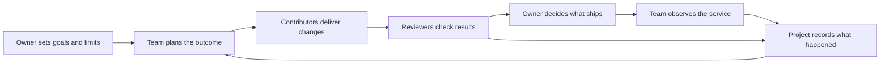

# Wavefoundry: Vision and Roadmap

Wavefoundry enables a single engineer or small team to take on the work of an exceptional engineering department. It is an autonomous engineering laboratory where teams build new products, take over unfamiliar systems and replace critical software while keeping services running. Its spec-driven development framework gives agents a clear account of what to build and how to check it. Local tools help them find the code that matters and pick up where another contributor left off. Independent reviewers check the results. People set the goals, make the tradeoffs and decide what ships. Each change leaves the next engineer a record of those decisions, the test results and the questions still open.

## Roadmap

**Teams using Wavefoundry have demonstrated the first three horizons in practice.** They deliver tested changes, trace behavior through unfamiliar code and carry work forward when a contributor or session changes. The operator reports these capabilities in Wavefoundry itself and in other projects.

**The next focus is Horizon 4.** Choose a consequential design decision, try two credible solutions under the same conditions and use independent checks to decide which one to integrate. The team already knows how to deliver and hand off the work. The new question is whether comparing alternatives leads to a better engineering decision at a cost worth paying.

| Horizon | What the team does | How to recognize progress |
| --- | --- | --- |
| 1. Deliver a dependable change | Define the behavior, make the change and test it. | A reviewer checks what the user actually experiences. |
| 2. Understand the system | Trace a behavior to the code, people and services that depend on it. | A maintainer spots a change that would break a real dependency. |
| 3. Carry work across handoffs | Keep several deliveries directed toward one outcome as contributors change. | The next contributor uses prior results to decide what to do when the plan changes. |
| 4. Compare competing solutions | Try different designs under the same conditions. | The evidence explains why the team chooses one and rejects another. |
| 5. Operate and maintain what ships | Roll out a change within the owner's authority and follow it into use. | The service delivers the intended result and a different maintainer can change it safely. |
| 6. Apply lessons to unfamiliar work | Turn failures and successes into methods other teams can use. | Independent evaluators see better results on projects the agents have never seen. |

## Give a small team greater engineering capacity

A founder who builds a product also inherits its outages, upgrades and support requests. A team replacing a billing system inherits promises to customers that the old code may never explain. A public-interest project may depend on a maintainer who is about to leave. In each case, writing the next piece of code is only part of the job. Someone must understand the obligations, decide what to change, check the result and keep the system useful. Wavefoundry exists to put that whole job within reach of a small team.

The benefit might be a service the team delivers sooner, an incident it avoids or a product it now has the capacity to build. Measure what happens after delivery, too. If a faster release creates months of support work, that work belongs in the comparison. Continuity matters even when headcount stays the same. An engineer who takes over a service should inherit the reasons for its design alongside its source code.

An engineering lead is a likely adopter. The person responsible for the service budget must also see enough value to support it. One possibility is an openly usable local framework with paid support, integrations or managed operation. Internal funding and public-interest stewardship are also plausible. The next evidence is a team that chooses to use Wavefoundry again and an owner who accepts its full cost. The project has yet to choose a market, price or future licensing model.

Some organizations may value the engineering record itself. Ask a change-management owner to use one real record for a handover or review. Find out what questions it answers, what evidence the recipient still needs and whether it saves either party time. An audit use also requires completeness, protection against tampering and a way to verify who performed independent checks. Willingness to pay remains an open question.

## Start with the workflow teams use today

Teams familiar with Spec Kit already know the starting point. A **spec** describes the change someone needs and how the team will check it. Product defines the first useful outcome. Engineering uses the same spec to plan the implementation and tests. A **wave** groups one or more changes the team implements and reviews together. [Plan spec](docs/prompts/plan-spec.prompt.md) · [Guide for Spec Kit and OpenSpec users](README.md#coming-from-spec-kit-or-openspec)

Wavefoundry gives agents local tools through the Model Context Protocol (MCP). Suppose a spec calls for replacing an old API. An agent searches the code for the endpoint, traces which functions call it and looks up the decision that explains why an older client still needs it. The next contributor starts with those references and the open compatibility question. Each project keeps the records in its repository. Contributors check the cited source because an index can miss a caller or fall behind the code. [Project overview](docs/references/project-overview.md) · [Architecture](docs/ARCHITECTURE.md)

The aim is to spend less time searching, repeating investigations and explaining prior decisions, so more effort goes into changes users need. The operator reports that different agents already finish work another agent started. First-feature trials exercised the planning handoff on example requests. To measure productivity, compare accepted changes, total effort and quality on comparable work. [First-feature trial results](docs/waves/23tct%20first-feature-workflow/wave.md)

Reviewers record findings, repairs and approvals. Wavefoundry checks which approvals apply before it closes the work. Those checks establish what the team reviewed and which requirements it met for closure. To judge whether a repair works, a reviewer also needs evidence of the behavior. Likewise, a framework test receipt covers the framework inputs it identifies. Each target project tests its own product. [Close checks](.wavefoundry/framework/scripts/lifecycle_gates.py) · [Review records](.wavefoundry/framework/scripts/review_evidence.py)

An **arc** gives the team one place to explain an outcome that takes several waves. The arc links to the waves in their existing folders and records what remains, which dependencies matter and what to do next. A **horizon** describes a capability the project wants to gain. One horizon may take several arcs, and each wave contains the changes the team delivers. Projects choose their own horizons and terminology. A single bug fix needs no arc. [Plan arc](docs/prompts/plan-arc.prompt.md) · [Record paths](.wavefoundry/framework/scripts/record_paths.py) · [Arc record tests](.wavefoundry/framework/scripts/tests/test_arc_records.py)

Wavefoundry’s release qualification shows how contributors use earlier findings. Reviewers traced 26 failures through repair and verified each fix against the same release candidate. The record shows what the team checked and how the work concluded. How much time teams save remains a separate measurement. [Wavefoundry qualification record](docs/waves/23ve4%20repair-renamed-profile-qualification/wave.md)

### Compare the whole workflow

A team can already combine a capable coding agent, an issue tracker, continuous integration and its own review practice. Compare Wavefoundry with the strongest combination the team would realistically use. Reuse an existing tool when it does part of the job well.

The November 8 review of vendor documentation identified three useful comparisons. Spec Kit helps agents plan and implement work through structured processes. 8090 links work orders to requirements, dependencies, code and pull requests. AWS Transform for .NET and Moderne address specific modernization tasks with analysis, transformations and build or test support. These descriptions establish what the vendors offer. They leave comparative cost, reliability and later maintenance for a trial. [Spec Kit](https://github.com/github/spec-kit) · [8090 work orders](https://docs.8090.ai/modules/work-orders) and [codebase integration](https://docs.8090.ai/codebase/overview) · [AWS Transform](https://docs.aws.amazon.com/transform/latest/userguide/dotnet.html) · [Moderne](https://docs.moderne.io/)

## Test each horizon

### Horizon 1 — Deliver a dependable change

An on-call engineer reports that a running API fails its liveness check when the database goes down. The team agrees on the expected behavior. If the API process still answers requests, its liveness endpoint returns HTTP 200. A separate readiness check tells callers whether the API can serve requests that need the database.

Engineering reproduces the failure, repairs the route and repeats the same request during the outage. A reviewer checks the response before the operator closes the work. The on-call team then observes whether unnecessary pages decline. The test establishes the endpoint's behavior. Only operating experience answers the question about pages.

Use today's planning, implementation, review and handoff for work of this size. When a new task introduces live deployment, a different execution provider or a risk of duplicate effects after interruption, test that particular boundary before expanding the agent's authority. Show the failure the extra control catches and what happens when the control is absent.

### Horizon 2 — Understand the system

Before replacing an unfamiliar component, a maintainer needs to know who uses it, what behavior those users rely on and who has authority to change it. Start with one proposed change. Trace its dependencies through code, tests, documentation and any operational evidence the team has permission to inspect. Record the source and date of each important conclusion. Name missing evidence and conflicting accounts. Business owners decide what disputed business rules mean.

Test that understanding with a characterization test and a review by the responsible owner. Then change a consequential fact, such as which customer still uses the old API. Check whether a new contributor spots the conclusion that no longer holds. Compare the result with today's search and handoff. A confident answer based on stale evidence fails this test. If the former expert is unavailable, identify who can settle the question or leave it open.

### Horizon 3 — Carry work across handoffs

A contributor leaves the goal, accepted changes, outstanding findings and reasons for the next step in the project records. The next contributor resumes from that evidence. When a dependency changes, the contributor adjusts the plan and returns changes of scope or priority to the owner. An arc helps when several waves serve the same goal.

Use this handoff during the next design comparison. Count repeated investigation, time spent maintaining records and any help the outgoing contributor provides. Those figures measure the cost and quality of a handoff the projects already use. Unattended scheduling still requires a specific need and the owner’s authorization.

### Horizon 4 — Competing solutions and coordinated engineering

For a consequential design choice, give separate contributors the same objective and representative workload. Let them try genuinely different approaches in isolated environments. Agree on interfaces, budgets and stopping rules before implementation. Give independent evaluators control of the acceptance tests where the decision requires it. Different model names or reviewer roles alone cannot establish independence.

For example, compare tuning an existing service with replacing its busiest component. Exercise compatibility, failure recovery, operating cost and maintenance as well as speed. Use workload replay, fault injection, property or mutation tests, or formal methods where they distinguish the designs. Integrate the strongest candidate with its real neighbors. Explain why a plausible alternative lost.

Advance when the comparison improves the decision enough to justify running it. A test that favors one design, a defect both candidates share or an integration problem the trial postpones weakens that claim. Concurrent work across repositories also requires explicit rules for ownership, conflicts and stopping work. Current activation rules apply until the project changes them.

### Horizon 5 — Operate and maintain what ships

Follow one change from a rehearsed migration through an authorized rollout and a later modification by a different maintainer. Identify the service owner, the release artifact and the version that actually runs. Agree on permitted data, access, incident coverage and conditions for stopping the rollout. Test recovery. Where a data change or external effect cannot be undone, explain how the team will handle the consequences.

Observe the service for an agreed period. Include an incident or dependency change while other work is in progress. The team must protect existing obligations and bring priority conflicts to the owner. The organization also needs a way to operate the service if Wavefoundry stops or the owner revokes access.

Judge the release by what users experience, what it costs to operate and how safely someone else maintains it. Compare it with a smaller change, a non-code intervention or leaving the system alone. A rehearsal helps the team prepare. A claim about production needs production evidence. [Earlier modernization research](VISION-research.md#repeatable-transformations-can-beat-free-form-generation)

### Horizon 6 — Apply lessons to unfamiliar work

Turn a useful lesson from an incident, a rejected design or an operator correction into a repeatable test. Have independent evaluators try the revised method on projects or task families the agents have never seen. Keep budgets comparable. Account for stronger models, extra reviewer effort, leaked examples and human rescues. Check for regressions in work the previous method handled well.

Advance when another maintainer benefits from the lesson and the improvement survives a change of project or qualified execution provider. Keep hidden test cases, success criteria and decisions about adopting the method outside the control of the agents under evaluation. People can curate lessons now. Automatic adoption needs its own evidence and authority.

Outside teams must be able to adopt the framework, recover from a failed upgrade and leave with usable records. Sharing examples across projects requires consent, a record of their origin and clear retention rules. Teams keep control of their private source and data.

## Keep people in control

The project owns its goals, source, decisions and evidence. The arc records the larger outcome. Wave records and review ledgers record what happened during delivery. Search indexes and summaries help people find those facts and maintainers can correct or rebuild them. A summary must point back to the record that supports its claim.

The owner sets the objective and limits. Contributors investigate, propose options, build and test. Reviewers examine the evidence. The owner resolves tradeoffs and authorizes operational action. What happens in use informs the next decision. An arc describes possible future work. The operator still decides which work to authorize.

Keep local operation useful. Preserve the existing rules for planning, admission, readiness and activation, including repository-wide locks for lifecycle changes and publication. Identify which limits software enforces and which depend on people following instructions. A review record names the reviewer. An organization that needs verified identity or isolated evaluation must establish those protections where the work runs.

Treat unfamiliar source files, comments, issues and dependencies as material to inspect. They may contain misleading instructions or executable threats. Limit what agents can read, execute, change and send outside the project. Protect evaluation inputs, record which artifact and environment produced a result, and provide a way to invalidate conclusions drawn from poisoned data. Test these controls against the specific risk before extending access. [Security research](VISION-research.md#hostile-inputs-are-part-of-the-takeover-problem)

People must be able to inspect and stop work, recover control, export records and delete data. Remote or shared execution adds responsibilities for authentication, isolation, revocation, support and migration. Measure the problem before choosing a new runtime, language or shared service. Qualify each integration for the effects it can cause and make it replaceable where practical.

## Measure useful work and total effort

The goal is to deliver more useful software within the team's budget, or deliver comparable results with less human effort. In both cases, preserve quality and maintainability. A **tenfold reduction in operator time** across a predefined portfolio of substantial projects remains a stretch target. The project has yet to demonstrate it.

Before a trial, choose the work, the strongest realistic comparison, the budget, the quality measures and the observation period. Count time from everyone involved, including setup, investigation, evaluation design, review, support, incident response and later maintenance. Record defects and their severity, recovery time, operating cost and whether the intended users accept the result. Token estimates help explain tool use. They do not measure human effort. [Statistics collector](.wavefoundry/framework/scripts/project_stats.py)

Include abandoned attempts, timeouts, unexpected interventions and delayed regressions. Count escalation as success only when the team agreed in advance that asking for a decision satisfies the task. If the records look complete but the user still has the original problem, record the failure. If a team declines to repeat the work, ask why before broadening the rollout.

## Demonstrate department-scale responsibility

Give a single engineer or small team an unfamiliar system, a consequential objective and explicit authority. For example, ask the team to support ten times a billing platform's traffic, keep infrastructure cost growth below 30%, preserve its API and billing obligations, and replace an obsolete integration with a recoverable migration. These numbers describe a possible trial. The team first determines whether the constraints fit together and whether higher capacity solves the owner's problem.

Investigate the bottleneck, compare designs, rehearse the migration and observe the authorized rollout. During the trial, introduce competing maintenance work or an operating incident that requires a priority decision. Check whether the owner gets the alternatives, evidence and costs in time to act. Interrupt the work and switch contributors. Before retrying an uncertain action, the incoming contributor must establish whether it already took effect.

Finally, have someone outside the original team maintain the result. Did the service keep its promises to customers? Did the team handle the incident within budget? What did it delay, and what remains at risk? One successful release demonstrates delivery. Department-scale responsibility also requires evidence across competing demands, later maintenance and unfamiliar work.

## Choose the next project

1. **Choose a decision that matters.** Find a project where two credible approaches differ in cost, risk or user benefit. Name the owner, the decision deadline and the evidence that would change the choice.
2. **Test both approaches.** Give contributors the same workload, constraints and budget. Use the existing delivery and handoff workflow. Have independent reviewers check each candidate, including its behavior when something goes wrong.
3. **Integrate the supported choice.** Check it with the components it actually serves. Record what ruled out the alternative and what remains uncertain. If neither meets the agreed criteria, bring the evidence back to the owner.

A twelve-month push remains an ambition. Start with the design comparison, repeat it on a contrasting project, then attempt cross-repository work and authorized operating trials as evidence permits. More resources buy more experiments and broader coverage. They cannot substitute for user judgment or years of maintenance.

The first Horizon 4 comparison, design partner, business model and policy for later automation remain open. Invite a willing team to choose the work and agree on access, support and evaluation. An internal trial can test a design decision. Claims about outside adoption or customer value need participating users and accountable owners. [Downstream research](VISION-research.md#downstream-experience-and-design-partner-selection)

---

Owner: Engineering
Status: active
Last verified: 2026-11-19
Evidence: Repository source, attributed operator and field reports, and vendor documentation examined on 2026-11-08. No customer interview, comparative productivity study or broad operational trial accompanied this revision. [Research history](VISION-research.md) · [Review history](VISION-review.md)
Adoption: The project retains its canonical vision and operator-selected destination. The roadmap proposes future work. The operator authorizes implementation, closure, commits and deployment separately.
Review coverage: On 2026-11-08, product strategy, workflow, architecture and independent challenge reviewed draft A. Product, workflow and challenge verified the repairs in B. On 2026-11-19, those four roles examined a later revision. Their feedback clarified the agents' role, the limits of handoff evidence and the distinction between process liveness and service readiness. The reviewers saw earlier wording. They did not review the subsequent prose edit or the operator’s assessment that the first three horizons work across three projects. Human onboarding, sustained handoff gains and department-scale capacity still need field evidence.
