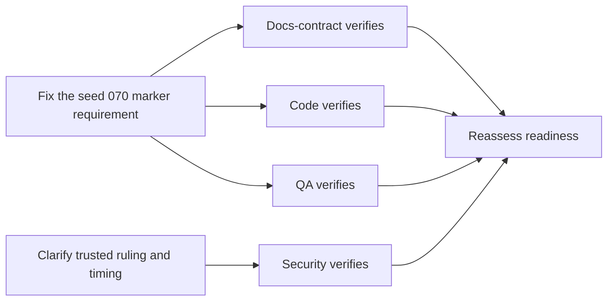

# Test a graph view of the review handoff

Change ID: `23z5n-task pilot-review-handoff-graph`
Change Status: `complete`
Owner: Engineering
Status: complete
Last verified: 2026-11-21
Wave: TBD

This standalone, read-only pilot is complete. Wave `24237` delivered the optional diagrams. The [pilot report](../reports/review-handoff-graph-pilot.md) records the decision to keep the existing review workflow.

## Rationale

In 23zbg, three reviewers reported a missing seed marker under separate IDs. In 23xo7, the team began full qualification while reviewers still had work that could change its inputs. A useful handoff tells the next coordinator what to do with those facts.

## Product Intent

A coordinator picking up a wave should identify the next repair, who must verify it and when qualification is trustworthy. Replay the same decisions with today's guided actions and a read-only dependency view. This exercises Horizon 4's comparison of two approaches. AC-1 through AC-3 establish what the replay can tell us.

## Requirements

1. Freeze both historical ledgers at selected complete event boundaries before repair, during review and after reviewer approval. Call the shipped review-action projection on each prefix. Keep later outcomes out of the reader packets.
2. Give both readers the same underlying lane observations, review actions and source-qualification information. Add a derived handoff to one packet. Mark suggested common repairs as coordinator judgments. Preserve original finding IDs, distinct failures and lane obligations.
3. Distinguish repair readiness, a diagnostic test run and qualification on settled inputs. Missing evidence leaves qualification unknown. Neither view authorizes a write, approval or closure.
4. Before scoring, set the decision rule. Advance the view to a live advisory trial only if it corrects a baseline decision without introducing a missed lane, merged distinct defect or unsupported qualification claim. Equal decisions establish parity only. A safety error calls for repair. Record preparation cost and likely sources of bias.

## Scope

This first trial uses two closed waves, current Python readers and temporary read-only packets. Deliver the results and an example handoff. The pilot changes no shipped code, dashboard, lifecycle state, or historical evidence. Wider orchestration and automated scheduling need a separate decision.

## Acceptance Criteria

- [x] AC-1: The replay identifies its exact cutoffs, comparator and evidence for each recommendation. A fresh reader can distinguish a shared repair from a separate issue and account for all observations.
- [x] AC-2: A change of review state alters the advice appropriately. The coordinator can distinguish a pending repair, remaining review, and missing suite evidence across the delivery checkpoints.
- [x] AC-3: Report both readers' decisions against the same rubric, any safety error and the justified next step. Reserve claims about throughput and adoption for observations on live work.

## Tasks

- [x] Capture baseline actions and build a read-only example showing dependencies.
- [x] Run separate reader sessions on the same cases, score them and record the decision.

## Agent Execution Graph

| Workstream | Owner | Depends on |
| --- | --- | --- |
| Select cutoffs, define scoring and prepare packets | Coordinator | Closed records |
| Interpret baseline and candidate separately | Independent readers | Frozen packets |
| Compare decisions and record limits | Coordinator | Both responses |

### Example handoff from 23zbg

At ledger line 14 the coordinator faces two repairs. One marker edit feeds three independent checks. The security reviewer checks a different requirement. The diagram groups the work while the ledger retains all four findings.

The last node asks the coordinator to check the current readiness requirements. Each arrow points from a prerequisite to the work it enables. This snapshot grants no signoff. Keep a graph at the wave level when its dependencies cross specs and in the spec when they concern one repair.

## Serialization Points

- `docs/reports/review-handoff-graph-pilot.md`

## Affected Architecture Docs

N/A. The historical replay changes no shipped interface or runtime contract.

## AC Priority

| AC | Priority | Reason |
| --- | --- | --- |
| AC-1 | required | Exposes unsafe grouping or dropped reviewers. |
| AC-2 | required | Exposes premature qualification or a stale next action. |
| AC-3 | required | Prevents an equal result from becoming an improvement claim. |

## Decision Log

| Date | Decision | Reason | Alternatives |
| --- | --- | --- | --- |
| 2026-11-21 | Try an advisory view on historical prefixes. | The operator asked to try the proposed handoff. The planner selected the existing review reader as the comparator. | A static diagram cannot respond to a new finding. A scheduler would introduce execution authority before demonstrating a better decision. |

## Risks

Two readers can differ for reasons unrelated to presentation. A person supplies the semantic grouping, and a closed ledger alone cannot reconstruct every historical working tree. Distinguish those limits from measured results. If the result warrants a live trial, compare duplicate calls, full-suite attempts, time to green and missed checks on comparable waves.

## Progress Log

| Date | Update | Evidence |
| --- | --- | --- |
| 2026-11-21 | Set the comparison and decision rule before the reader trials. | Requirements and acceptance criteria above. |
| 2026-11-21 | Completed the read-only pilot. Both coordinators reached the correct decisions at all five checkpoints. The diagram and table readers each answered both dependency questions correctly. Keep diagrams optional. | [Results, controls and reproduction](../reports/review-handoff-graph-pilot.md) |

### Diagram comparison

Compare the rendered graph with a table of the same eight relationships using two fresh readers. Both receive the same two partial-completion scenarios. Score whether each names the remaining verification and recognizes that reassessment depends on it. Keep diagrams optional if both readers answer both correctly.

## Session Handoff

See `docs/agents/session-handoff.md` for current session state.
