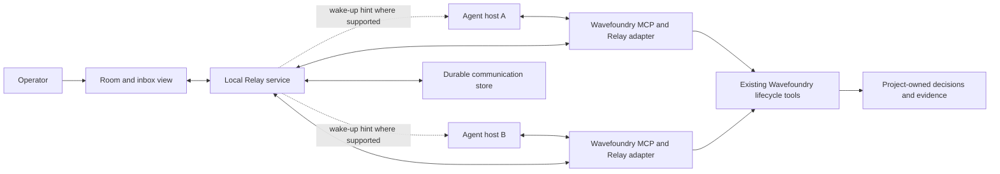

# Relay: Vision and Technical Horizons

Owner: Engineering
Status: active
Last verified: 2026-10-27

## Purpose

Relay is a proposed independent coordination service that lets agents working on the same project communicate reliably across hosts and sessions. The operator selects a project root; agents join its room, discover authorized participants, exchange questions and findings, and resume conversations after interruption. The operator no longer has to carry messages between otherwise capable agents.

“Relay” is a working name. This document establishes the intended product and its technical progression; it does not describe an implemented service. It is temporarily maintained in Wavefoundry until the service has its own repository. The service is independently useful, while Wavefoundry is a prospective integration and a demanding first consumer. Its place in the larger program is described in [Wavefoundry's vision](../../VISION.md).

The ultimate outcome is dependable collaboration among independently operated agents. Communication remains inspectable, participants retain clear scopes, and a conversation can outlive any one model context or host process. Success means less blocked work and less human relaying, with no loss of accountability.

## The experience

An operator starts implementation in one agent host and API work in another, both pointed at the same checkout. They join the same project room through their Wavefoundry MCP connections. Each has a distinct session identity and a scoped assignment.

The implementation agent discovers that the proposed response format breaks pagination. It sends a question to the API agent in the task thread, referencing the interface and relevant revision. The API agent replies with a proposed compatible shape. The coordinator resolves the interface decision through the project's normal workflow; both agents continue against that agreed contract.

A QA agent later reports a restart failure with a reproducer and the tested revision. The recipient disconnects before reading it. The message remains available; the replacement session receives a deliberate handoff and sees what remains unresolved. It does not inherit the previous agent's claimed completion or authority merely by reusing its display name.

The operator sees who is working, which requests are unanswered, which assumptions changed, and which decisions need attention. A quiet project generates little traffic. Agents receive the relevant thread, not an ever-growing copy of every conversation.

## Starting point and evidence

This is a new service proposal. No Relay implementation or separate service repository was supplied or evaluated. The current-state evidence below concerns the inspected Wavefoundry checkout and the integration constraints; it is not live cross-host qualification.

| Foundation | Current evidence | What Relay would add |
|---|---|---|
| Host-neutral collaboration guidance | [Seed 180](../../.wavefoundry/framework/seeds/180-implement-change.prompt.md), **Host-neutral orchestration**, requires scoped delegation, actual capability checks, integrated evidence, and artifact-based handoff. It does not require shared chat or a session registry. | Durable participant discovery and communication across host boundaries. |
| Per-host MCP entry point | [server.py](../../.wavefoundry/framework/scripts/server.py), `main`, builds the server and runs the stdio transport. | A shared service reached by separate MCP processes; process-local memory cannot serve as the common room. |
| Independent service integration precedent | [Embedding architecture](../architecture/embedding-model.md), **Optional Tensorwell execution**, and [tensorwell_client.py](../../.wavefoundry/framework/scripts/tensorwell_client.py), `_request`, describe and implement a bounded client to a separately owned service. | A separate communication responsibility with its own protocol and lifecycle; Tensorwell is an architectural precedent, not a proposed chat backend. |
| Review authority | [review_evidence.py](../../.wavefoundry/framework/scripts/review_evidence.py), module contract and `_validate_evidence_shape`, separates canonical evidence validation from deciding whether a claim is true. | Messages can point to evidence and request review; they do not become approval records by being delivered. |
| Host notification mechanisms | [MCP notification documentation](https://ts.sdk.modelcontextprotocol.io/v2/servers/notifications) describes server-to-client change signals. | Host-specific integration must establish whether a notification reaches model context or starts work. Protocol delivery alone does not establish either. |

The immediate uncertainty is whether the first intended hosts can receive a message at a useful time without human intervention. Establish this experimentally before investing in broad protocol or UI work.

## Product and authority boundaries

Relay owns rooms, participant sessions, messages, receipt state, and communication history. Agent hosts own agent execution and the mechanism for introducing new input. Wavefoundry owns its project context, lifecycle policy, work allocation, and review records. The operator owns delegated authority and consequential decisions.

A received message is peer input, not a higher-priority instruction or a grant of new permissions. A role label such as “reviewer” is descriptive unless the surrounding system binds it to an authorized identity. Even an authenticated sender can make an incorrect claim.

Relay does not initially launch agents, select models, assign repository write locks, resolve Git conflicts, or declare tasks complete. Acknowledging delivery and accepting an assignment are separate acts. Independent reviewers receive scoped factual inputs without automatically inheriting implementation deliberations that could compromise an independent assessment.

The service should be usable through a small protocol and CLI as well as an MCP adapter. A useful local mode is the first product. Remote federation is a later capability with a separate trust model, not a prerequisite for two agents on one machine to communicate.

## Proposed architecture

Every Relay component below is proposed. Wavefoundry's stdio MCP surface exists; its Relay adapter does not yet exist.

Use a transactional local store as the initial design candidate; SQLite is worth evaluating for the single-machine service. Keep its records separate from Wavefoundry's semantic index and review ledger: room history has different ownership, retention, access, and rebuild semantics. Losing a disposable index must not lose undelivered requests. Database selection, endpoint transport, service discovery, and packaging remain implementation decisions.

### Project identity

The project root is the room selector, not an authorization credential. Resolve permitted path aliases to a canonical checkout identity using platform-aware filesystem semantics. Do not blindly lowercase paths. Separate checkouts and worktrees remain separate rooms by default, even when their Git remotes match.

Use an opaque room identity behind that local root mapping. Repository moves require an explicit rebind or documented continuity rule; a new project created at an old path must not silently inherit old conversations. Later multi-machine collaboration needs an explicit shared project identity and membership, not guesses from path names or repository URLs. Links between rooms should be deliberate and revocable.

### Message and session semantics

A minimal envelope identifies the room, sender session, recipient or thread, message ID, creation time, and optional task and artifact references. The body can remain ordinary prose. Add structured request kinds only when consumers demonstrate a need; preserve unknown compatible fields through versioned evolution.

Distinguish server acceptance, durable persistence, availability to the recipient, adapter receipt, and an explicit agent response. Only report states actually observed. Presence is a renewable liveness hint, not proof that an agent is reasoning, available, or holding a resource safely.

Use stable IDs and idempotent submission to handle ambiguous retries. Provide per-recipient cursors and bounded replay; retain a message until its documented retention or expiry policy applies. Delivery may repeat after a crash, so consumers deduplicate by identity. Do not promise exactly-once external actions: a recipient must independently make an action idempotent or reconcile its outcome. Ordering needs to be defined within a thread; a global ordering of all project activity is unnecessary initially.

Messages reference artifacts and revisions instead of copying entire workspaces. Attachment access remains subject to the recipient's permissions. An attachment path is not an instruction to read arbitrary files, and a copied test result is not proof that the current tree passed it.

## Horizon 1 — A durable project room

**Unlocked experience.** Two independent clients can join one permitted project room and exchange messages that survive service and client restarts.

**Foundations and prerequisites.** Establish service discovery, local access control, canonical root mapping, opaque room and session IDs, transactional persistence, idempotent sends, bounded inbox reads, acknowledgments, expiry, and explicit error states. No model integration is required to prove this layer. Keep session generation distinct from a reusable participant name.

**Demonstration.** Two command-line clients exchange requests while a fault harness interrupts the service before and after persistence and acknowledgment. Retry ambiguous sends, resume from stored cursors, and test path aliases, separate worktrees, and unauthorized room access.

**Exit criteria and failure conditions.** An independently maintained test oracle accounts for every accepted message in the declared fault model: it is retrievable, acknowledged, or explicitly expired under policy. Retries do not create new logical messages. Room isolation holds for the exercised identities. Any unexplained loss, cross-room disclosure, or acknowledgment by the wrong session fails this horizon. An in-memory queue must fail the restart demonstration.

**Uncertainty and intermediate value.** The endpoint transport, retention defaults, OS identity binding, backup model, and storage location require evaluation. Durability is limited to the declared process, filesystem, and backup fault model; permanent disk loss is not solved by transactions. Even before agent integration, this horizon provides a usable local mailbox and replayable protocol.

## Horizon 2 — Agents actually receive and use messages

**Unlocked experience.** Agents in two different hosts resolve a dependency through Relay without the operator copying text between them.

**Foundations and prerequisites.** Build on durable rooms with Wavefoundry MCP tools and a small host capability contract. Qualify foreground inbox checks, bounded waiting, and wake-up integration independently for each supported host. Unsupported hosts use explicit polling at task boundaries and advertise that limitation. Avoid rapid empty polling, indefinite blocking calls, and false “delivered to agent” claims.

**Demonstration.** Run an interdependent API/client task in two real hosts. Send a contract question while its recipient is busy, disconnect one session, and resume deliberately. Verify the relevant agent turn contains the question and the resulting work reflects the answer.

**Exit criteria and failure conditions.** The two-host task completes without human message relaying under a declared delivery mode and latency budget. Observed transcripts distinguish service acceptance from actual agent consumption. The restart path preserves unresolved requests. A notification that reaches the client but never reaches an agent fails the push claim; a poll-only result cannot be labeled automatic wake-up. A mocked host callback alone does not qualify host support.

**Uncertainty and intermediate value.** Host APIs, capability availability, interruption semantics, and context injection may limit automation. Measure these early. Reliable pull-based communication still offers useful collaboration if push cannot be supported.

## Horizon 3 — Focused collaboration and durable handoffs

**Unlocked experience.** Several agents cooperate without flooding each other's context, losing unresolved questions, or confusing conversation with approved work.

**Foundations and prerequisites.** Add scoped task threads, reply correlation, recipient filters, participant capabilities with observed-versus-claimed status, backpressure, unread summaries with source links, and handoff manifests referencing current artifacts. Build on proven receipt behavior. Explicitly track withdrawn or superseded requests. Summaries aid navigation; original messages remain inspectable while retained.

Wavefoundry's adapter maps threads to existing wave and change identifiers and provides an explicit path to record a decision or finding through existing tools. Relay does not independently update acceptance criteria, grant write ownership, or infer review approval. Review contexts can exclude shared deliberation while still receiving the required source and evidence packet.

**Demonstration.** A coordinator, implementer, API agent, and reviewer handle a mid-task interface change. Replace the coordinator, supersede an old request, and have the reviewer independently reproduce a reported failure. The incoming coordinator recovers the outstanding questions and artifact references without rereading the entire room.

**Exit criteria and failure conditions.** Independent adjudication confirms the resulting implementation uses the agreed interface and stale requests cause no unauthorized actions. Compare operator relaying, blocked time, missed questions, and communication tokens against an artifact-only baseline. The horizon fails if improved apparent throughput depends on hidden human relaying, lost objections, or chat messages being treated as lifecycle approval.

**Uncertainty and intermediate value.** Optimal thread granularity and summary quality are empirical questions. Excessive communication can amplify shared mistakes. A bounded task inbox is useful even if more ambitious orchestration never ships.

## Horizon 4 — Deliberate collaboration across machines and teams

**Unlocked experience.** Authorized participants on different machines can collaborate on explicitly linked projects while retaining local control and visible failure states.

**Foundations and prerequisites.** Require proven local semantics and demonstrated demand. Add authenticated principals, project membership, scoped capabilities, encrypted transport, revocation, quotas, version negotiation, audit export, and a documented reconnect/partition policy. Distinguish participant identity from model identity. Shared project membership must not imply access to every local checkout or attachment.

Prefer a single authoritative room service per room as the first remote candidate. Treat offline multi-writer replication as a separate research decision; do not introduce a distributed consensus system merely to send messages. Local-only rooms continue to work without a remote service.

**Demonstration.** Two operator-controlled machines collaborate across a temporary partition. Revoke one participant, reconnect, and verify backlog access, retry behavior, expiry, and artifact permissions. Exercise deployment and upgrade compatibility between supported client versions.

**Exit criteria and failure conditions.** Independent protocol and security tests establish the declared membership, partition, and revocation semantics. No message is silently described as current when its delivery state is unknown. Revocation prevents new authorized access after the specified enforcement point; previously received content cannot be recalled. Unauthorized disclosure, silent split histories, or a mandatory network dependency for local rooms fails the horizon.

**Uncertainty and intermediate value.** Remote trust, operational ownership, data residency, retention, and partition behavior need explicit product decisions. A self-hosted single-authority service provides value before any federation or replication.

## Sequencing and investment

No separate twelve-month or unlimited-resources commitment was specified for Relay. Sequence it by evidence. Work on protocol fault testing and host-reception feasibility can proceed in parallel; broader features depend on both succeeding.

| Stage | Demonstration | Decision unlocked |
|---|---|---|
| Feasibility | Real message consumption in the first two intended hosts; plain-client restart experiment | Whether push, pull, or a mixed mode is viable, and whether a shared service earns its integration cost. |
| Local foundation | Horizon 1 fault and isolation qualification | Stable message/session semantics for adapters. |
| First useful release | Horizon 2 real-host task and recovery | A supported local collaboration workflow. |
| Coordination maturity | Horizon 3 comparative multi-agent tasks | Whether richer threads and handoffs improve verified delivery. |
| Optional expansion | Horizon 4 authorized remote collaboration | Whether remote operation justifies its operational and trust complexity. |

Within Wavefoundry's initial twelve-month program, Relay's local feasibility and durable-room work fit the first quarter; qualified host integration can support later mission and parallel-experiment work. This is an integration opportunity, not a promise that Relay completes a horizon on that schedule.

## Measuring whether Relay helps

Use the same agents, models, task classes, and execution budgets to compare artifact-only handoff, available host-native messaging, and Relay. Include tightly coupled tasks, independent tasks that should need little communication, interruption, stale context, and deliberate conflicting information. Rotate assignments and repeat trials; freeze evaluation tasks and success criteria before comparison.

Measure operator relay minutes, dependency wait time, verified task completion, escaped defects, missed requests, duplicate action attempts, communication tokens, service overhead, and recovery time. Separate time spent awaiting a legitimate human decision from avoidable message delay. Count failed, abandoned, and human-rescued trials. An independent reviewer judges correctness from artifacts and behavior rather than the agents' completion reports.

An initial proposed adoption target is a 50% reduction in human relaying on the selected interdependent-task portfolio with no increase in escaped defects or unauthorized actions. Set the observation window, sample size, acceptable uncertainty, and latency/resource budgets during the first evaluation design. This target is not a measured result. If coordination cost exceeds saved effort, narrow the use case rather than expanding message volume.

## Open decisions and next investment

The first decisions are which two hosts to qualify, how their sessions are bound to room membership, where durable state lives, and which transport meets local access and discovery needs. The first experiment should test real recipient consumption; the first protocol test should interrupt persistence and acknowledgment. Neither needs a full dashboard, scheduler, or federation layer.

Longer-term questions include when an unanswered request should escalate, how summaries preserve disagreement, how reviewers remain independent, and how an operator can distinguish inactivity from a dead session. Reliable delivery cannot make a wrong message true or a compromised peer trustworthy. Relay must expose those limits rather than hide them behind a green presence indicator.

This vision authorizes no implementation, service installation, repository-policy change, or deployment. Future changes follow their own project's lifecycle. The ultimate demonstration is several independently operated agents completing an interdependent project through interruption and handoff, with the human directing consequential choices instead of carrying messages, and with a complete, challengeable record of what was communicated and what was actually accomplished.
