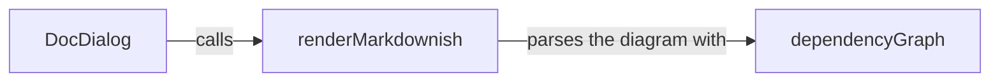

# Explain implementation paths with labeled diagrams

Change ID: `24238-enh explain-implementation-with-labeled-diagrams`
Change Status: `implemented`
Owner: Engineering
Status: implemented
Last verified: 2026-11-21
Wave: 24239 implementation-walkthrough-diagrams

## Rationale

Explain already asks the engineer to trace an input through the real code. Architecture guidance already covers control flow, state ownership and system boundaries. The missing instruction is when a picture helps the person taking over a delivered change and what each arrow claims. Wave 24237's dashboard describes every supported arrow as “must finish before.” A call from one component to another has a different meaning.

## Product Intent

A maintainer reviewing a change can trace a real request or recovery path, say what crosses each boundary, and find the code or test supporting that account. This advances Horizon 2 (understand the system) and supports Horizon 3 handoffs. AC-1 tests the walkthrough on a delivered example. AC-2 tests whether the dashboard communicates the same relationships.

## Requirements

1. In the shipped and self-hosted Explain prompts, tell the author to use an optional diagram when it clarifies a consequential implementation path or architecture change. Choose one real request, state transition or failure and recovery. Name the participating components and show the direction and meaning of each relationship. In the accompanying text, cite the entry point and the implementation or test that supports the trace. Mark uncertainty where evidence runs out. A straightforward change can use prose alone.
2. Prefer linking an accurate, maintained architecture diagram when it already answers the reader's question. If it is stale, identify the discrepancy and use the verified path. Keep a new walkthrough diagram in the conversation by default. Explain remains read-only. A maintainer who needs a permanent correction uses the existing documentation workflow.
3. Extend the local dashboard's existing bounded flowchart syntax to accept an explicit plain-text label on a directed edge, for example `A -->|reads from| B`. Render the author's words visibly on that arrow and in the accessible relationship list in the same direction. Support different verbs and distinct labels on parallel edges. Use a neutral heading such as “Relationships” for labeled diagrams. Explain can give the same relationships in text on hosts that do not display Mermaid.
4. Preserve the dependency diagrams delivered by 24237. A wholly unlabeled diagram retains its existing prerequisite semantics and accessible wording. For a walkthrough, require a label on every edge. A block mixing labeled and unlabeled edges falls back in full to its readable source. Renderers must not infer meaning from node names, section headings or document location. Keep layout offline, treat labels as inert text, bound work and label length, and retain whole-block fallback for unsupported or unrenderable input.
5. Deliver guidance through the existing missing-only Explain baseline and the existing upgrade reconciliation guidance for customized prompts. Preserve local vocabulary and authored instructions on a repeat upgrade. Keep one owner for the dashboard syntax and cross-reference it from Explain.

### Worked example

When the document dialog displays a spec, `DocDialog` passes the body to `renderMarkdownish`. For a supported Mermaid fence, that renderer calls `dependencyGraph` to interpret the diagram. These arrows describe calls observed in code. They do not require the caller to finish before the callee starts. [Document dialog](../../../.wavefoundry/framework/dashboard/dashboard.js) · [Markdown renderer](../../../.wavefoundry/framework/dashboard/ds/wfds.js)

## Scope

The first deliverable is useful on its own: a source-backed conversational walkthrough. The second lets a reader inspect the same notation in a wave or spec already displayed in the dashboard. Use wave 24237's renderer and test fixture as the implementation baseline. General Mermaid support, automatic diagram extraction, new architecture pages, scheduling and approval policy are outside this change.

## Acceptance Criteria

- [x] AC-1: Using the revised Explain prompt on a real delivered change, a fresh reader correctly identifies the entry point, direction of an interaction and the code or test that supports it. The reviewer checks those answers against the implementation. A simple-change control stays concise, and a relevant maintained diagram can be reused without writing project files.
- [x] AC-2: In a real offline dashboard document view, the reader can match each visible arrow to its source, verb and target, and recover the same triples from the accessible list. Cover two different verbs, parallel edges, a join and a narrow viewport. A swapped verb or reversed endpoint fails verification even when node and edge counts match.
- [x] AC-3: The existing pilot still displays seven nodes, eight prerequisite edges and its original accessible descriptions. A mixed block, malformed label, unsupported active content, input beyond the bounds or a layout failure displays the complete source. Neighboring Markdown and ordinary fences retain their behavior.
- [x] AC-4: A fresh install supplies the guidance. Following the upgrade instructions on a customized Explain prompt retains local text and vocabulary and introduces the guidance once. A repeat leaves the reconciled prompt stable.

## Tasks

- [x] Update the shipped Explain baseline, local prompt, syntax guidance and upgrade instructions. Exercise the walkthrough and install/upgrade cases.
- [x] Extend the shared parser, layout and accessible output. Run regressions for labeled, legacy and unsupported blocks.
- [x] Verify legibility and direction in the dashboard, complete delivery review, validate docs and run the framework suite.

## Agent Execution Graph

The technical writer and dashboard builder agree on the edge syntax and fallback first. They can then work independently. QA checks their combined example through the document viewer.

## Serialization Points

- `.wavefoundry/framework/install/lifecycle-prompts/explain.prompt.md`
- `docs/prompts/explain.prompt.md`
- `.wavefoundry/framework/seeds/170-plan-spec.prompt.md`
- `docs/prompts/plan-spec.prompt.md`
- `.wavefoundry/framework/seeds/160-upgrade-wavefoundry.prompt.md`
- `.wavefoundry/framework/dashboard/ds/wfds.js`
- `.wavefoundry/framework/dashboard/dashboard.css`
- `.wavefoundry/framework/scripts/tests/test_dashboard_server.py`
- `.wavefoundry/framework/scripts/tests/fixtures/dashboard-dependency-diagrams.cjs`

## Affected Architecture Docs

The domain-boundary guidance in seed 060 and architecture-authoring guidance in seed 211 already cover how to document a system. Reuse them. The technical writer owns the prompt and seed edits above; the frontend builder owns the dashboard changes. Code, QA, security and docs-contract reviewers verify the change read-only. Protect the lifecycle ledger, existing skill routing, project-authored architecture pages and the completed 24237 records.

## AC Priority

| AC | Priority | Reason |
| --- | --- | --- |
| AC-1 | required | Tests whether a maintainer understands a verified path. |
| AC-2 | required | The graphic and the text must communicate identical relationships. |
| AC-3 | required | Protects existing plans, dashboard readers and the local rendering boundary. |
| AC-4 | required | New and existing downstream projects both consume Explain. |

## Decision Log

| Date | Decision | Reason |
| --- | --- | --- |
| 2026-11-21 | Planner selected explicit Mermaid edge labels and the existing offline layout. | Guidance alone leaves dashboard readers with a false prerequisite description. Inferring the meaning from the containing document fails when a single spec contains both kinds of diagram. |
| 2026-11-21 | Keep the existing meaning for wholly unlabeled diagrams and fall back for a mixed block. | This preserves existing plans and gives authors one clear way to express runtime relationships without guessing at an unlabeled arrow. |

## Risks

A label between two close or parallel edges can appear to describe the wrong edge. Include that case in visual and accessible checks. A reader trial on one delivery can establish that the example is understandable; it cannot establish a general improvement in maintainer speed.

## Progress Log

| Date | Update | Evidence |
| --- | --- | --- |
| 2026-11-21 | Identified the shipped prompt, customized-prompt upgrade route, shared renderer and legacy pilot for comparison. | Shipped Explain baseline, seed 160 delivery walkthrough reconciliation, and 24237 delivery record. |
| 2026-11-21 | Readback: a maintainer can trace a real interaction in Explain. A labeled arrow that previously appeared as source now reads “Handler reads from Store” visually and in text. AC-1 through AC-4 cover comprehension, drawn direction, legacy fallback and prompt delivery. The renderer, its fixture, the planning and Explain prompts and the upgrade seed carry the change. Explain remains read-only. | Recorded after the first renderer edit and before the prompt changes. |
| 2026-11-21 | A blinded reader identified the caller, callee and reversal test. Chrome at 390 px showed three labeled relationships, two parallel, and all eight original prerequisite edges. A missing-only install and two customized upgrade trials preserved local wording on repeat. | Dashboard browser checks, reader trial and independent QA. |
| 2026-11-21 | Delivery review found a mismatch in the stated label length rule and a clipped diagram under invalid layout output. Both syntax guides now include surrounding nonbreaking spaces. The viewer keeps the complete source when returned geometry lies outside the canvas. | The focused test rejects a zero-width canvas, an offscreen verb, a mismatched verb and a 65-unit trimmed label. Both dashboard dialogs passed after repair. |
| 2026-11-21 | All four delivery lanes approved after both repairs. Full documentation validation passed. The default framework suite ran 13,194 tests across 253 files in 759 seconds with 12 skips and zero failures. | Wave review ledger and framework test receipt. |
| 2026-11-21 | Readback for the terminal follow-up: Requirement 3 already calls for equivalent relationships in text. Show the diagram first in a terminal walkthrough, retain source, verb and target on narrow displays, and link an available graphic for zoom or sharing. Verify the shared Explain prompt and its upgrade instructions on Codex CLI and Claude Code. | Operator request after trying the walkthrough. |
| 2026-11-21 | Offline replay of synthetic assistant responses in Codex CLI 0.170.0 and Claude Code 2.1.330 showed the same labeled text diagram at 40 and 80 columns. At 40 columns Codex drew the sample Mermaid graph, Claude Code displayed its source, and both displayed the existing SVG reference as a link. The explicit text diagram works across both. | Real client transcripts, isolated local fixtures. The probe exercised display of fixed messages and did not invoke a model or activate the SVG link. |
| 2026-11-21 | QA and docs-contract approved the terminal follow-up. Full docs lint and both skill-route tests passed. The full suite ran 13,194 tests with 12 skips and two failures. All offending inputs were scratch files belonging to another wave. Both failing checks passed in an isolated copy of the current tracked and nonignored source. | The CLI documentation census found a copied changelog. The chunk-coordinate census found five scratch Markdown tables. A green current-checkout receipt is still outstanding. |

## Session Handoff

See `docs/agents/session-handoff.md` for current session state.
