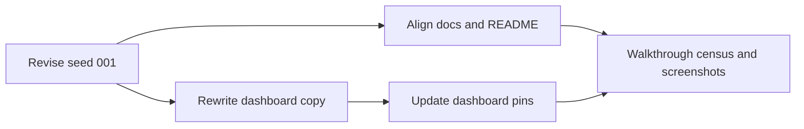

# One simple lifecycle model across the docs and the dashboard

Change ID: `2430q-enh simple-lifecycle-model-and-dashboard-dialogs`
Change Status: `implemented`
Owner: Engineering
Status: implemented
Last verified: 2026-11-22
Wave: 2430r simple-lifecycle-docs-and-dashboard

## Rationale

On 2026-11-22 the operator asked for "a review of the documentation, readme as well as the dashboard lifecycle" and for "the most accurate yet simple representation of the wave / spec lifecycle", so that "people coming from speckit are comfortable in WF". The operator also asked to "keep the dashboard lifecycle tiles simple" and to "add additional context in the dialogs so people know what they're doing, when the councils are running, what the gates are."

The audit below shows that each surface tells the lifecycle a little differently. Some surfaces leave steps out, and some describe a gate that does not exist. The dashboard dialogs describe none of the councils or gates.

### Audit 1: the lifecycle as the code and seeds implement it

Each fact below was read in the cited source on 2026-11-22. A gate marked **hard** refuses the call; **advisory** reports and does not block.

| Step | What happens | Gates and reviewers | Source |
| --- | --- | --- | --- |
| Plan spec | The agent mints a change id with `wf_new_<kind>` (`feat` is retired; `wf_new_feature` refuses) and writes one consolidated spec in `docs/plans/<change-id>.md`: Rationale, Product Intent, Requirements, Scope, ACs, Tasks, Decision Log | None. Repository code edits are not allowed yet (stage gate) | `docs/prompts/plan-spec.prompt.md` Steps 3 and 5; AGENTS.md **Stage Gate** |
| Review plan (optional) | Walks every unresolved decision in a spec, or in the current wave, one question at a time | Records no signoff and satisfies no gate | `docs/prompts/plan-spec.prompt.md` Step 7; seed 175 |
| Create wave | Creates `docs/waves/<wave-id>/wave.md` | None | seed 001 section 1 |
| Add spec to wave | Admits the change and moves its spec into the wave folder | None | seed 001 Core Concepts |
| Prepare wave (alias Ready wave) | Validates and gardens docs, makes admitted specs wave-owned, selects readiness lanes from Serialization Points and requested lanes, records the review-policy receipt, and runs the readiness Wave Council: a `red-team` adversarial primer at a declared depth, then the configured fixed seats (`fixed_seats`; the framework default is `architecture-reviewer`, `security-reviewer`, `qa-reviewer`, `reality-checker`) and one rotating seat, synthesized by `council-chair` into a `council-readiness` approval | **Hard, every repository**: implementation refuses without the readiness approval the current receipt requires; a changed policy input (spec digest) lapses approvals and needs re-Prepare. Ordinary review (the shipped default, `wave_review.enabled: true`) requires `council-readiness`; the operator-selected small-change lane requires an independent code reviewer instead; with review disabled (`enabled: false`, `delivery_mode: disabled`) no council runs and a clean Prepare pass suffices. A readied wave does not take an OPEN slot | `review_policy.py` `REVIEW_POLICY_SURFACE_BLOCKS` (Prepare is "the single readiness authority"); seed 007 lines 25 to 59; AGENTS.md **READY vs OPEN** |
| Implement wave | Activates the wave (OPEN) and implements every admitted change with real-time AC and task tracking | **Hard, every repository**: by default one OPEN wave per repository, checked at activation (`Implement wave`, `wf_reopen_wave`, `wf_prepare_wave(mode='create')`); the policy is `record_paths.OPEN_CONTAINER_SCOPE` (shipped `"repository"`), and a distribution with `NESTED = True` may set `"parent"` for one OPEN wave per parent folder. **Host hook, not a lifecycle gate**: the `framework_edit_allowed` and `seed_edit_allowed` gates guard framework-maintenance and seed paths through the host's pre-edit hook; the operator or agent opens them explicitly with `wf_open_gate`, and while closed the hook refuses (or, on some hosts, warns and halts) those edits. They do not affect ordinary product-code edits | `docs/prompts/implement-wave.prompt.md` line 108; `record_paths.py` line 50; AGENTS.md **Framework Script Hygiene** and **Seed prompts**; seed 050 line 441 ("a host guarantee, not a framework one") |
| Review wave | Runs the required delivery lanes (`wf_review_wave(phase='implementation')`); runs the delivery Wave Council only when the receipt lists `council-delivery`; records typed events in the wave's `events.jsonl` ledger | Delivery council per `wave_review.delivery_mode`: `targeted` (shipped default) escalates only on boundary triggers such as release, trust, permission or cross-platform changes; `disabled` never runs it. Readiness review already ran at Prepare | `docs/prompts/review-wave.prompt.md` lines 21 and 36; `review_policy.delivery_council_required`; `FULL_COUNCIL_TRIGGER_FIELDS`; `FRESH_INSTALL_DELIVERY_MODE = "targeted"` |
| Pause wave | Parks session state in `docs/agents/session-handoff.md`. A paused wave whose delivery review is complete shows **Awaiting closure** and can be closed without reopening | None | `lifecycle_gates.paused_wave_presentation`; README "Close the work" |
| Close spec (optional) | Closes one reviewed change inside the open wave with `wf_close_change`; never closes the wave | Needs the change's delivery review | `docs/prompts/close-spec.prompt.md`; AGENTS.md shortcut table |
| Close wave | Operator-owned. Verifies required approvals and the typed `operator` signoff; in the framework source repository only, also the framework test receipt (`.wavefoundry/framework/test-cache.json`) | **Hard, every repository**: close blocks without operator signoff, without required delivery approvals, or with any AC or task still `[ ]`; agents never close without explicit operator instruction. **Framework source repository only**: close also blocks on a missing, red or stale test receipt (`framework_test_receipt_not_proven`); in a repository that consumes the packaged framework the runner and receipt are absent and the check is a documented no-op | seed 190 item 18 and the operator-approval rule; `docs/contributing/build-and-verification.md` lines 649 to 656; AGENTS.md **Wave Close** |

The optional small-change lane (wave `241lp`, `small_change_lane.py`) applies only when the operator requests it at admission. It requires an independent code reviewer at readiness and at delivery and keeps operator-owned closure (seed 020 line 18).

### Audit 2: surfaces that depict the lifecycle

Dashboard (`.wavefoundry/framework/dashboard/dashboard.js`, `FRAMEWORK_FLOW()` lines 236 to 281; all lifecycle copy is in JS, none in Python):

1. Five tiles: Plan spec, Prepare Wave, Implement Wave, Review Wave, Close & Maintain. Create wave and Add spec to wave appear only as a clause in the Plan dialog.
1. The Prepare dialog ("Resolve material gaps before opening the wave for implementation") names no docs validation, receipt, readiness lanes or readiness council, and implies that Prepare opens the wave. It does not say that a readied wave leaves the OPEN slot free.
1. The Implement dialog names neither the single OPEN slot nor the edit gates.
1. The Review dialog names no delivery lanes, no delivery council and no ledger.
1. The tile "Close & Maintain" names no real step; its chip "Signoff" does not say the signoff is the operator's, and the dialog omits the test receipt and Close spec.
1. Defect: `FrameworkProcessDialog` (line 316) renders `{ value: process.track }`, but no entry defines `track`, so an empty meta pill renders (`ds/wfds.js` 216 to 218).
1. The copy dates from wave `12rqj` (2026-05-20) and has not been revised since.

Documentation:

1. README.md "Lifecycle" (lines 282 to 289) says there are only "two enforced gates" and that readiness council runs "when configured". Review ships enabled (`wave_review.enabled: true`), so the readiness council runs by default, though "when configured" stays partly true because a repository can disable review and the small-change lane replaces the council. Activation refuses a second OPEN wave by default, and Close also checks AC states (and, in the framework source repository only, the test receipt). README line 196 ("What you get") repeats "Two phases are enforced gates". `docs/references/wavefoundry-overview.md` line 67 correctly names three gates (readiness, activation, closure), so the two documents contradict each other.
1. README.md "Day-to-day phrases": line 373 says Create wave opens "a delivery unit", but Create only writes a planned record and opening happens at activation; line 374 says Add spec admits to "the active wave", but `wf_add_change` admits into any named wave; line 376 says Implement runs "review lanes", but delivery lanes run in **Review wave**, which the list omits. `docs/prompts/index.md` line 47 repeats "the active wave".
1. README.md "Coming from Spec Kit or OpenSpec" (line 176) maps documents but not commands. It omits constitution, clarify, checklist, analyze and converge.
1. Seed 001 "Lifecycle At A Glance" step 4 (line 50) says Review wave reruns readiness; `docs/prompts/review-wave.prompt.md` line 21 says readiness already ran at Prepare. Step 1 folds Create wave and Add spec into "Plan the wave". Step 5 (line 51) and section 4 (lines 178 and 187) say Close commits the result, which conflicts with operator-owned commits. Lines 62 and 72 offer a "smaller change workflow" that conflicts with seed 020 line 18 ("regardless of apparent simplicity").
1. `docs/contributing/lifecycle-overview.md` (adapted from seed 001) nests Review wave inside the Implement block (lines 31 to 35), lists `council-delivery` as unconditional (line 72) against its own targeted-mode note (line 69), says to "commit" the handoff (line 85), and names a nonexistent `wave_new_<kind>` tool (line 89; the tools are `wf_new_*`). `docs/contributing/change-workflow.md` line 11 repeats `wave_new_<kind>`, and its line 112 allows a docs-only stage-gate waiver that AGENTS.md **Stage Gate** handles as out of scope instead.
1. `docs/prompts/index.md` line 93 says "Every non-trivial code change" needs the full lifecycle, against seed 020 line 18; line 94 omits the small-change exception to the readiness council.
1. `docs/references/wavefoundry-overview.md` lines 59 to 66 fold Add spec into Create wave.
1. `docs/references/project-overview.md` lines 95 to 104 are the most accurate surface (ready versus open, single OPEN slot, Close spec, Pause, Awaiting closure) but omit operator signoff, the test receipt and the small-change lane; line 100 carries `record_paths` detail that does not help orientation.
1. AGENTS.md **Stage Gate** is accurate. No surface in `docs/ARCHITECTURE.md` or `docs/architecture/` depicts the whole lifecycle, and the install prompt does not depict it; neither needs a change.

### Audit 3: Spec Kit commands and their Wavefoundry equivalents

Fetched on 2026-11-22: the Spec Kit README (https://github.com/github/spec-kit), the command reference (https://github.github.io/spec-kit/reference/agentic-sdd.html) and the quickstart (https://github.github.io/spec-kit/quickstart.html). The reference lists nine commands in this order; the table merges `specify`, `plan` and `tasks` into one row because they map to one Wavefoundry step. Commands are invoked as `/speckit.<name>` or, in Copilot skills mode, `/speckit-<name>`.

| Spec Kit command (reference wording) | Spec Kit output | Wavefoundry equivalent | Honest difference |
| --- | --- | --- | --- |
| `constitution`: "Establish or update project principles" | project principles | `AGENTS.md`, `docs/ARCHITECTURE.md` and behavior contracts under `docs/specs/`, written by **Init Wavefoundry** | Wavefoundry derives the operating rules from the repository at install; there is no single principles file |
| `specify`, `plan`, `tasks`: "Define requirements and user stories"; "Create the technical implementation plan"; "Break the plan into actionable tasks" | `spec.md`, design artifacts, `tasks.md` | **Plan spec**: one command and one document (Requirements and ACs; Scope and Decision Log; Tasks) | A Spec Kit feature corresponds to one Wavefoundry **spec**, not to a wave; Wavefoundry keeps what Spec Kit splits across three files in one spec |
| `clarify`: "Resolve ambiguity before planning (optional quality gate)" | updates `spec.md` | **Review plan** (optional) | Review plan records no signoff and gates nothing |
| `checklist`: "Generate requirements-quality checklists (optional quality gate)" | checklist | **Prepare wave** readiness lanes and readiness council | There is no checklist file: reviewers record typed approvals instead, and implementation refuses without the required ones |
| `analyze`: "Check artifact consistency after tasks and before implementation (optional quality gate)" | read-only report | **Prepare wave**: docs validation and the readiness council | Prepare is required, not optional |
| `implement`: "Execute the tasks" | code | **Implement wave** | Implements every spec in the wave; one wave is OPEN at a time |
| `converge`: "Assess implementation against the artifacts and append remaining work" | appends to `tasks.md` | **Review wave** | Review runs delivery reviewer lanes and records findings in a typed ledger; it does not append tasks. Cited from the command reference fetched 2026-11-22 |
| none | none | **Create wave**, **Add spec to wave**, **Close wave** | A **wave** bundles one or more specs for review and delivery; Spec Kit's core commands have no such bundle and no operator-owned closure |

The fetched pages did not confirm the `specs/<feature>/` directory that the existing README table names; implementation must recheck it against Spec Kit's documentation or remove the path.

## Product Intent

A developer who already uses Spec Kit, or who is new to Wavefoundry, reads one short lifecycle in the README and sees the same steps, in the same order, on the dashboard. Clicking a dashboard tile tells them what to do, what the framework does for them, which reviewers or councils run, which gate can stop them and how to clear it, and what comes next.

Before: five surfaces describe the lifecycle differently, the README says only two steps are gated, and the dashboard dialogs mention no council or gate. After: every surface uses one step list taken from one source, the dialogs state the councils and gates with the facts cited in Audit 1, and the tiles stay five short cards.

Boundaries: text and presentation only. No gate, mechanism, tool, tile behavior or linter changes. The first outcome worth delivering alone is the README lifecycle and Spec Kit table (AC-1, AC-2); the dashboard dialogs (AC-4, AC-5) follow and depend on the same step list. A reader walkthrough after delivery (AC-3) tests whether the intent was established.

## Requirements

1. The canonical lifecycle is a five-row table in seed 001 **Lifecycle At A Glance**, one row per stage, with these columns: stage, what you do, what runs automatically, councils and reviewers, gates (with where each applies and how to clear it), and what comes next. The row facts are those of Audit 1, qualified as Audit 1 qualifies them. The README lifecycle section and the five dashboard dialogs copy their rows from that table, and may shorten wording but must not add or drop a gate or council. Every other surface in Scope uses the same stage names in the same order with the one-line summaries below and links to the table. The stage names and summaries are:
   1. **Plan spec**: write one spec with the outcome, acceptance criteria and tasks. Optional: **Review plan**.
   1. **Prepare wave**: **Create wave**, **Add spec to wave**, then Prepare; in ordinary review the readiness council approves the plan (an operator-selected small change uses an independent code reviewer, and a repository with review disabled needs only a clean Prepare pass).
   1. **Implement wave**: open the wave and build every admitted spec.
   1. **Review wave**: delivery reviewers check the result against the acceptance criteria.
   1. **Close wave**: the operator signs off, and the agent closes only on the operator's explicit instruction; optional **Close spec** first; **Pause wave** parks work and shows **Awaiting closure** when review is done.
1. Seed 001 **Lifecycle At A Glance** must state the five stages above and must drop the claim that Review wave reruns readiness. Seed 001 must say the operator commits the closed wave, and must not offer a smaller workflow that skips the stage gate for repository code.
1. `docs/contributing/lifecycle-overview.md` must be hand-merged from the revised seed 001 (it is adapted, not rendered) and must place Review wave only in its own block.
1. README.md must have a short lifecycle section, near **Quick start** or **Fix a bug or add an enhancement**, that lists the five stages, copies the gate facts from the seed 001 table with their scope: the readiness approval and operator-owned close with signoff apply in every repository; one OPEN wave at a time is the default policy; the framework test receipt applies only in the framework source repository and is a no-op in a consuming repository; the framework and seed edit gates are host hooks opened explicitly, which refuse framework-maintenance edits while closed, and are not described as lifecycle gates on product code. It links to the table.
1. README.md **Coming from Spec Kit** must contain a command mapping table built from Audit 3, with the fetch date and source links, and must not name a Spec Kit path that the implementer has not confirmed in Spec Kit's documentation.
1. README.md **Lifecycle** (Core concepts) and **Day-to-day phrases** must match the five stages, include **Review wave**, and stop saying that only two phases are gated or that Implement runs review lanes.
1. `docs/references/project-overview.md`, `docs/references/wavefoundry-overview.md`, `docs/prompts/index.md`, `docs/contributing/change-workflow.md` and `AGENTS.md` must use the five stage names where they list the lifecycle, and must link to the canonical owner instead of restating it. Shortcut tables keep every existing phrase and alias.
1. Every surface in Scope must correct the specific inaccuracies listed in Audit 2: "two gates", Create wave "opens", "the active wave" for admission, review lanes inside Implement, `wave_new_<kind>`, "non-trivial", the unconditional `council-delivery`, agent commits, and the docs-only waiver wording (which must match AGENTS.md **Stage Gate**).
1. The dashboard keeps five tiles in the same order. Each tile keeps only a stage name and one short summary line. Tile 5 is renamed from "Close & Maintain" to the close-wave label, and tile 2's summary names creating the wave and adding specs.
1. Each dashboard dialog body must state, in this order: what you do and the shortcut or tool; what runs automatically; which reviewers or councils run and when; which gates block, where each applies and how to clear it; what comes next. Each dialog copies its row of the seed 001 table. The Close dialog also explains **Close spec**, **Pause wave** and **Awaiting closure**.
1. Dialog text must build every wave and spec noun through the existing terminology helpers (`tierLabel`, `planning`), so a custom vocabulary profile still renders without the default nouns. Dialogs must not compose a shortcut phrase from nouns: under a custom profile the page receives only `planning.shortcut`, `planning.doc` and `planning.docs` (`dashboard_lib.py` lines 244 to 247), and every other shortcut is a per-key override (`vocabulary_profile.derive_prompt_names`). The Plan dialog names `planning.shortcut`; every other dialog names its stable MCP tool (`wf_create_wave`, `wf_add_change`, `wf_prepare_wave`, `wf_implement_wave`, `wf_review_wave`, `wf_pause_wave`, `wf_close_change`, `wf_close_wave`). The tile titles keep their existing construction.
1. Dialogs state one OPEN wave as the default policy (`record_paths.OPEN_CONTAINER_SCOPE`, shipped `"repository"`), not as unconditional.
1. The empty meta pill in `FrameworkProcessDialog` (`process.track`) must be removed.
1. The change must not alter any gate, tool, lifecycle state, MCP response, tile count or click behavior.
1. Platforms: the change is text in Markdown and browser-rendered JavaScript, so behavior is identical on Windows, macOS, Linux and WSL2; the dashboard tests run under Node on each.

## Scope

**Problem statement:** the lifecycle surfaces disagree with each other and with the code, and the dashboard dialogs do not explain councils or gates.

**In scope:**

- seed 001 **Lifecycle At A Glance** (seed-first owner of the five-row table)
- seed 005 line 45 ("rerun during final review"), one line under the same seed gate
- `docs/contributing/lifecycle-overview.md` (hand-merge)
- README.md lifecycle section, **What you get** (line 196), Core concepts **Lifecycle**, **Day-to-day phrases**, **Coming from Spec Kit**
- `docs/references/project-overview.md`, `docs/references/wavefoundry-overview.md`, `docs/prompts/index.md`, `docs/contributing/change-workflow.md`, `AGENTS.md` lifecycle wording
- `.wavefoundry/framework/dashboard/dashboard.js` `FRAMEWORK_FLOW()` copy and `FrameworkProcessDialog`
- `.wavefoundry/framework/dashboard/dashboard.css` only if the longer dialog body needs spacing or headings
- the pinned dashboard tests named in Tasks
- CHANGELOG.md `[Unreleased]` entry

**Out of scope:**

- any gate, lifecycle tool, review-policy, ledger or MCP behavior
- new tiles, tile interactions or a new dialog component
- a prose linter or any new sensor (operator decision, 2026-11-21)
- seed 007 and the lifecycle prompts; seed 007 line 13 repeats the "rerun readiness" phrase, and is left for a separate change because seed 007 is the review-system contract rather than a lifecycle depiction
- `docs/ARCHITECTURE.md` and `docs/architecture/`, which do not depict the lifecycle
- OpenSpec cells of the README table, except where the new layout requires moving them

## Acceptance Criteria

- [x] AC-1: A reader can follow the README lifecycle section from Plan spec to Close wave without opening another file, and each of the five stages and each hard gate named there matches a row of Audit 1. Oracle: reviewer walkthrough against Audit 1; fails if a stage is missing, out of order, or a gate is named that Audit 1 does not support.
- [x] AC-2: README **Coming from Spec Kit** maps all nine Spec Kit commands from Audit 3 to a Wavefoundry step, states the fetch date and links the Spec Kit sources, and names no Spec Kit path absent from the cited pages. Oracle: reviewer comparison with the fetched pages.
- [x] AC-3: An agent given only README.md and the Spec Kit table, with no other context, correctly answers: which step runs the readiness council, which step can run a delivery council, what blocks a second wave from opening, who closes a wave, and whether the framework test receipt gates close in a repository that consumes the packaged framework (expected answers, written before the run: Prepare wave; Review wave, in targeted mode only when a boundary trigger applies; the default one-OPEN-wave policy, checked at activation; the operator; no, only in the framework source repository). Oracle: recorded transcript in `## Progress Log`; fails on any wrong answer.
- [x] AC-4: The five stage names and their order are identical in seed 001, `docs/contributing/lifecycle-overview.md`, `docs/contributing/change-workflow.md`, README.md, `docs/references/project-overview.md`, `docs/references/wavefoundry-overview.md`, `docs/prompts/index.md`, `AGENTS.md` and the dashboard tiles, and none of the Audit 2 phrases remains in those files. Oracle: a keyword census over those files listed in `## Progress Log`.
- [x] AC-5: Each of the five dashboard dialogs contains the five parts in Requirement 9, and every council, gate and tool it names matches a cited row of Audit 1. Oracle: reviewer table mapping each dialog sentence to an Audit 1 row; fails on an uncited claim.
- [x] AC-6: The dashboard still shows exactly five tiles, each with a stage name and one summary line, and tile 5 reads as the close-wave label. Oracle: the updated `test_dashboard_terminology.py::test_rendered_labels_and_advisory` assertion.
- [x] AC-7: Under a custom vocabulary profile, no dialog matches `/\b(?:waves?|specs?)\b/i`, and `test_literal_census_and_stale_allowlist` passes without a new allowlist entry. Oracle: those two existing tests.
- [x] AC-8: The dialog passes no empty meta item. Oracle: in `test_dashboard_terminology.py`, `RENDER_SCRIPT` replaces the `DialogFrame` stub with one that captures its props, and asserts for every dialog that `meta` is absent or contains no item with an empty or undefined `value`. On the current tree the stub captures `meta: [{ value: undefined }]`, so the assertion fails while the pill remains.
- [~] AC-9: The Prepare and Close dialogs, which carry the longest bodies, render legibly in light and dark themes at 1280 px and 390 px viewport widths, and the page makes no request to another origin.
   1. Theme: forced by setting `data-theme` to `light` and then `dark` on `document.documentElement`, with the dashboard served locally by `wf_start_dashboard`.
   1. Legibility: no clipped or overflowing text, no horizontal scroll inside the dialog or the page, and the body text and dialog background use the theme tokens (`--ink`, `--panel-bg`). Oracle: headless-browser screenshots of the eight combinations, recorded in `## Progress Log`.
   1. No network: a request log captured by the same headless browser while opening both dialogs lists only same-origin URLs; and the CSP header in `dashboard_server.py` (line 727, beginning `default-src 'self'; script-src 'self'; connect-src 'self'`) is unchanged in the diff. Fails if any logged URL has another origin.
  *Status: Legibility, layout, text-token and no-network clauses met in all eight captures (Prepare and Close dialogs, light and dark, 1280 and 390 px; evidence .wavefoundry/work/2430r/ac9/). The dark-theme background clause is not met: every .agent-dialog uses the pre-existing hardcoded #21242a (dashboard.css), which this change did not add; switching it to --panel-bg would restyle every dialog and is outside this text-and-presentation scope (coordinator decision, 2026-11-22).*
- [x] AC-10: The change's own suites and every test it adds pass, including `test_dashboard_terminology.py` (run with Node present, so `test_rendered_labels_and_advisory` is not skipped) and `test_dashboard_server.py`, and the docs census guards the edits can turn red: `test_events_only_residue_census.py` (retired lifecycle tokens and universal delivery-mode claims), the `wave-council` actor census in `test_distribution_seams.py`, and `test_history_paths.py::test_project_overview_pins_the_tuple`; the documents this change authors or edits validate; and no failure elsewhere is attributable to this change.
- [x] AC-11: No gate, tool, lifecycle state or MCP response changes. Oracle: the diff touches only the files in Scope, and the dashboard JS diff changes only string content, the removed pill and terminology-helper calls.

## Tasks

- [x] Open `framework_edit_allowed` first (the pre-edit hook also guards `AGENTS.md` and `docs/prompts/`) and keep it open until the last framework or prompt-surface edit.
- [x] Open `seed_edit_allowed`; replace seed 001 **Lifecycle At A Glance** with the five-row table; remove the "rerun readiness at final review" clause; fix seed 005 line 45; close the gate.
- [x] Hand-merge `docs/contributing/lifecycle-overview.md` from the revised seed; keep its Wavefoundry-specific sections and the `wavefoundry:review-policy` marker block unchanged.
- [x] Recheck the Spec Kit pages; add the README lifecycle section and the command mapping table; repair Core concepts **Lifecycle** and **Day-to-day phrases**.
- [x] Align the lifecycle wording and fix the Audit 2 inaccuracies in `docs/references/project-overview.md`, `docs/references/wavefoundry-overview.md`, `docs/prompts/index.md`, `docs/contributing/change-workflow.md` and `AGENTS.md`, keeping every shortcut and alias; if any of these regions is rendered from a seed, edit the seed and render instead.
- [x] Rewrite `FRAMEWORK_FLOW()` summaries and dialog bodies from the seed 001 table using `tierLabel` and `planning`; name shortcuts only through `planning.shortcut` and the `wf_*` tools; rename tile 5; remove the `process.track` pill.
- [x] Keep the stage ids (`plan` to `close`), because CSS tests pin `.framework-flow-card--close` and `.framework-process-dialog--close`.
- [x] Keep `docs/waves/` and other wave-bearing paths out of the dialog text, because the terminology census flags them.
- [x] Keep the test's slice anchors (`'function FrameworkProcessDiagram('`, `'// ── Dark mode hook'` and the others listed in `test_dashboard_terminology.py`) in place.
- [x] Update the byte-exact pins in `test_dashboard_terminology.py` (`RENDER_SCRIPT` title and chip `deepEqual`, the `/Use this stage to write the ticket doc/` regex) and any `assertIn` in `test_dashboard_server.py::test_dashboard_js_includes_framework_flow_visualization` that the edit changes; add the AC-8 assertion.
- [x] Capture the AC-9 screenshots and request log; record the AC-3 walkthrough and AC-4 census in `## Progress Log`.
- [x] Add an `[Unreleased]` CHANGELOG.md bullet; close `framework_edit_allowed`.

## Agent Execution Graph

The seed revision comes first because every other surface copies its stage list. The README, the other docs and the dashboard can then proceed in parallel. Verification starts after all three finish.

| Workstream | Owner | Depends On | Notes |
| --- | --- | --- | --- |
| seed | technical-writer | none | seed_edit_allowed |
| docs | technical-writer | seed | README, overview, index, AGENTS, lifecycle-overview |
| dashboard | frontend-developer | seed | framework_edit_allowed |
| verify | qa-reviewer | docs, dashboard | AC-3, AC-4, AC-9 |

## Serialization Points

- `.wavefoundry/framework/seeds/001-framework-lifecycle-overview.md`
- `.wavefoundry/framework/seeds/005-persona-system-overview.md`
- `.wavefoundry/framework/dashboard/dashboard.js`, `.wavefoundry/framework/dashboard/dashboard.css`
- `.wavefoundry/framework/scripts/tests/test_dashboard_terminology.py`, `.wavefoundry/framework/scripts/tests/test_dashboard_server.py`
- `docs/contributing/lifecycle-overview.md`, `docs/contributing/change-workflow.md`, `docs/references/project-overview.md`, `docs/references/wavefoundry-overview.md`, `docs/prompts/index.md`
- README.md, AGENTS.md and CHANGELOG.md are root-level files and are reviewed through the docs-contract lane request.

## Affected Architecture Docs

N/A. The change rewrites descriptive text and dashboard copy; no module boundary, data or control path, or test seam changes.

## AC Priority

| AC | Priority | Rationale |
| --- | --- | --- |
| AC-1 | required | The README is where a new reader starts |
| AC-2 | required | The operator named Spec Kit users |
| AC-3 | important | Evidence that the intent was established |
| AC-4 | required | One model across surfaces is the core requirement |
| AC-5 | required | The operator asked for councils and gates in the dialogs |
| AC-6 | required | The operator asked to keep tiles simple |
| AC-7 | required | Protects custom vocabulary profiles |
| AC-8 | nice-to-have | Small presentation defect found by the audit |
| AC-9 | required | Both themes and offline rendering are existing dashboard contracts |
| AC-10 | required | Existing tests must keep passing |
| AC-11 | required | Text and presentation only |

## Progress Log

| Date | Update | Evidence |
| --- | --- | --- |
| 2026-11-22 | Planned from the operator request; audit recorded in Rationale | Spec Kit pages fetched 2026-11-22 |
| 2026-11-22 | Readiness repair cycle 1 (implementer): repaired `2430r-qa-ac9-ac8-oracle-not-concrete` (AC-8 props-capturing stub, AC-9 dialogs, themes, widths, legibility and request log, AC-10 census guards), `2430r-docs-contract-gates-overstated-for-target-repos` (each gate described by where it applies; stage 2 qualifier kept) and `2430r-docs-contract-dialog-facts-wrong-under-profiles` (shortcut names from `planning.shortcut` and `wf_*` tools; one OPEN wave as the default). Folded in the red-team primer items the coordinator adopted | repair_start events in `events.jsonl`, context `2430r-implementer-repair-1`; notes in `.wavefoundry/work/2430r/review/` |
| 2026-11-22 | Focused readiness round 2: qa-reviewer and docs-contract-reviewer reverified their three findings (all terminal) and, with code-reviewer, approved on receipt `review-policy-b6e680a810fc3715d0e8`. Ledger correction: the docs-contract-reviewer's first reverification text says a Close spec finding was recorded; no such finding exists. The ledger is append-only, so the correction is recorded here. Docs-contract advisories for implementation (Close spec wording, required sensors, seed 005 wording, other seeds that say readiness is rerun) are in its focused-r2 note. | `.wavefoundry/work/2430r/review/*-focused-r2.md` |
| 2026-11-22 | Implementation (implementer): seed 001 **Lifecycle At A Glance** is now the five-row table (with Close spec as a workflow step, project-configured required sensors and the readiness specialist lanes named); seed 001 section 1 no longer offers a smaller workflow, section 4 says the operator commits, and its final-review bullet follows seed 190 item 10. Seed 005 line 45 follows seed 190 item 10. Hand-merged `docs/contributing/lifecycle-overview.md`; aligned `change-workflow.md`, `project-overview.md`, `wavefoundry-overview.md`, `docs/prompts/index.md` and the AGENTS.md shortcut row; README gained the five-stage table and the Spec Kit command table, and its What you get, Lifecycle and Day-to-day phrases sections were corrected. Dashboard: five dialogs carry the five parts, tile 5 is `Close ${title}`, the empty meta pill is removed, and `test_dashboard_terminology.py` pins the new chips plus a props-capturing `DialogFrame` assertion for AC-8. CHANGELOG `[Unreleased]` `### Changed` bullet added. | `git diff` of the files named |
| 2026-11-22 | Seeds 007 (line 13), 002 (line 162) and 009 (line 84) left unchanged. A seed 007 edit failed `test_events_only_residue_census.py::test_review_system_keeps_the_existing_final_readiness_recheck_contract`, which pins the seed 007 sentence byte-exactly as the final readiness recheck contract; seed 007 is out of Scope, so the edit and the matching seed 002 and 009 edits were reversed by restoring the original sentences. Follow-up for the operator: decide whether that pinned contract should change. | focused run of `test_events_only_residue_census.py`: 1 failure with the edit, 25 ok after the reversal |
| 2026-11-22 | Focused tests (`python3 -B .wavefoundry/framework/scripts/run_tests.py --file <f>`): `test_dashboard_terminology.py` 13 ok (Node v26 present, not skipped); `test_dashboard_server.py` 260 ok; `test_render_agent_surfaces.py` 227 ok; `test_events_only_residue_census.py` 25 ok; `test_distribution_seams.py` 48 ok; `test_history_paths.py` 26 ok; `test_docs_lint.py` 367 ok (a first run reported stray repository changes because I edited files while it ran; a rerun with no concurrent edits passed); `test_lifecycle_document_names.py` 24 ok; `test_historical_fixture_support.py` 9 ok. Full suite not run. AC-8 known-bad: the same render script against a scratch copy of `dashboard.js` with the `process.track` meta restored fails with `a lifecycle dialog must pass no empty meta item`. | scratch copy under the session scratchpad; tree untouched |
| 2026-11-22 | AC-3 transcript: a fresh agent (sonnet) allowed to read only README.md answered: (1) Prepare wave runs the readiness council; (2) Review wave, only when the change crosses a boundary such as a release, trust or permission boundary, or cross-platform behavior; (3) an already open wave, by default only one is open at a time; (4) the operator; (5) no, the test check applies only in the Wavefoundry framework repository. All five match the expected answers. AC-4 census: each of the eight files names all five stages (counts per stage at least 1), the six non-AGENTS docs link the **Lifecycle At A Glance** table, and none of the Audit 2 phrases (two enforced gates, open a delivery unit, into the active wave, implementation loop with review lanes, `wave_new_<kind>`, non-trivial, rerun readiness at final review, Close and commit, smaller change workflow, may skip the stage gate, unconditional `council-delivery`) remains. AGENTS.md names the stages in its shortcut table and does not restate the lifecycle, so it carries no table link. | grep census over the eight files |
| 2026-11-22 | AC-9 (not marked): headless Chrome 'new' mode driven over the DevTools protocol (`ac9.mjs`) opened the Prepare and Close dialogs with `data-theme` set to light and dark at 1280 px and 390 px. All eight captures: no page or dialog horizontal scroll, no clipped text, dialog inside the viewport, body text color equals `--ink`. Dialog background equals `--panel-bg` in light; in dark it is `#21242a` from the pre-existing rule at `dashboard.css` lines 3464 to 3465, not `--panel-bg` (`rgb(21, 23, 25)`), so the token clause of AC-9 fails in dark for a reason this change did not introduce. Request log: 10 unique URLs, all `http://127.0.0.1:43127`; no other origin. The CSP line in `dashboard_server.py` is not in the diff. Decision needed: change the dark dialog background to the token (a visual change), or narrow the AC. | `.wavefoundry/work/2430r/ac9/` (8 PNGs, `result.json`, `requests.json`, `ac9.mjs`) |
| 2026-11-22 | Gapfill: retrieval was mostly shell (`grep`, `sed`, Python string edits) because the edits were exact text replacements in known files; MCP `code_read`, `code_keyword` and `wf_*` tools were used for the review ledger, task marks and the initial audit. | none |
| 2026-11-22 | Delivery repair cycle 2 (implementer, context `2430r-implementer-delivery-repair-1`): `2430r-docs-contract-readiness-not-rerun-contradicts-seed-007`: seed 001 row 4, the dashboard Review dialog and the CHANGELOG clause now say the readiness council is not rerun while final review re-evaluates lanes newly applicable to the delivered scope; seed 007 unchanged. `2430r-docs-contract-lifecycle-overview-non-trivial-residue`: `lifecycle-overview.md` line 11 now says every repository-code change, regardless of apparent simplicity. `2430r-cr-council-name-from-tier-label`: the Prepare and Review dialogs now say the readiness council and the delivery council instead of deriving the name from the tier label. `vocabulary_profile.COUNCIL_DISPLAY_NAME` is not in the dashboard payload, and adding it would change `dashboard_lib.py`, which is outside Scope, so the dialogs use the generic phrase. A new RENDER_SCRIPT assertion rejects `Sprint Council` under the Sprint label; restoring the tier-derived name in a scratch copy fails it. Focused runs: `test_dashboard_terminology.py` 13 ok, `test_events_only_residue_census.py` 25 ok, `test_render_agent_surfaces.py` 227 ok. Ledger note from the docs-contract reviewer: its initial-delivery finding `2430r-docs-contract-readiness-not-rerun-contradicts-seed-007` was stored with the default `execution_status: executed`, but it was a read and grep comparison, so `inferred` is the honest status; the code-reviewer's `2430r-cr-council-name-from-tier-label` finding carries the same caveat. The repair cycle is 2 because cycle 1 had completed. | repair_start events in `events.jsonl`; `.wavefoundry/work/2430r/review/*-delivery.md` |
| 2026-11-22 | Before close, the AC-9 captures, request log and driver script were archived from the disposable `.wavefoundry/work/2430r/ac9/` folder, which close removes, to `evidence/ac9-dashboard-captures.tar.gz` in this wave folder. | `evidence/ac9-dashboard-captures.tar.gz` |

## Decision Log

| Date | Decision | Reason | Alternatives |
| --- | --- | --- | --- |
| 2026-11-22 | One spec covers docs and dashboard | Planner default: both surfaces copy one stage list, and splitting would let them drift; the review lanes overlap (docs-contract plus code and QA for the JS) | Two specs, docs and dashboard: weaker because the stage list would be reviewed twice and could diverge between waves |
| 2026-11-22 | Five stages, with Create wave and Add spec to wave inside Prepare | Planner default: matches the five existing tiles, so no tile is added; the README example already says "Create a wave for this spec and prepare it" | Six stages with a separate Create-and-admit tile: adds a tile the operator asked to avoid. Nine stages, one per command: too long for tiles and for a newcomer |
| 2026-11-22 | Seed 001 **Lifecycle At A Glance** owns the stage list | Planner default: it is the shipped conceptual overview that `docs/contributing/lifecycle-overview.md` adapts, so target repositories inherit the same list | README as owner: target repositories do not receive Wavefoundry's README. Dashboard as owner: code is a poor home for prose |
| 2026-11-22 | No mechanism, sensor or gate is added | Operator rejects prose linters (2026-11-21); efficacy is checked by the AC-3 walkthrough and the AC-4 census at delivery, not by a new check | A test that pins stage names across docs: would be a prose linter |
| 2026-11-22 | No separate tiles for Pause wave or Close spec; the Close wave dialog explains both | Coordinator default (reversible), following the operator's request to keep the tiles simple; this settles the open tile question in `## Risks` | A tile each for Pause wave and Close spec: adds tiles the operator asked to avoid |
| 2026-11-22 | Edit seed 001 first; open the `seed_edit_allowed` gate at implementation | Coordinator default (reversible): the seed-first edit is accepted, and its reach to every target repository is intended | Edit only the local docs: the local docs would drift from the seed they are adapted from |
| 2026-11-22 | Seed 001 owns a five-row table whose columns match the dialog parts; the README and the dialogs copy it | Coordinator default (reversible), adopting the red-team best alternative: the gate and council facts get one shipped owner that outlives this spec, which resolves the conflict between Requirement 1 and Requirements 4 and 9 | Stage names only in seed 001 with facts restated per surface: leaves the facts with no owner after close |
| 2026-11-22 | Fix seed 005 line 45 in this wave under the same seed gate | Coordinator default (reversible): otherwise shipped seeds contradict each other once seed 001 drops the rerun claim | Defer to a later change: leaves a known contradiction in every target |
| 2026-11-22 | Spec Kit table: a feature maps to a spec; `specify`, `plan` and `tasks` share one row; `checklist` maps to reviewer approvals with no checklist file; `converge` kept | Coordinator default (reversible) from the red-team primer; `converge` is kept because the command reference fetched on 2026-11-22 lists it, as the docs-contract reviewer independently confirmed | Three rows pointing to one step, or mapping a feature to a wave: both mislead a Spec Kit reader |
| 2026-11-22 | Dialogs name shortcuts only through `planning.shortcut` and the stable `wf_*` tools | Repair of `2430r-docs-contract-dialog-facts-wrong-under-profiles`: the page receives no other shortcut names under a custom profile | Send every shortcut name to the page: changes `dashboard_lib.py` output, which this text-only change excludes |
| 2026-11-22 | Kind `enh` rather than `doc` | Planner default: the dashboard copy lives in framework JavaScript and needs code and QA review | `doc`: understates the code edit |

## Risks

| Risk | Mitigation |
| --- | --- |
| The terminology census rejects new dialog strings containing "Wave", "Change" or "Task" | Build nouns through `tierLabel`/`planning`; run `test_literal_census_and_stale_allowlist` before review |
| Moving test slice anchors in `dashboard.js` breaks `RENDER_SCRIPT` | Edit only inside `FRAMEWORK_FLOW()` and `FrameworkProcessDialog`; keep anchors |
| A surface region is rendered from a seed and a hand edit would drift | Check marker regions with `code_read` before editing; edit the seed and render when present |
| `test_events_only_residue_census.py` rejects any live claim that the delivery mode defaults to universal | State the shipped default as `targeted` |
| Spec Kit changes its commands again | State the fetch date in the README table |
| Open question: should Pause wave and Close spec get their own tiles? | Planner default is no (kept in the Close dialog); the operator may decide otherwise before Prepare |

## Session Handoff

See `docs/agents/session-handoff.md` for current session state.
