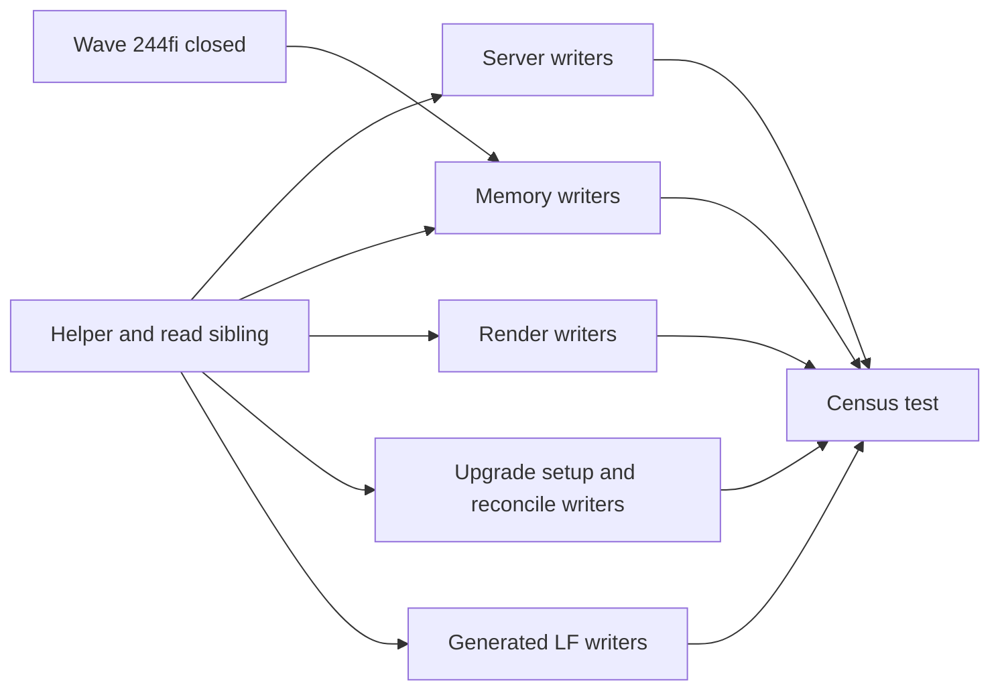

# Preserve Line Endings on In-Place Writes and CRLF-Equal Gate Digests

Change ID: `244fj-bug preserve-line-endings-on-in-place-writes`
Change Status: `implemented`
Owner: Engineering
Status: implemented
Last verified: 2026-11-23
Wave: 244in preserve-line-endings

## Rationale

The operator decided on 2026-11-22: "we should be consistent." Every framework writer that edits an existing file in place must keep that file's own line endings on every platform, and every writer of a generated file must write LF on every platform. Today neither holds. In-place writers use one of two faulty patterns:

- **Pattern A.** The writer reads through `read_text` (or an equivalent universal-newline read), which turns CRLF into `\n`, then writes the text with no translation. A CRLF file becomes LF on every platform.
- **Pattern B.** The writer reads through `read_text`, then calls a plain `Path.write_text` or writes with `os.linesep`. On POSIX a CRLF file becomes LF. On native Windows an LF file becomes CRLF.

Some writers that already preserve endings insert new lines in LF, or apply "any CRLF means CRLF" to the whole file, so they disagree with each other on mixed files. Generated-file writers that call `Path.write_text` without `newline` write CRLF on native Windows.

One writer corrupts files. `wf_add_change_response` repairs the admitted spec's `Wave:` back-reference by reading raw bytes, keeping `\r`, applying `(?m)^Wave: (?:TBD|...)$`, and writing with a plain `write_text`. Executed on 2026-11-22 against the current regex:

- A pure CRLF spec never matches, because `\r` sits between `TBD` and `$`. The repair is silently skipped and the spec keeps `Wave: TBD`.
- A mixed spec whose `Wave:` line is LF does match. The plain `write_text` then turns each `\r\n` into `\r\r\n` on native Windows. On POSIX the bytes are kept.

Separately, the operator approved a scope addition on 2026-11-22: a digest or comparison that gates a lifecycle decision must treat CRLF and LF content as equal, so a Windows checkout of identical content cannot rotate a receipt, lapse an approval or mark a file changed. The census below finds no gate that needs a fix: each one either normalizes, is not derived from file content, or is byte-exact on purpose and rechecked in the same working tree.

This change supersedes the 20b39 decision that Prepare publishes its wave-record projection as all-LF; the operator's 2026-11-22 decision governs.

## Product Intent

Operators on native Windows, and teams whose checkouts mix Windows and POSIX hosts, benefit first. Before: a lifecycle tool, memory tool, renderer or upgrade step flips a file's line endings, producing a whole-file diff on a file whose content barely changed, and on Windows can corrupt a spec with `\r\r\n`. After: an in-place edit changes only the edited lines, each existing line keeps its own ending, and inserted lines take the file's majority ending, on Windows, macOS, Linux and WSL2. Files the framework fully generates are byte-stable LF on every platform (memory record `1svek`). The gate digests keep their current, verified behavior.

The first outcome worth delivering alone is the wave-record and spec writers (AC-1, AC-3), because they run on every lifecycle step and include the corruption. AC-11 and AC-12 pin the gate digest behavior the census verified. The writer outcomes ship together because they share the helper and the census test.

## Requirements

1. **One shared helper.** A new framework module `line_endings.py` (standard library only) owns the line-ending rule. It provides:
   1. `to_lf(text)`: replaces each CRLF pair with `\n`. A lone `\r` is content and is kept.
   2. `majority(text)`: the file's majority ending. It counts lines terminated by CRLF and lines terminated by a bare LF; CRLF wins when its count is greater than or equal to the LF count and at least one line is terminated. A file with no terminated line gives LF.
   3. `merge(original, new_lf)`: returns the new text with endings applied. `original` is the decoded file as read (endings intact); `new_lf` is the writer's result computed on `to_lf(original)`. It aligns the LF lines of both with `difflib.SequenceMatcher(autojunk=False)`. A line in an equal block keeps its original ending byte for byte. An inserted or replaced line takes `majority(original)`. An equal line that had no ending in the original but is now followed by another line takes the majority ending. The last line keeps having no ending when `new_lf` has none.
   4. `encode(text)`: UTF-8 bytes, with no newline translation.
2. **The line-ending rule.** Existing lines keep their own ending, byte for byte. Newly inserted or replaced lines take the file's majority ending, with ties going to CRLF. A file with no line ending yet gets LF. This replaces the earlier "any CRLF means CRLF" rule (Decision Log).
3. **Write only on a content change.** A routed writer decides whether to write by comparing `new_lf` with `to_lf(original)`, never by comparing raw bytes, so a mixed file whose LF content does not change is not rewritten. One writer transaction uses one read: a writer that compares the live file before publishing (for example `_publish_prepare_policy_state` checking `live != wave_text`) compares texts from the same read form.
4. **In-place writers.** The governing rule is: a framework function that reads an existing repository file and writes a modified version of that same file, including an operator-owned file that it reserializes (JSON, TOML and workflow configs, `.gitignore`, `.gitattributes`, `.aiignore`, `docs/scan-findings.json`). Every such writer must compute its result on `to_lf` text and publish `encode(merge(original, new_lf))` through its existing write primitive. The census (Requirement 10) is the authoritative inventory of these writers; this spec does not enumerate them by hand. The writers below are the known cases on 2026-11-22. Each carries an explicit test in AC-1, and each must appear as `in_place` in the census table. A function that only transforms text and returns it is not a writer: the function that calls it and writes the result is the `in_place` key and calls `merge`.
   1. `wf_server/server_impl.py`: the `wf_review_event_response` review-status projection; the `wf_prepare_wave_response` projection; `_retain_review_escalation`; `_write_handoff_text`; the `wf_implement_wave_response`, `wf_close_wave_response`, `wf_pause_wave_response`, `wf_remove_change_response` and `wf_reopen_wave_response` status writes; `wf_add_change_response` (the wave record and the admitted-spec back-reference repair, counted as 2); `_prepare_fix_heading_spacing`; `_close_change_rewrite_block` (both callers in `wf_close_change`).
   2. `wf_server/context_efficiency_handlers.py`: the checkpoint projection into the wave record.
   3. `memory_records.py`: `record_memory_validation`, `reconcile_memory_record` (which also backs `memory_add(supersedes=...)` and consolidation), `archive_memory_record`, and `migrate_memory_ids_to_lifecycle_naming` (both of its rewrites, including `_repair_text_file`).
   4. `render_agent_surfaces.py`: `patch_thin_pointer`, the Cursor `.cursor/rules/project-context.mdc` block update, `reconcile_context_efficiency_surface`, `patch_root_bridge`, `_repair_change_prompt_manifest`, `_write_prompt_manifest`, `_tier3_write`, and the writing callers of the text transforms `_upsert_review_protocol_region`, `_upsert_review_policy_region` and `_merge_claude_agent` (the call sites at lines 2018, 2028, 4855, 5510 and 5683 today).
   5. `render_platform_surfaces.py`: `_merge_mcp_server` (all four host configs), `render_claude_settings`, `render_claude_permissions`, `render_gitignore_block`, `render_gitattributes_block`, `render_aiignore` and `render_codex_mcp_config` (`.codex/config.toml`, whose upserted region is LF inside a CRLF file today).
   6. `upgrade_extensions.py`: `_reconcile_docs_scalar_claims`, `_backfill_role_field_on_agent_docs`, `_strip_pycache_row_from_settings_file`, `_rewrite_legacy_config_keys` and `_repair_declaring_scaffold_on_path`.
   7. `upgrade_wavefoundry.py`: `materialize_lifecycle_policy` (`docs/workflow-config.json`) and `_stamp_manifest_revision` (`docs/prompts/prompt-surface-manifest.json`).
   8. `setup_wavefoundry.py`: `_provision_workflow_defaults_if_absent` (`docs/workflow-config.json`).
   9. `review_policy_reconcile.py`: `plan_reconciliation` and `reconcile_upgrade_policy_surface`. An inserted block takes the file's majority ending.
   10. `review_policy_upgrade.py`: `plan_review_policy_upgrade` and `refresh_review_status_blocks` (every live wave record).
   11. `docs_gardener.py`: `ensure_manifest`.
   12. `gen_codebase_map.py`: `_refresh_repo_index_modules` (the marker block in `docs/repo-index.md`).
   13. `build_pack.py`: `_stamp_readme_version_badge` (framework source repository only) and `update_manifest_revision` (`docs/prompts/prompt-surface-manifest.json`).
   14. `wave_lint_lib/secrets_validators.py`: `save_exceptions` (`docs/scan-findings.json`, which holds operator confirmations).
   15. `design_token_build.py`: `update_manifest_parity`, which reserializes an existing design-system `manifest.json`.
   Writers that only substitute text inside existing lines keep their raw substitution and are classified `in_place_raw` in the census: `wf_mark_task`, `wf_mark_ac`, `docs_gardener.refresh_last_verified`, and the link-repair migrations `render_agent_surfaces.migrate_council_role_renames` and `render_agent_surfaces.migrate_lifecycle_document_renames`, which splice link destinations inside existing lines. The census may classify further raw-substitution writers `in_place_raw` with a stated reason.
5. **`upgrade_extensions.py` stays self-contained.** The upgrade runner execs the incoming `upgrade_extensions.py` from the pack against the old install's sibling modules, which have no `line_endings.py`, so a top-level `import line_endings` would skip the whole extension. `upgrade_extensions.py` must not import `line_endings` at module level. Each routed writer in Requirement 4 item 6 receives the module from `_incoming_framework_module("line_endings", ctx.zip_path)`, called by its caller, which already holds `ctx` (lines 922, 3792, 4293 and 4661 today). This is the loader the module already uses for stdlib-only siblings at seven call sites, and it works before extraction (from the zip) and after (beside the module). If the loader raises `_IncomingModuleUnavailable`, that one writer is skipped with a warning naming the file, and the rest of the extension runs.
6. **Wave-record reads.** `lifecycle_gate_support._read_wave_record_text` stays the sole read boundary for wave records. A sibling reads the raw bytes once and returns `(original, error)` with endings intact; the routed wave-record writers use it, and the residue census that keys on that boundary must accept it.
7. **Back-reference repair.** `wf_add_change_response` applies its back-reference regex to `to_lf` text and publishes through `merge`. A pure CRLF spec gets its `Wave:` line repaired and stays CRLF. No write produces a `\r\r\n` sequence.
8. **New files keep LF.** When a routed writer creates a file that does not exist (for example the session handoff, `.gitignore`, `.mcp.json` or `docs/workflow-config.json`), it writes LF on every platform.
9. **Generated files are LF on every platform.** A writer of a file the framework fully generates (skill documents, rendered prompt surfaces, hook configs, ledgers, receipts, stamps, reports, state files) must write LF bytes on every platform: it writes bytes, or opens text mode with `newline="\n"` or `newline=""` on LF-only content. `events.jsonl` stays LF-only and byte-exact. Local process logs opened for a child's output are exempt with that reason. A planning probe on 2026-11-22 matched 88 text-mode write calls with `newline` unset by name, including the render modules' own verbatim `write_text` function, which is a bytes writer; the census separates the two and its table is the authority for the exact list.
10. **Census test.** An AST census over every non-test `.py` file under `.wavefoundry/framework/scripts/` (including `benchmarks/`) enforces Requirements 4, 8 and 9:
    1. **Primitives.** `Path.write_text`, `Path.write_bytes`, `contained_files.write_contained_bytes`, `os.write`, and `open`, `Path.open`, `io.open`, `os.fdopen` and `tempfile.NamedTemporaryFile` in a write, append or create mode.
    2. **Writer functions.** A function (qualified by module, class and enclosing function) is a writer when its body calls a primitive directly, or calls a function classified `wrapper`. Writer status propagates only through wrappers: a caller of an `in_place`, `in_place_raw`, `generated` or `exempt` writer is not itself a writer, because the callee owns the write. Calls resolve by bare name within the module; by `module.name` attribute for imported framework modules; and by names bound with `from M import f` or `from M import f as g`, at module level or inside a function, absolute or package-relative, which resolve to `M.f`. Dynamic loads (`_load_script(...)`, `_incoming_framework_module(...)` results, `getattr`) are not resolved; the callee is still classified in its own module, and a wrapper received as a parameter is matched by its attribute name (for example `.merge` on the `line_endings` module that `upgrade_extensions.py` passes in).
    3. **Classification.** Each writer function has exactly one entry in a checked-in table: `in_place` (calls `line_endings.merge`), `in_place_raw` (raw substitution within lines, named in Requirement 4 or with a stated reason), `generated` (LF bytes), `wrapper` (writes caller-supplied content to a caller-named path), or `exempt` with a stated reason (binary payloads, process logs, pid files). Each entry records the number of primitive and writer calls in the function.
    4. **Wrapper call sites.** Every call to a `wrapper` function is its own key (caller, wrapper, ordinal) with its own `in_place`, `generated` or `exempt` classification. The wrappers on 2026-11-22 include `_replace_artifacts_transactionally`, `_write_review_carrier_text`, `_write_text_exclusive`, `_write_text_exclusive_identity`, `_write_bytes_atomic_exclusive`, `_write_bytes_atomic_exclusive_identity`, `review_policy_upgrade._atomic_replace`, `review_policy_reconcile._atomic_replace`, `review_policy_reconcile.apply_reconciliation`, `upgrade_wavefoundry._atomic_write_json`, `upgrade_wavefoundry._atomic_write_text`, `upgrade_lib._durable_json_replace`, `write_install_log`, `_write_upgrade_review_log`, `wave_lint_lib.helpers.write_if_changed`, `context_efficiency._write_exclusive`, `memory_records._atomic_replace_text`, `memory_records.write_memory_record` and `_atomic_replace_bytes`.
    5. **Failures.** The census fails on: an unclassified writer function; an unclassified wrapper call site; a table entry whose function no longer writes; a call count that differs from the table; an `in_place` function that does not call `line_endings.merge`; and any text-mode primitive call, anywhere in scope, whose `newline` is omitted or `None`, unless its function is `exempt` as a process log.
    6. `_write_repo_text_platform_newlines` has no remaining callers and is deleted.
    7. **Authority and table location.** The census is the authoritative inventory. At implementation time the implementer runs it over the whole tree and classifies every site it reports; the known cases in Requirement 4 are a subset that carries explicit tests. The classification table lives in the fixture `tests/fixtures/line-ending-census.json`, read by the census test. Delivery reviewers verify the classification table entry by entry, not a hand-made list in this spec.
11. **Gate digest census.** A digest or comparison that gates a lifecycle decision keeps its current behavior; the census on 2026-11-22 (Scope) verifies each of the 12 gates as correct. The small-change content digest in `small_change_lane.py` stays byte-exact on purpose. A change to a product file that only touches line endings must still lapse a narrow approval, because line endings can be functional (a CRLF `.sh` breaks; `.cmd` needs CRLF), and the lane rechecks in the same working tree, so a Windows checkout causes no spurious lapse. The gates that already normalize stay normalizing.
12. **Platforms.** The behavior is identical on native Windows, macOS, Linux and WSL2, because routed and generated writers write bytes or text with an explicit `newline` and never depend on `os.linesep`. On WSL2 a file under `/mnt/c` that a Windows-side Git checked out with CRLF keeps its CRLF lines. The `.gitattributes` managed defaults (`docs/**/*.md text eol=lf`) still make documentation LF on checkout where a project keeps them; this change matters where a project overrides them, where an editor or tool writes CRLF, and for operator files outside `docs/`. The old installed `upgrade_wavefoundry.py` runner keeps its own writers for the upgrade that installs this change; `_stamp_manifest_revision` and `materialize_lifecycle_policy` preserve endings from the next upgrade on, while the `upgrade_extensions.py` writers, which come from the new pack, preserve them during the installing upgrade.

## Scope

**Problem statement:** In-place writers flip line endings or disagree on mixed files, one of them corrupts a spec with `\r\r\n` on Windows, and generated-file writers that omit `newline` write CRLF on Windows. The gate digests need verification, not a fix.

**In scope:**

- The helper module, every in-place writer the census reports (with the known cases in Requirement 4), the self-contained loading in `upgrade_extensions.py`, the wave-record read sibling, explicit LF for every generated-file writer, the census test and the gate digest pins.
- A shared test-support context manager that simulates native Windows text writes, by forcing text-mode `newline=None` writes to `"\r\n"` (the existing `_windows_default_text_writes` in `tests/test_docs_gardener.py`) and patching `os.linesep` to `"\r\n"`. The gardener tests move to the shared version. The simulation patches `Path.open` only; builtin `open`, `os.fdopen` and `NamedTemporaryFile` are covered by the census rule on `newline`, not by the simulation.
- The `[Unreleased]` CHANGELOG entry and the documentation updates in Affected Architecture Docs.

**Gate digest census (2026-11-22, by reading code; the review-policy rows also by execution):**

| Gate | LF versus CRLF today | Disposition |
| --- | --- | --- |
| Review-policy receipt (`review_policy.policy_input_snapshot`) | Equal: spec bodies go through `canonical_review_policy_body`; the other inputs are parsed JSON values | Keep; regression pin in AC-12 |
| `gardener_metadata.canonical_review_policy_body` | Equal (executed: LF and CRLF bodies give identical bytes) | Keep; existing test in `test_review_policy.py` |
| Spec digest rechecks (`review_evidence.py` receipt verification, `wave_work._verify_snapshot_documents`) | Equal: both compare through `canonical_review_policy_body`; the raw hash in `wave_work` compares bytes read in the same process | Keep. No separate section digest exists |
| Framework test receipt `inputs_hash` (`run_tests._hash_inputs`) | Differs | Keep byte-exact: `test-cache.json` is gitignored and written and verified on the same checkout, and a line-ending change can change test results (byte-exact fixtures, `wf.cmd`) |
| Handler digest fixture and tool-surface golden pins | Differs | Keep byte-exact: generated LF files, and `*.py text eol=lf` pins the sources |
| Small-change content digest (`small_change_lane.py`, bound in `events.jsonl`) | Differs: raw `sha256` and length of each product file | Keep byte-exact on purpose (Requirement 11): line endings can be functional, and the lane rechecks in the same working tree; pinned by AC-11 |
| Setup and install receipts (`setup_readiness` stamp identities, `setup_reconciliation.framework_fingerprint`) | Differs | Keep byte-exact: local, uncommitted, same-checkout identities of installed behavior bytes. The install log reader already normalizes |
| Docs-lint changed set | Git decides membership; `advisory_lint_identity` differs | Keep: the identity is a local cache key that includes the absolute root |
| Gardener changed-from-HEAD check (`docs_gardener._without_date_line`) | Equal | Keep; regression pin in AC-12 |
| Render changed-only compare and the `--manifest` written list | Differs for a generated file on a CRLF checkout (rewritten LF and reported written) | Keep: generated files follow the LF policy, Git's text normalization absorbs the rewrite, and the list is a report, not a lifecycle gate |
| `review_event_request_digest` and replay identity | Not file-derived: hashes the request fields the caller sends | Keep |
| Secrets allowlist and scan-record digests (`build_scan_allowlist._sha256_file`, `secrets_validators`) | Equal | Keep; regression pin in AC-12 |

Result: 12 gates, each correct as is: 5 normalize, 1 is not derived from file content, and 6 stay byte-exact by design (same-checkout, local or generated identities, plus the small-change digest).

**Out of scope:**

- Writers that only substitute within existing lines (`in_place_raw`), beyond their census classification.
- The LF-only `events.jsonl` contract.
- Making the render changed-only compare line-ending blind. Re-rendering a generated file on a CRLF checkout is out of scope: generated files follow the LF policy and Git's text normalization absorbs the rewrite.
- Normalizing any gate digest, including the small-change content digest, the framework test receipt, setup receipts and the handler and golden pins.
- The old installed upgrade runner's writers during the upgrade that installs this change (Requirement 12).

## Acceptance Criteria

- [x] AC-1: A parameterized matrix runs every `in_place` writer in Requirement 4 on LF, CRLF and mixed inputs, each both natively and under the shared Windows-write simulation, and asserts the exact expected bytes and the absence of `\r\r\n`. Today it fails:
   1. For the Pattern A writers, on the CRLF and mixed inputs, because they emit LF.
   2. For the Pattern B writers, on the LF input under the simulation, because they emit CRLF.
   3. For the existing whole-file preservers and the line-inserting writers, on the mixed inputs, because they apply "any CRLF means CRLF" or insert LF lines.
   The matrix includes `PrepareCRLFPublicationTests.test_prepare_publication_keeps_existing_all_lf_policy` (`tests/test_server_tools_lifecycle.py`), inverted: a CRLF wave record stays CRLF after Prepare.
- [x] AC-2: A mixed-file test pins the rule: a 200-line LF file with one CRLF line, edited in one line, changes only that line's bytes and keeps the stray CRLF line; a file with more CRLF than LF lines gives an inserted line CRLF; a tie gives CRLF; a file with no terminated line gives LF. Today `patch_root_bridge` and `_write_prompt_manifest` rewrite all 201 lines on the first case.
- [x] AC-3: `wf_add_change` admits a pure CRLF spec whose `Wave:` line is `TBD`: the line becomes the wave id and the file stays CRLF. A mixed spec admitted under the simulation contains no `\r\r\n`. Both fail today: the first is never repaired, the second gains `\r\r\n`.
- [x] AC-4: Under the simulation, `_write_handoff_text` keeps an LF handoff LF, keeps a CRLF handoff CRLF, and creates a missing handoff as LF; `_provision_workflow_defaults_if_absent` creates a missing `docs/workflow-config.json` as LF. The handoff LF and new-file cases fail today because the writer uses `os.linesep`.
- [x] AC-5: A routed writer whose LF content does not change leaves a mixed file's bytes and modification time unchanged. `_merge_mcp_server` fails today because it writes unconditionally.
- [x] AC-6: Under the simulation, every `generated` writer the census lists writes LF bytes. This fails today: for example, `build_pack.write_manifest` and `run_tests._write_cache` call `write_text` with `newline` unset and write CRLF under the simulation.
- [x] AC-7: The incoming `upgrade_extensions.py`, exec'd from a pack zip against a scripts directory with no `line_endings.py`, loads and runs `_rewrite_legacy_config_keys` on a CRLF `docs/workflow-config.json`, which stays CRLF. A known-bad copy with a top-level `import line_endings` fails to load (`No module named 'line_endings'`).
- [x] AC-8: Helper tests cover `to_lf` on a lone `\r`; `majority` on LF, CRLF, tie, mixed and empty input; and `merge` on unchanged, replaced, inserted and deleted lines, a missing final ending, and a `\r\r\n` input, which round-trips without new corruption.
- [x] AC-9: The census test passes on the delivered tree and fails on each known-bad copy:
   1. A new function with an unclassified `Path.write_text` call.
   2. A new caller of `upgrade_wavefoundry._atomic_write_json`.
   3. An `in_place` function whose `line_endings.merge` call is removed.
   4. A second write call added to a classified function.
   5. A `generated` writer's `write_text(..., encoding="utf-8")` with `newline` omitted.
   6. A table entry whose function no longer writes.
   7. A new function that calls `_durable_json_replace` through `from upgrade_lib import _durable_json_replace`, at module level and inside the function.
   8. A new caller of `_write_review_carrier_text` that writes a transform's result without calling `merge`.
- [x] AC-10: Every known writer in Requirement 4, including the writing callers of the three text transforms, is classified `in_place` in the census table; the five raw-substitution writers named in Requirement 4 are `in_place_raw`; the three transforms have no entry; and `_write_repo_text_platform_newlines` has no definition or caller.
- [x] AC-11: A test pins the small-change content digest as byte-exact on purpose: LF and CRLF copies of the same product file give different digests, so a line-ending-only edit lapses a narrow approval.
- [x] AC-12: A regression test asserts LF and CRLF equality for the gates that already normalize: the review-policy receipt id, `canonical_review_policy_body`, the gardener changed-from-HEAD comparison and the secrets allowlist file digest. This pins existing behavior at the operator's request; it passes today by design.
- [x] AC-13: The change's own suites and every test it adds pass; the documents this change authors or edits validate; and no failure elsewhere is attributable to this change.
- [x] AC-14: The census test passes on the delivered tree with zero unclassified writer functions and zero unclassified wrapper call sites, and its table lives in `tests/fixtures/line-ending-census.json`. This fails today, since neither the census nor its table exists.

## Tasks

- [x] Add `line_endings.py` with `to_lf`, `majority`, `merge` and `encode`, and register it in the reload purge list in `wf_server/server_impl.py` and in `FRAMEWORK_SCRIPT_MODULE_NAMES` in `mcp_tool_extensions.py`; run `wf_sync_surfaces` so `.claude/hooks/pre-edit.py` carries the new digest.
- [x] Add the wave-record read sibling in `lifecycle_gate_support.py` and update the residue census that keys on `_read_wave_record_text`.
- [x] Route the `wf_server/server_impl.py` and `wf_server/context_efficiency_handlers.py` writers.
- [x] Route the `memory_records.py` writers (after wave 244fi closes).
- [x] Route the render writers in `render_agent_surfaces.py` and `render_platform_surfaces.py`; delete `_write_repo_text_platform_newlines`.
- [x] Route the `upgrade_extensions.py` writers through `_incoming_framework_module("line_endings", ctx.zip_path)` passed by their callers, with no top-level import.
- [x] Route the writers in `upgrade_wavefoundry.py`, `setup_wavefoundry.py`, `review_policy_reconcile.py`, `review_policy_upgrade.py`, `docs_gardener.py`, `gen_codebase_map.py`, `build_pack.py` and `wave_lint_lib/secrets_validators.py`.
- [x] Make every `generated` writer write LF bytes or open text mode with an explicit `newline`.
- [x] Move the Windows-write simulation into shared test support with the `os.linesep` patch, and switch `test_docs_gardener.py` to it.
- [x] Run the census over the whole tree, classify every site it reports in `tests/fixtures/line-ending-census.json`, and route every `in_place` site through `merge`.
- [x] Add the helper tests, the writer matrix, the mixed-file test, the generated-writer test, the zip-load test, the census test and its known-bad copies, the small-change byte-exact pin and the normalizing-gate regression test.
- [x] Invert `PrepareCRLFPublicationTests.test_prepare_publication_keeps_existing_all_lf_policy`.
- [x] Refresh `tests/fixtures/register-surface-handler-digests.json` for the changed handlers.
- [x] Add an `[Unreleased]` CHANGELOG bullet stating that in-place edits keep each line's ending and give new lines the file's majority ending on every platform, that Prepare and the lifecycle tools keep a CRLF wave record CRLF instead of publishing all-LF, that generated files are LF on Windows too, that a pure CRLF spec's `Wave: TBD` line is now repaired at admission, and that the Windows `\r\r\n` corruption is fixed. It also says the first upgrade from an older release keeps the old runner's writers.
- [x] Make the documentation updates named in Affected Architecture Docs.

## Agent Execution Graph

The helper lands first. The writer groups can then run in parallel, except that the memory group waits for wave 244fi to close. The census test runs last, after every writer group and the generated-writer pass finish. The digest pins have no prerequisite.

| Workstream | Owner | Depends On | Notes |
| --- | --- | --- | --- |
| helper | implementer | — | Module, registrations, read sibling, shared test support |
| server-writers | implementer | helper | `server_impl.py`, `context_efficiency_handlers.py` |
| memory-writers | implementer | helper, wave 244fi closed | `memory_records.py` |
| render-writers | implementer | helper | `render_agent_surfaces.py`, `render_platform_surfaces.py` |
| upgrade-writers | implementer | helper | `upgrade_extensions.py`, `upgrade_wavefoundry.py`, `setup_wavefoundry.py`, `review_policy_reconcile.py`, `review_policy_upgrade.py`, `docs_gardener.py`, `gen_codebase_map.py`, `build_pack.py`, `secrets_validators.py` |
| generated-writers | implementer | helper | Explicit LF across the generated-file writers |
| digest-pins | qa | — | AC-11 and AC-12 tests |
| census | qa | all above | AST census and known-bad copies |

## Serialization Points

This change must be implemented after wave 244fi (memory review audit) closes. 244fi edits `memory_records.py`, `wf_server/server_impl.py`, `tests/test_memory_records.py`, `tests/test_render_agent_surfaces.py` and the handler digest fixture, all of which this change also edits.

- `.wavefoundry/framework/scripts/line_endings.py`
- `.wavefoundry/framework/scripts/lifecycle_gate_support.py`
- `.wavefoundry/framework/scripts/wf_server/server_impl.py`
- `.wavefoundry/framework/scripts/wf_server/context_efficiency_handlers.py`
- `.wavefoundry/framework/scripts/wf_server/edit_gate_handlers.py`
- `.wavefoundry/framework/scripts/wf_server/index_handlers.py`
- `.wavefoundry/framework/scripts/memory_records.py`
- `.wavefoundry/framework/scripts/render_agent_surfaces.py`
- `.wavefoundry/framework/scripts/render_platform_surfaces.py`
- `.wavefoundry/framework/scripts/upgrade_extensions.py`
- `.wavefoundry/framework/scripts/upgrade_wavefoundry.py`
- `.wavefoundry/framework/scripts/upgrade_bridge_bootstrap.py`
- `.wavefoundry/framework/scripts/setup_wavefoundry.py`
- `.wavefoundry/framework/scripts/setup_index.py`
- `.wavefoundry/framework/scripts/setup_readiness.py`
- `.wavefoundry/framework/scripts/review_policy_reconcile.py`
- `.wavefoundry/framework/scripts/review_policy_upgrade.py`
- `.wavefoundry/framework/scripts/docs_gardener.py`
- `.wavefoundry/framework/scripts/gen_codebase_map.py`
- `.wavefoundry/framework/scripts/build_pack.py`
- `.wavefoundry/framework/scripts/build_scan_allowlist.py`
- `.wavefoundry/framework/scripts/design_token_build.py`
- `.wavefoundry/framework/scripts/graph_quality_eval.py`
- `.wavefoundry/framework/scripts/indexer.py`
- `.wavefoundry/framework/scripts/lexical_ranking_eval.py`
- `.wavefoundry/framework/scripts/model_bundle.py`
- `.wavefoundry/framework/scripts/prune_framework.py`
- `.wavefoundry/framework/scripts/retrieval_eval.py`
- `.wavefoundry/framework/scripts/run_secrets_scan.py`
- `.wavefoundry/framework/scripts/run_tests.py`
- `.wavefoundry/framework/scripts/scan_secrets.py`
- `.wavefoundry/framework/scripts/scanner_skips.py`
- `.wavefoundry/framework/scripts/wave_gate.py`
- `.wavefoundry/framework/scripts/mcp_tool_extensions.py`
- `.wavefoundry/framework/scripts/wave_lint_lib/helpers.py`
- `.wavefoundry/framework/scripts/wave_lint_lib/secrets_validators.py`
- `.wavefoundry/framework/scripts/benchmarks/compare_retrieval_receipts.py`
- `.wavefoundry/framework/scripts/benchmarks/embed_bench.py`
- `.wavefoundry/framework/scripts/tests/line_ending_support.py`
- `.wavefoundry/framework/scripts/tests/test_line_endings.py`
- `.wavefoundry/framework/scripts/tests/test_line_ending_census.py`
- `.wavefoundry/framework/scripts/tests/test_server_tools_lifecycle.py`
- `.wavefoundry/framework/scripts/tests/test_server_context_efficiency.py`
- `.wavefoundry/framework/scripts/tests/test_memory_records.py`
- `.wavefoundry/framework/scripts/tests/test_render_agent_surfaces.py`
- `.wavefoundry/framework/scripts/tests/test_render_platform_surfaces.py`
- `.wavefoundry/framework/scripts/tests/test_upgrade_wavefoundry.py`
- `.wavefoundry/framework/scripts/tests/test_setup_wavefoundry.py`
- `.wavefoundry/framework/scripts/tests/test_review_policy.py`
- `.wavefoundry/framework/scripts/tests/test_docs_gardener.py`
- `.wavefoundry/framework/scripts/tests/test_gen_codebase_map.py`
- `.wavefoundry/framework/scripts/tests/test_build_pack.py`
- `.wavefoundry/framework/scripts/tests/test_small_change_scope.py`
- `.wavefoundry/framework/scripts/tests/test_secrets_validators.py`
- `.wavefoundry/framework/scripts/tests/test_scan_secrets.py`
- `.wavefoundry/framework/scripts/tests/test_profile_literal_census.py`
- `.wavefoundry/framework/scripts/tests/test_events_only_residue_census.py`
- `.wavefoundry/framework/scripts/tests/fixtures/register-surface-handler-digests.json`
- `.wavefoundry/framework/scripts/tests/fixtures/line-ending-census.json`
- `.wavefoundry/framework/scripts/tests/line_ending_census_engine.py`
- `.wavefoundry/framework/scripts/tests/test_line_ending_writers.py`
- `.wavefoundry/framework/scripts/tests/test_wave_work_lifecycle.py`
- `.wavefoundry/framework/scripts/tests/test_design_token_build.py`
- `CHANGELOG.md`
- `.claude/hooks/pre-edit.py`
- `docs/architecture/testing-architecture.md`
- `docs/references/native-windows-support.md`
- `docs/contributing/build-and-verification.md`

## Affected Architecture Docs

- `docs/architecture/testing-architecture.md`: mark the 20b39 row's "Prepare all-LF publication" as superseded by this change, and add a row for the line-ending census, the writer matrix and the Windows-write simulation next to the 20b39 and 20dkl rows.
- `docs/contributing/build-and-verification.md`: generalize the newline-policy paragraph (lines 522 to 526, which cover the gardener only) to every in-place writer: existing lines keep their ending, inserted lines take the majority ending, new files and generated files are LF, and JSONL ledgers stay LF-only.
- `docs/references/native-windows-support.md`: state the same rule for native Windows.

## AC Priority

| AC | Priority | Rationale |
| --- | --- | --- |
| AC-1 | required | The writer matrix proves the rule for every in-place writer on both platforms |
| AC-2 | required | Pins the coordinator's mixed-file rule |
| AC-3 | required | The only corruption, and a silent skipped repair |
| AC-4 | required | New files stay LF on Windows |
| AC-5 | important | Prevents rewrites of unchanged mixed files |
| AC-6 | required | Generated files are LF on Windows |
| AC-7 | required | Keeps every upgrade from older releases working |
| AC-8 | required | The helper defines the rule every writer uses |
| AC-9 | required | Keeps new writers and wrapper callers from bypassing the rule |
| AC-10 | required | Proves the census covers the routed list |
| AC-11 | required | Pins the operator's byte-exact decision for the narrow approval |
| AC-12 | important | Pins gates that already normalize, at the operator's request |
| AC-13 | required | Change-local verification |
| AC-14 | required | The census is the authoritative inventory of writers |

## Progress Log

| Date | Update | Evidence |
| --- | --- | --- |
| 2026-11-22 | Planned. Writer census re-derived from the tree: 19 census writers confirmed, 11 more found. Back-reference repair executed: pure CRLF never matches, mixed LF line matches and gains `\r\r\n` under Windows text writes. Gate digest census added at the operator's scope addition. | `grep` over non-test framework scripts for write primitives; executed regex probe; executed `canonical_review_policy_body` LF and CRLF probe |
| 2026-11-22 | Readiness repair, cycle 1, for findings `244in-f-upgrade-ext-import`, `244in-qa-census-wrapper-blindspot`, `RT-1`, `244in-qa-crlf-simulation-quadrant`, `DC-1`, `244in-arch-census-wrapper-and-generated-gap` and `244in-cr-writer-census-incomplete`. Writers grow from 30 to 50: 8 found by reviewers, 9 existing whole-file preservers routed so every writer applies one rule, and 3 line-inserting writers. The census now classifies writer functions transitively and keys wrapper call sites; generated writers must write LF; `upgrade_extensions.py` loads the helper through `_incoming_framework_module`. Recording note: red-team finding RT-1 was stored with `execution_status: executed`, but its evidence came from reading code, so its honest status is `inferred`. | Reviewer notes in `.wavefoundry/work/244in/review/`; `repair_start` records in `events.jsonl` (context `244in-implementer-repair-1`); AST probe of text-mode writes with `newline` unset (88 matches by name) |
| 2026-11-22 | Second readiness repair, authorized by the operator on 2026-11-22, for `244in-qa-census-wrapper-blindspot`, `244in-arch-census-transitive-class-gap` and `244in-cr-writer-census-incomplete`. The census resolves `from` imports and propagates writer status only through wrappers; the three text transforms are replaced by their writing callers; four writers are added (`render_codex_mcp_config`, `refresh_review_status_blocks`, `update_manifest_parity`, and the two link-repair migrations as `in_place_raw`); the census becomes the authoritative inventory, with AC-14. The ledger allowed a new `repair_start` only for the cycle-0 transitive-gap finding; the other two keep their cycle-1 `repair_start` and are reverified in cycle 1. | Round-2 notes in `.wavefoundry/work/244in/review/*-focused-r2.md`; `repair_start` in `events.jsonl` (context `244in-implementer-repair-2`) |
| 2026-11-22 | Implemented. `line_endings.py` (stdlib only: `to_lf`, `majority`, `merge`, `encode`, `read`) is registered in the reload purge list and `FRAMEWORK_SCRIPT_MODULE_NAMES`; `wf_sync_surfaces` refreshed `.claude/hooks/pre-edit.py`. The wave-record sibling `_read_wave_record_original` is the raw read for every routed wave-record writer, and the 1v0lw read-seam census now also flags `read_bytes` and allows the sibling. Every writer the census reports is classified in `tests/fixtures/line-ending-census.json`: functions 53 `in_place`, 7 `in_place_raw`, 72 `generated`, 24 `wrapper`, 36 `exempt`; wrapper call sites 34 `in_place`, 8 `in_place_raw`, 30 `generated`, 12 `wrapper`. `_write_repo_text_platform_newlines` is deleted. | `run_tests.py` on the 20 touched test files: 3178 tests OK; census, helper and writer files: 37 tests OK; `test_mcp_tool_registry.py` and `test_extension_tool_modules.py`: 260 OK |
| 2026-11-22 | Census sites classified beyond the spec's list: wrappers `server_impl._atomic_replace_text`, `render_agent_surfaces.write_text`, `_write_repo_bytes`, `_write_move_target` and `render_platform_surfaces.write_text`; `in_place_raw` `_mark_change_item_response`, `_move_prompt_pair`, `migrate_change_prompt_renames` and `migrate_review_plan_prompt` (prompt moves keep their bytes; a replaced line keeps its line's ending); `in_place` `_publish_prepare_policy_state`, the `render_agent_surfaces` orchestrator (CLAUDE.md and Cursor blocks), `review_policy_reconcile.reconcile_lifecycle_sections` and `review_policy_upgrade.apply_review_policy_upgrade`; `generated` and `exempt` entries for every report, stamp, state, binary, lock and process-log writer, each `exempt` with its reason. | Census table entry by entry |
| 2026-11-22 | Council advisory on `generated` entries: each `generated` entry pins its in-scope callers, so a new caller fails the census, and a caller that is itself a writer needs a recorded `writer_callers_reason` (11 orchestrator cases, each with its reason). `test_bad_wrapper_relabelled_generated` relabels `_durable_json_replace` as `generated` and the census fails on the unpinned callers and on every caller that stops being a writer. | `tests/test_line_ending_census.py` |
| 2026-11-22 | Census rule refinements found while running it over the tree: a `.open(...)` method whose first argument is not a literal is a read (`ZipFile.open(info)`, `opener.open(url)`); a non-literal mode needs a `dynamic_mode_reason` (`runtime_lock._open_carrier`); an `in_place` entry may name a `merged_by` planner that calls merge, with a reason (the review-policy planners, so their byte "changed after preflight" checks compare the final bytes). Process logs are `exempt` with `process_log`. | `tests/line_ending_census_engine.py` |
| 2026-11-22 | Tests: helper (AC-8, AC-2 rule), writer matrices in each writer's module and a public lifecycle run on LF, CRLF and mixed records natively and under `line_ending_support.windows_text_writes()` (AC-1, AC-3, AC-4), AC-5 on `_merge_mcp_server`, AC-6 generated writers, AC-7 zip load (`IncomingLineEndingsZipLoadTests` in `test_upgrade_wavefoundry.py`), AC-9 known-bad copies, AC-11 in `test_small_change_scope.py`, AC-12 in `test_line_ending_writers.py`. The lifecycle oracle is `shape(to_lf(output)) == output` after every step, which pins every line ending while the lifecycle suites pin content. A scratch copy with the HEAD server, memory and gate modules fails the new server, memory and checkpoint tests. | Scratch run under the session scratchpad |
| 2026-11-22 | Platforms. Every routed or generated writer writes bytes or text with an explicit `newline`, never `os.linesep`, so native Windows, macOS, Linux and WSL2 write the same bytes; a CRLF file under `/mnt/c` on WSL2 keeps its CRLF lines. The Windows behavior is proven by the simulation, not on native Windows. `child_tee.py` keeps `os.linesep` for child console output, which is not a file edit. | Code read; census `NEWLINE_UNSET` rule |
| 2026-11-22 | Handler digests: no `@mcp.tool` handler body inside `register_mcp_surface` changed (the routed writers are module-level `*_response` functions), so `tests/fixtures/register-surface-handler-digests.json` needed no refresh; `test_mcp_tool_registry.py` passes against it unchanged. AC-6 is checked statically for every `generated` entry (`test_generated_text_writes_are_lf`) and executed under the simulation for representative writers. | `run_tests.py --file test_mcp_tool_registry.py`; `test_line_ending_census.py` |
| 2026-11-22 | Full-suite repair, 4 files. `graph_quality_eval.py` edit reverted: its shipped baseline and post reports pin the evaluator source hash, and no identity-only refresh exists (a re-run would rewrite the historical builder-55 post report); `materialize` writes a scratch evaluation corpus, so it is `exempt` with a `newline_unset_reason`, a census allowance added for this case. The close-record test now patches only `_read_wave_record_original`, the read Close makes, with its call asserted. `test_line_ending_writers.py` imports `wf_server.edit_gate_handlers` by its package path. The admission comment no longer spells the back-reference marker. Census now: functions 53 `in_place`, 7 `in_place_raw`, 71 `generated`, 24 `wrapper`, 37 `exempt`. | `run_tests.py --file` on the 4 files plus `test_line_ending_census.py`, `test_wave_work_lifecycle.py`, `test_line_ending_writers.py`: 237 tests OK |
| 2026-11-23 | Delivery repair for `244in-arch-exempt-wrapper-blindspot` (repair_start, cycle 2, context `244in-implementer-delivery-repair-1`). `setup_readiness:_write_stamp_exclusive` and `upgrade_extensions:_write_journal_exclusive` are now `wrapper`; their new writer callers are `write_setup_stamp` (`generated`) and `_migrate_journal_entries` and `_move_journal_at` (`in_place_raw`, journal bytes moved verbatim). `exempt` entries now pin their callers like `generated` entries, and a caller that is itself a writer needs a `writer_callers_reason` (6 recorded). A text write in an `in_place` or `in_place_raw` function may pass only `newline=""` (`IN_PLACE_NEWLINE`). Every exempt reason now states what is written. `native-windows-support.md` names the writers that still translate (process logs, child console output, the graph-quality scratch corpus) and why each is fine. Census: functions 53 `in_place`, 9 `in_place_raw`, 71 `generated`, 26 `wrapper`, 35 `exempt`; sites 34 `in_place`, 10 `in_place_raw`, 31 `generated`, 12 `wrapper`. | Known-bad tests `test_bad_in_place_caller_of_exempt_or_wrapper_shaped_writer` and `test_bad_in_place_writer_with_translating_newline`; `run_tests.py --file` on 9 files: 942 tests OK; no `__pycache__` under `.wavefoundry/framework/` |
| 2026-11-22 | Gapfill: some focused runs used `python3 -B -m unittest` from `tests/` with `PYTHONPATH=..` because parallel implementer forks held the `run_tests.py` lock; every touched file was then rerun through `run_tests.py`. `test_extension_tool_modules.py` needs the runner's interpreter (`mcp`). | `run_tests.py` reruns above |
| 2026-11-23 | Delivery reviewed and closed. The full suite passed after the delivery repair (13,404 tests OK). Code, qa, architecture and release approved delivery, and council-delivery passed with intent_fit establishes. The review notes from `.wavefoundry/work/244in/review/` are archived in `evidence/review-notes.tar.gz` (28 files), because close removes the work folder. | `evidence/review-notes.tar.gz` |
| 2026-11-23 | Reopened after close, by operator approval, because the 1.51.0 release preflight's second-profile qualification run failed 10 of 11 tests in `test_line_ending_writers.py`. The tests hard-coded the `Wave:` back-reference label, and the second profile's vocabulary writes `Set:`. Test-only fix: the fixture and assertions use `vocabulary_profile.BACKREF_LABEL`. No product code changed. The writer, census and helper tests pass under the default and second profiles. Lesson: run the second profile on new record-shaped tests before delivery. | `run_tests.py --profile second --file test_line_ending_writers.py`: 0 of 1 files failed |

## Decision Log

| Date | Decision | Reason | Alternatives |
| --- | --- | --- | --- |
| 2026-11-22 | In-place writers preserve the file's own line endings; generated files stay LF; reserialized operator files count as in-place | Operator: "we should be consistent." | Keep LF everywhere (rejected by the operator) |
| 2026-11-22 | One new module `line_endings.py`, with each writer keeping its own write primitive and passing bytes | Planner default. The writers use many different containment and atomic primitives; a text-rule module that returns text reuses all of them. Efficacy: replaying the back-reference case through `to_lf` and `merge` repairs the pure CRLF spec and cannot produce `\r\r\n`, since no text-mode write with platform translation remains. The census test makes the rule controlling rather than advisory | Per-site fixes (no single rule, nothing stops the next bypass); putting the rule in `contained_files.py` (mixes path containment with text policy); reusing `markdown_layout._split_lines` (markdown-only, and JSON and ignore files are not markdown) |
| 2026-11-22 | Mixed files are rewritten CRLF when any CRLF is present | Superseded by the next row | Majority of terminated lines; per-line preservation |
| 2026-11-22 | Existing lines keep their own ending byte for byte; inserted or replaced lines take the majority ending, ties to CRLF; a file with no ending yet gets LF. This supersedes the "any CRLF" row | Coordinator decision from the red-team probe, reversible default: under "any CRLF", one stray CRLF line in a 200-line LF file rewrites all 201 lines; under this rule, 2 change | "Any CRLF means CRLF" (whole-file churn on mixed files); majority applied to the whole file (still rewrites existing lines) |
| 2026-11-22 | Route the 9 existing whole-file preservers and the 3 line-inserting writers through the helper | Planner default under the operator's consistency decision: otherwise two rules coexist and disagree on mixed files | Leave them on their inline rules (two behaviors) |
| 2026-11-22 | `upgrade_extensions.py` loads `line_endings` through `_incoming_framework_module` at each routed writer's caller, not by a top-level import or an inline copy | Planner default. Every caller already holds `ctx.zip_path`, the loader is the existing precedent for stdlib-only siblings, and one copy of the rule avoids drift. A top-level import would skip the extension in the old-code window (executed by the release-reviewer) | Inline copy of the rule (now about 30 lines with `merge`, and it could drift from the helper); lazy in-function import (fails before extraction) |
| 2026-11-22 | The census classifies writer functions transitively, keys every wrapper call site, records call counts, and fails any text-mode write with `newline` unset | Planner default, repairing the wrapper blind spot four reviewers found: a key per primitive call site hid every caller of a wrapper | Key only direct primitive calls (the reviewed design); add wrappers to a fixed primitive list (misses the next wrapper) |
| 2026-11-22 | Generated-file writers write LF bytes on every platform | Coordinator decision under the operator's consistency decision: Requirement 8 was false on Windows for text-mode writers | Scope Windows CRLF from generated writers out with a reason |
| 2026-11-22 | `docs/scan-findings.json` and `docs/prompts/prompt-surface-manifest.json` are in-place files | Coordinator decision for `save_exceptions`, because the operator edits exceptions; the prompt manifest follows the gardener contract that already preserves its endings | Classify them generated |
| 2026-11-22 | Gate digests: no fix; the census verifies all 12 and pins the small-change digest as byte-exact | Coordinator decision on the operator's scope addition: line endings can be functional (a CRLF `.sh` breaks, `.cmd` needs CRLF) and the lane rechecks in the same working tree. Reversible default | Normalize the small-change digest (lets a line-ending-only product edit keep a narrow approval) |
| 2026-11-22 | Re-rendering a generated file on a CRLF checkout stays out of scope | Coordinator decision, reversible default: generated files follow the LF policy and Git's text normalization absorbs the rewrite | Make the render changed-only compare line-ending blind (would leave CRLF on generated files) |
| 2026-11-22 | The census is the authoritative inventory of in-place writers; the spec keeps only the known cases that carry explicit tests | Operator-approved change of approach, 2026-11-22: two review rounds each found writers a hand-made list missed | Keep enumerating writers by hand in Requirement 4 |
| 2026-11-22 | Writer status propagates only through `wrapper` functions, and `from` imports resolve to their module | Planner default, repairing the architecture-reviewer's transitive-class finding (about 217 caller-only functions fitting no class) and the qa-reviewer's four from-import wrapper calls | Full transitive closure (classifies `main()` and orchestrators as writers); bare-name and attribute resolution only (misses from-imports) |
| 2026-11-22 | `update_manifest_parity` is `in_place` | Planner default under the governing rule: it reserializes an existing file in place, and whether the operator edits it is not established | Classify it `generated` |
| 2026-11-22 | The review-policy writers merge in their planners (`plan_reconciliation`, `plan_review_policy_upgrade`), and the census accepts a `merged_by` planner for their apply steps | Implementer: the plan must hold the final bytes so the apply step's "changed after preflight" byte checks keep working | Merge in the apply functions (the byte checks would compare unmerged plans) |
| 2026-11-22 | `_write_handoff_text` reads the existing handoff raw itself and merges the caller's text, taken as LF | Implementer: its callers and `wf_set_handoff` pass whole-file text; reading inside the writer keeps one writer for every caller, and there is no compare-before-publish | Thread the raw original through every caller |
| 2026-11-22 | Prepare and the other routed wave-record readers read with `to_lf`, which keeps a lone `\r` that `read_text` turned into `\n` | Implementer: Requirement 3, one read form for the compare and the merge | Keep `read_text` for the gates (two read forms) |
| 2026-11-22 | The routed `upgrade_extensions.py` writers take an optional `line_endings` argument; a caller holding `ctx` passes it and skips only its writer with a warning on `_IncomingModuleUnavailable`, and a direct call without it loads the helper itself | Implementer: keeps existing direct callers and tests working without a top-level import | Make the argument required at every call |

## Risks

| Risk | Mitigation |
| --- | --- |
| Overlap with wave 244fi in `memory_records.py`, `server_impl.py` and shared tests | Implement after 244fi closes; rebase onto its `_UPDATED_LINE_RE` change |
| Routing every in-place writer touches high-traffic handlers and shifts handler digests | The writer matrix and one digest fixture refresh |
| `difflib` alignment can pair a moved line differently from the author's intent, giving it the majority ending | Only the ending of a moved line can change, never its content; AC-8 pins the alignment cases |
| The census does not resolve dynamic loads | Each dynamically loaded callee is still classified in its own module |
| The first upgrade from an older release runs the old runner's writers | Stated in Requirement 12 and the CHANGELOG |

## Session Handoff

See `docs/agents/session-handoff.md` for current session state.
